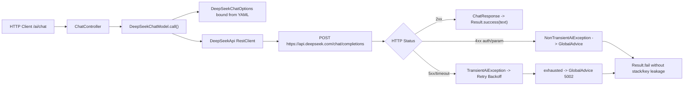
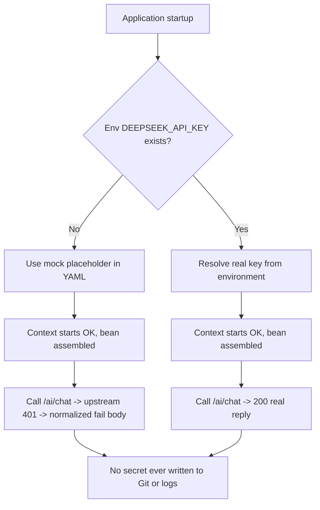

# D01-01 Spring AI 初始化与 DeepSeek 接入 · 项目迭代规划任务书

> 阶段：M2-Java（Java AI 工程师转型）第 1 天 D01 聚合模块
> 模块：`D01_SpringAI_init`（制造业设备故障知识库 + 工单助手 · 基础骨架）
> 模式：**迭代规划与任务书生成模式（仅规划，不修改源码）**
> 出具时间：2026-10-25
> 技术基线：JDK 21 / Spring Boot 3.5.16 / Spring AI 1.1.x / Maven 3.9.16（Redis 6.2.16、Nacos 3.0.3 为后续迭代基线，本次不引入）

---

## 第一部分：迭代目标与边界

### 1.1 业务与学习双目标

| 目标类型 | 具体目标 |
|---|---|
| 工程目标 A | 在已初始化的 Maven 聚合骨架中正确引入 Spring AI 依赖管理（BOM）与 DeepSeek 专用 Starter，完成可启动、可装配、可发起一次真实 Chat 调用的最小应用骨架 |
| 学习目标 B | 建立 Spring AI 1.1.x 的第一层认知：BOM 版本治理、Starter 自动装配机制、`ChatModel` 抽象、配置属性绑定、密钥外置规范，并跑通"本地无密钥可启动、有密钥即联通"的工程闭环 |
| 项目长线 | 本模块是"制造业设备故障知识库 + 工单助手"的地基。D01 只解决**模型通道（Chat Channel）**问题；RAG、向量库、工具调用（Function Calling）、工单工作流均在后续 Dxx 迭代叠加，本次不得提前实现 |

### 1.2 功能范围（本次必须完成）

1. **引入 Spring AI 依赖**：在 D01 聚合 POM 中加入 `spring-ai-bom` 版本管理；在 `D01_SpringAI_init` 子模块引入 `spring-ai-starter-model-deepseek` 及 Web/测试/Lombok 配套依赖。
2. **接入 DeepSeek API**：基于 Spring AI 官方 DeepSeek 自动装配，配置 `base-url`、`api-key`、聊天模型参数（model、temperature），注入 `DeepSeekChatModel` 暴露一个最小问答接口。
3. **模拟密钥与可替换设计**：入库配置只允许存在**明确标注的无效 mock 占位密钥**；真实密钥通过环境变量 `DEEPSEEK_API_KEY` 注入，替换时**零代码、零入库配置改动**。
4. **可验证骨架**：主启动类、分层包结构、统一返回体、最小 AI 异常处理、离线装配测试、受环境变量开关保护的在线冒烟测试。

### 1.3 明确不做的事项（Out of Scope）

| 不做项 | 边界依据 |
|---|---|
| 不引入 Redis、Nacos、MySQL、MyBatis-Plus、Spring Cloud 依赖 | 父 POM 已做版本管理但本模块不引依赖；没有真实业务场景需要，引入即违反最小充分原则 |
| 不做 RAG、Embedding、向量数据库、文档解析 | 后续知识库专题迭代内容；DeepSeek 当前不提供 Embedding 能力，提前引入会产生无效配置 |
| 不做 Function Calling / Tool Calling、MCP、多模态、流式输出封装 | 第一天只立同步阻塞调用通道；`stream` 能力待通道稳定后单独迭代 |
| 不做 ChatClient 高阶 DSL、Advisor、记忆（Chat Memory） | 先用官方文档同款 `DeepSeekChatModel` 打牢底层抽象，再在上层迭代引入 `ChatClient` |
| 不实现登录鉴权、RBAC、限流、幂等 | 无对外生产流量，属后续工程化迭代 |
| 不写入任何真实密钥，不修改 Git 历史、不执行 push | 安全红线与授权边界 |
| 不改动 D01 聚合 POM 中已有的 Spring Cloud / MyBatis-Plus 版本管理段 | 与本次需求无关，保持既有决策原样 |

### 1.4 关键假设（实施前需用户确认，见第七部分）

- A1：基础包名沿用 M1 个人习惯 `com.zl.dxx`，M2 阶段建议为 **`com.zl.m2.d01`**（groupId 仍为既有 `org.ai.m2`，二者不强制一致）。
- A2：Spring AI 1.1.x 线锁定 **1.1.8**（Maven Central 上 1.1.x 的最新且最终补丁版，核实时间 2026-10-25）。
- A3：默认聊天模型使用 **`deepseek-v4-flash`**（非思考模式、成本低、适合冒烟），模型名外置可一行切换。
- A4：服务端口沿用 M1 习惯 `8080`；多模块并行启动的端口规划在后续迭代处理。

### 1.5 主要风险摘要

| 风险 | 等级 | 处置章节 |
|---|---|---|
| DeepSeek 旧模型名 `deepseek-chat`/`deepseek-reasoner` 已于 2026-07-24 弃用，而 Spring AI 1.1.8 内置枚举可能仍为旧名 | 高 | 2.4、4.4、7.2 |
| 工作区存在已暂存未提交变更（`A`/`AM` 状态），实施时可能与新改动混杂 | 中 | 3.3、5（实施 Prompt 第一步） |
| 本地 Maven 仓库无任何 Spring AI 缓存且未配置镜像，首次构建依赖国内网络直连 Maven Central | 中 | 3.4、6.3 |
| mock 密钥下上下文可启动但真实调用必然 401，验收时易被误判为故障 | 中 | 4.7、6.2 |
| Spring AI 1.1.8 基于 Spring Boot 3.5.15 构建，项目父 POM 为 3.5.16，需实证无自动装配冲突 | 低 | 4.2、6.3 |

---

## 第二部分：知识覆盖清单

### 2.1 核心概念（本次必须掌握的最小知识集）

| 概念 | 必须回答清楚的问题 | 本次关联 |
|---|---|---|
| Spring AI BOM | 为什么不手写每个构件版本、BOM 与 Spring Boot Parent 的协作顺序 | 父 POM `dependencyManagement` |
| Starter 自动装配 | `spring-ai-starter-model-deepseek` 凭什么能直接注入 `DeepSeekChatModel` Bean | 子模块依赖 + `AutoConfiguration` |
| ChatModel 抽象 | 统一模型 API 的端口抽象：`call(Prompt)`/`stream(Prompt)`，与厂商 API 解耦 | Controller 注入 |
| Prompt / Message | `UserMessage`、`SystemMessage`、`ChatResponse` 的对象模型 | 问答接口内部 |
| ChatOptions | 模型参数（model、temperature、maxTokens）的配置绑定与运行时覆盖两级机制 | `application.yml` |
| 配置外置 | SpEL 占位 `${ENV:default}`、Spring Profile、环境变量注入的优先级 | 密钥治理 |
| 重试机制 | `spring.ai.retry.*` 默认指数退避（默认最大 10 次）对 4xx 不重试 | 异常与冒烟测试 |
| 可移植抽象 | `ChatModel`/`ChatOptions` 便携接口 vs 厂商专属 `DeepSeekChatModel` 的取舍 | 方案选型 |

### 2.2 底层原理与执行流程

Spring AI DeepSeek Starter 的运行机制分三层：

1. **装配层**：Starter 通过 Spring Boot 自动装配（`AutoConfiguration.imports` 注册），读取 `spring.ai.deepseek.*` 前缀属性，构造底层 `DeepSeekApi` HTTP 客户端（基于 Spring `RestClient`/`WebClient`），再创建 `DeepSeekChatModel` Bean 注册进容器；该过程**不发起任何网络请求**，因此 mock 密钥下应用仍可正常启动。
2. **调用层**：业务代码调用 `chatModel.call(String/Prompt)` 时，`DeepSeekChatModel` 把 `Message` 列表与 `DeepSeekChatOptions` 序列化为 OpenAI 兼容的 `/chat/completions` 请求体，附 `Authorization: Bearer <api-key>` 请求头发往 `base-url`。
3. **响应层**：HTTP 响应被反序列化为 `ChatResponse`，经异常翻译器把 4xx/5xx 分别映射为 `NonTransientAiException`（不可重试）与 `TransientAiException`（可重试），重试策略由 `spring.ai.retry.*` 控制。



### 2.3 知识维度裁剪表（按本主题适配，不机械堆砌）

| 知识维度 | 相关性 | 说明 |
|---|---|---|
| 核心概念 / 底层原理 / 执行流程 | 相关 | 见 2.1、2.2 |
| 生命周期 | 相关 | 仅 Bean 单例生命周期与 HTTP 客户端资源托管，无手动 close 资源 |
| 一致性 / 事务 | **无关** | 纯无状态模型调用，无数据库写入、无本地事务 |
| 并发安全 | 弱相关 | `DeepSeekChatModel` 为线程安全单例，可被多请求并发注入使用；本次无共享可变状态，不造锁 |
| 异常机制 | 相关 | AI 异常分类、重试语义、错误响应归一，见 4.7 |
| 适用边界 | 相关 | 专用 Starter 仅适配 DeepSeek 官方 OpenAI 兼容协议；私有代理/网关需覆盖 base-url |
| 常见错误 | 相关 | 密钥写死入库、模型名用旧、误用 webflux 导致容器栈切换、测试真实调用产生费用 |
| 安全风险 | 相关 | 密钥泄露（日志/异常/Git）、伪造 base-url、提示注入（后续 RAG 迭代再治理） |
| 工程取舍 | 相关 | 专用 Starter vs OpenAI 兼容 Starter；ChatModel vs ChatClient，见 2.5 |
| 测试方法 | 相关 | 离线装配测试 + 环境变量开关的在线冒烟，见 4.9 |
| 生产运行 | 弱相关 | 本次只预留日志与异常归一；指标/追踪/Token 成本监控列入后续迭代 |

### 2.4 原理—设计—代码—测试映射（代码位置待实施阶段按实填写）

| 知识点 | 原理/机制 | 本次设计约束 | 关联代码位置 | 验证方式 |
|---|---|---|---|---|
| BOM 版本治理 | import scope POM 统一约束 Spring AI 全系版本 | 父 POM 引入 `spring-ai-bom:1.1.8`，子模块依赖不写版本 | 待实施：`D01/pom.xml` | `mvn dependency:tree` 无版本冲突 |
| 自动装配 | 配置属性 → `DeepSeekChatModel` Bean | 引入专用 starter，yaml 前缀 `spring.ai.deepseek` | 待实施：子模块 `pom.xml`、`application.yml` | 上下文测试断言 Bean 存在 |
| 密钥外置 | `${ENV:default}` 占位解析 + 环境变量高优先级 | 入库仅 mock 占位，真实 key 走 `DEEPSEEK_API_KEY` | 待实施：`application.yml`、`.gitignore` | 离线断言占位值；在线断言 200 |
| 模型参数绑定 | `@ConfigurationProperties` 松散绑定 | model 外置为 `${DEEPSEEK_MODEL:deepseek-v4-flash}` | 待实施：yml | 测试读取 Environment 断言 |
| 同步调用 | `ChatModel.call(Prompt)` 阻塞返回 | Controller 同步返回，不做线程池包装 | 待实施：`ChatController` | 在线冒烟测试 |
| 异常翻译 | 4xx/5xx → 非瞬时/瞬时异常分类 | `@RestControllerAdvice` 归一为 `Result.fail` | 待实施：`common/GlobalAiExceptionHandler` |  mock 密钥下 401 被归一处理的手工验证 |
| 模型名兼容 | 模型名为普通字符串属性，不依赖 SDK 枚举常量 | yml 直接写新模型名，不引用 `DeepSeekApi.ChatModel` 枚举 | 待实施：yml | 真实 key 冒烟成功即证 |

### 2.5 关键技术决策与备选方案

#### 决策 1：DeepSeek 专用 Starter（推荐） vs OpenAI Starter 改 base-url

| 对比项 | 方案 A：`spring-ai-starter-model-deepseek`（推荐） | 方案 B：`spring-ai-starter-model-openai` + base-url 指向 DeepSeek |
|---|---|---|
| 官方定位 | Spring AI 1.1 官方文档为 DeepSeek 单列章节并提供自动装配 | OpenAI 兼容生态的通用接法，DeepSeek 官方亦声明兼容 OpenAI 格式 |
| 配置前缀 | `spring.ai.deepseek.*`，默认 base-url 已内置 `https://api.deepseek.com` | `spring.ai.openai.*`，需手动改 base-url，且常需手动关闭 embedding 自动装配 |
| 特性支持 | 原生支持 reasoning_content、DeepSeek 专属消息类型与 V4 思考模式演进 | 通用 OpenAI 模型，DeepSeek 专属字段（推理内容、思考模式）支持滞后 |
| 与项目长线 | 设备故障知识库后续大概率用到推理模型/思考模式，专属模型类型可平滑承接 | 后续接推理特性时仍要回迁，产生二次改造成本 |
| 结论 | **采用**。依赖一个 starter、语义清晰、官方维护 | 作为备用通道保留认知：若专属 starter 出现兼容问题可临时切换，切换仅改依赖与配置前缀 |

#### 决策 2：直接使用 `DeepSeekChatModel`（推荐） vs 上手 `ChatClient`

- 推荐 D01 直接注入 `DeepSeekChatModel`（官方 DeepSeek 文档示例同款），先理解 `Prompt`/`ChatResponse` 底层对象。
- `ChatClient` 是上层 fluent DSL（带 Advisor、Memory、结构化输出钩子），在尚未理解底层抽象时直接使用容易"会调 API 不懂机制"，安排在通道稳定后的下一迭代。

#### 决策 3：版本锁定方式

- 父 POM 以属性 `<spring-ai.version>1.1.8</spring-ai.version>` 单点管理，BOM 引用该属性；升级时只改一处。不允许在子模块散落硬编码版本。

### 2.6 官方资料溯源（版本匹配，附完整 URL）

1. Spring AI Reference (1.1) - Getting Started | Spring AI 1.1 参考文档·入门（1.1 支持 Spring Boot 3.4.x/3.5.x，GA 制品在 Maven Central 无需额外仓库）：[https://docs.spring.io/spring-ai/reference/1.1/getting-started.html](https://docs.spring.io/spring-ai/reference/1.1/getting-started.html)
2. Spring AI Reference (1.1) - DeepSeek Chat | Spring AI 1.1 参考文档·DeepSeek 聊天（starter 坐标、`spring.ai.deepseek.*` 属性、重试与示例控制器）：[https://docs.spring.io/spring-ai/reference/1.1/api/chat/deepseek-chat.html](https://docs.spring.io/spring-ai/reference/1.1/api/chat/deepseek-chat.html)
3. Spring AI 1.1 GA Released | Spring AI 1.1 GA 发布公告（2025-11-12）：[https://spring.io/blog/2025/11/12/spring-ai-1-1-GA-released/](https://spring.io/blog/2025/11/12/spring-ai-1-1-GA-released/)
4. Spring AI 1.0.9, 1.1.8 Available Now | Spring AI 1.1.8 版本公告（依赖升级至 Spring Boot 3.5.15、MCP SDK 0.18.3）：[https://spring.io/blog/2026/06/12/spring-ai-1-1-8-1-0-9-avaialble-now/](https://spring.io/blog/2026/06/12/spring-ai-1-1-8-1-0-9-avaialble-now/)
5. DeepSeek API Docs - Your First API Call | DeepSeek 官方文档·首次调用 API（base_url、Bearer 认证、模型名与旧名弃用时间表）：[https://api-docs.deepseek.com/zh-cn](https://api-docs.deepseek.com/zh-cn)
6. DeepSeek API Docs - Models & Pricing | DeepSeek 官方文档·模型与价格（V4 模型明细与 BASE URL）：[https://api-docs.deepseek.com/zh-cn/quick_start/pricing/](https://api-docs.deepseek.com/zh-cn/quick_start/pricing/)
7. Maven Central - spring-ai-bom metadata | Maven 中央仓库·spring-ai-bom 版本元数据（1.1.x 最新为 1.1.8 的核实来源）：[https://repo1.maven.org/maven2/org/springframework/ai/spring-ai-bom/maven-metadata.xml](https://repo1.maven.org/maven2/org/springframework/ai/spring-ai-bom/maven-metadata.xml)

---

## 第三部分：项目现状分析报告（基于 2026-10-25 真实扫描）

### 3.1 本机工具链实测证据

| 检查项 | 实测结果 | 证据来源 | 与基线比对 |
|---|---|---|---|
| JDK | `java version "21.0.7" 2025-04-15 LTS`，HotSpot 64-Bit，`JAVA_HOME=D:\SoftwareInstall\JDK\JDK21` | `java -version` 实机输出 | 符合 JDK 21 基线 |
| Maven | `Apache Maven 3.9.16`，运行时正是 JDK 21.0.7，平台编码 UTF-8，OS Windows 11 amd64 | `mvn -v` 实机输出 | 符合 Maven 3.9.16 基线 |
| Spring AI 本地缓存 | `~/.m2/repository/org/springframework/ai` 不存在 | 文件系统扫描 | 首次构建需联网下载 |
| Maven 镜像 | 全局 `conf/settings.xml` 与用户级 `~/.m2/settings.xml` 均无 mirror 配置 | XML 扫描 | 默认直连 Maven Central，国内下载可能慢 |
| Maven Central 可达 | 成功拉取 spring-ai-bom 与 deepseek starter 的 maven-metadata | 实测 HTTPS 请求 | 网络通道可用 |

### 3.2 仓库与骨架现状

仓库根：`E:\AI\project\AI-Learning-two-dblp\M2-Java`（独立 Git 仓库，含 `.idea` 工程配置）。

```text
M2-Java/
├── .gitignore                 # 已忽略 target/ *.iml .idea/ *.log 等（未忽略 local 配置，本次需补规则）
├── README.md                  # 当前为空文件(0 字节)
├── M2-Java.iml
└── D01/
    ├── pom.xml                # 聚合 POM，4025 字节，已有实质内容
    └── D01_SpringAI_init/
        ├── pom.xml            # 子模块 POM，502 字节，仅 parent + artifactId 空壳
        └── src/
            ├── main/java/     # 空目录
            ├── main/resources/# 空目录
            └── test/java/     # 空目录
```

**聚合 POM（`D01/pom.xml`）已确认事实**：

- `packaging=pom`，聚合 `D01_SpringAI_init`；坐标 `org.ai.m2:D01:1.0-SNAPSHOT`。
- parent 为 `spring-boot-starter-parent:3.5.16`，与基线完全一致。
- `properties` 已声明 Java 21 编译三件套、`mybatis-plus.version=3.5.17`、`spring-cloud.version=2025.0.0`、`spring-cloud-alibaba.version=2025.0.0.0`。
- `dependencyManagement` 已 import Spring Cloud / Spring Cloud Alibaba 两个 BOM，并管理 MyBatis-Plus 三个构件；**尚无 Spring AI BOM**。
- build 段已配 `maven-compiler-plugin:3.13.0`（source/target=21、UTF-8）与 `spring-boot-maven-plugin:3.5.16`。

**子模块 POM 现状**：仅声明 parent 与 `artifactId=D01_SpringAI_init`，无任何依赖，因此当前它还不是可运行的 Spring Boot 应用（无启动类、无 web 依赖、无资源配置）。

### 3.3 Git 状态（实施前必须处理的现场）

- 已有提交：`1712323 第二阶段,M2-Java init初始化`。
- 工作区非干净，存在两份未提交变更：
  - `A  D01/D01_SpringAI_init/pom.xml`（已 `git add` 的新增）
  - `AM D01/pom.xml`（已暂存后又被修改，暂存区与工作区内容不一致）
- 结论：实施第一步必须先复核这两处差异并由用户决定"先提交现状再开工"还是"随本次迭代一并提交"，严禁在不了解暂存内容时直接覆盖。

### 3.4 现状基线表

| 检查项 | 当前真实状态 | 证据位置 | 已知问题/限制 | 本次处理方式 |
|---|---|---|---|---|
| 项目结构 | D01 聚合 + 单空壳子模块，src 三层空目录已建 | 目录扫描 | 无启动类、无资源文件 | 按约定包结构补齐 |
| 依赖版本 | Boot 3.5.16 父 POM、SC/SCA/MP 版本已管理 | `D01/pom.xml` | 无 Spring AI 治理 | 仅追加 spring-ai BOM 与属性，不动既有段 |
| 已有业务能力 | 无任何 Java 代码 | src 全空 | 无可复用业务类 | 全部新建，规模控制在骨架级 |
| 数据结构 | 无实体、无表、无迁移脚本 | — | 本次不涉及数据层 | 不新增任何数据库相关内容 |
| 测试体系 | `src/test/java` 空目录 | 目录扫描 | 零测试 | 新建 1 个离线装配测试 + 1 个受开关保护的在线冒烟 |
| 运行与部署 | 无启动脚本、无 mvnw wrapper | 目录扫描 | 只能依赖本机 mvn | 验证统一用本机 mvn 3.9.16；wrapper 补建列为可选 |
| 工程规范参照 | M1 仓库 `com.zl.d01` 分层、`Result<T>`、中文 Javadoc、yml 中文注释 | `M1-Java/D01/D01_SpringBoot_Auto_config` 实测 | 两仓库 groupId 不同 | 延续编码/注释/统一返回风格，不照抄 M1 业务依赖 |
| Git | 1 次提交 + 2 处未提交变更 | `git status` | 暂存区与工作区不一致 | 实施前先确认处置方式 |
| 网络与依赖 | Central 可达，本地无 Spring AI 缓存 | 实测 | 首编下载耗时、无国内镜像 | 文档记录；是否加阿里云镜像由用户决定，不擅自改全局 settings |

### 3.5 复用与重复建设结论

1. Spring AI 能力在仓库中**完全不存在**，引入 BOM 与 starter 是必要新增，不构成重复建设。
2. 统一返回体 `Result<T>` 可参照 M1 实现**轻量复刻**（M2 是独立仓库，无法依赖 M1 类），保持 `code/msg/data` 契约与静态工厂习惯；不引入 M1 的 MyBatis/Redis 配置。
3. 父 POM 已有的编译插件、Boot 插件、SC/MP 版本管理全部复用，零改动。
4. 后续 Redis/Nacos 迭代直接复用父 POM 已管理的版本坐标，本次不预埋依赖。

### 3.6 尚不能确认的事实（保持"未确认"标注）

- Spring AI 1.1.8 自动配置类的全限定类名在未下载源码前不做硬编码，测试只断言 `DeepSeekChatModel` Bean 类型。
- 1.1.8 内置 `DeepSeekApi.ChatModel` 枚举是否仍仅含旧模型名，需实施时下载源码或反编译核实；本设计已通过"yml 字符串模型名 + 不引用枚举"绕开该不确定性。
- 用户是否已持有真实 DeepSeek API Key 未知；无 key 不影响除在线冒烟外的全部验收。

---

## 第四部分：详细需求与技术设计

### 4.1 业务目标的可验收行为拆解

| 编号 | 可观察行为 | 可验收标准 |
|---|---|---|
| R1 | 工程可编译 | `mvn clean compile` 成功，Spring AI 构件由 BOM 统一约束，依赖树无版本冲突 |
| R2 | 应用可离线启动 | 不配置任何环境变量、使用 mock 占位密钥时，`mvn spring-boot:run` 启动无异常，根路径返回模块标识 |
| R3 | 模型 Bean 完成装配 | 容器中存在 `DeepSeekChatModel` 单例，配置属性按 yml 绑定 |
| R4 | 问答接口契约稳定 | `GET /ai/chat?message=xx` 返回统一 `Result` 结构；mock key 下错误被归一为失败结构且不泄露堆栈/密钥 |
| R5 | 真实密钥零改动切换 | 仅注入环境变量 `DEEPSEEK_API_KEY` 即可完成真实对话，入库文件不发生任何修改 |
| R6 | 安全红线 | Git 跟踪文件中不存在真实密钥；异常与日志不回显 api-key |
| R7 | 测试分层 | 离线测试默认通过且不依赖网络；在线冒烟默认跳过、仅在检测到真实 key 环境变量时执行 |

### 4.2 依赖与版本设计（精确坐标）

**父 POM `D01/pom.xml` 变更点（仅追加两处）**：

- `properties` 段追加：`<spring-ai.version>1.1.8</spring-ai.version>`
- `dependencyManagement.dependencies` 段追加 BOM import：
  - groupId `org.springframework.ai`，artifactId `spring-ai-bom`，version `${spring-ai.version}`，type `pom`，scope `import`
- 不添加任何 `<repositories>`：1.1.x 为 GA 制品，Maven Central 直接提供（官方文档明示 1.0.0 起无需额外仓库）。

**子模块 `D01_SpringAI_init/pom.xml` 新增依赖**：

| 依赖坐标 | scope | 版本来源 | 必要性说明 |
|---|---|---|---|
| `org.springframework.boot:spring-boot-starter-web` | compile | Boot Parent | 提供 Servlet 容器与 REST 能力 |
| `org.springframework.ai:spring-ai-starter-model-deepseek` | compile | spring-ai-bom 管理，不写 version | DeepSeek 自动装配（方案 A） |
| `org.projectlombok:lombok` | optional | Boot Parent | 与 M1 统一返回体风格保持一致 |
| `org.springframework.boot:spring-boot-starter-test` | test | Boot Parent | 装配测试与冒烟测试 |

兼容性约束：Spring AI 1.1.8 官方公告基于 Boot 3.5.15，本项目父 POM 为同一次要版本（3.5.x）内的补丁版 3.5.16；BOM 只治理 Spring AI 自身版本、不反向锁定 Boot，兼容风险低，**但必须以实际启动与自动配置装配结果为最终证据**（见 AC-02）。

### 4.3 包结构与文件清单（规划，不在本阶段创建）

```text
D01_SpringAI_init/src/
├── main/
│   ├── java/com/zl/m2/d01/
│   │   ├── M2D01App.java                 # @SpringBootApplication 启动类，兼根路径健康检查
│   │   ├── controller/
│   │   │   └── ChatController.java       # GET /ai/chat 同步问答
│   │   └── common/
│   │       ├── Result.java               # 统一返回体（参照 M1 轻量复刻）
│   │       └── GlobalAiExceptionHandler.java  # @RestControllerAdvice 归一 AI 异常
│   └── resources/
│       ├── application.yml               # 主配置入库，仅含 mock 占位
│       └── application-local.yml.example # 本地真实配置模板（可选交付，.example 入库）
└── test/java/com/zl/m2/d01/
    ├── SpringAiContextTest.java          # 离线：上下文 + Bean + 配置绑定
    └── DeepSeekLiveSmokeTest.java        # 在线：@EnabledIfEnvironmentVariable 开关保护
```

另需在仓库根 `.gitignore` 追加一条规则：`**/application-local.yml`（仅新增规则，不改动既有忽略项）。

### 4.4 配置契约（`application.yml` 设计，含全部键的语义约束）

| 配置键 | 规划值/占位规则 | 契约说明 |
|---|---|---|
| `server.port` | `8080` | 沿用 M1 习惯 |
| `spring.application.name` | `D01_SpringAI_init` | 与模块名一致，便于日后日志/注册识别 |
| `spring.ai.deepseek.api-key` | `${DEEPSEEK_API_KEY:sk-mock-placeholder-replace-me}` | SpEL：环境变量存在则用真实 key；不存在回退到**显式无效** mock 串。默认值必须一眼可辨为假值 |
| `spring.ai.deepseek.base-url` | `https://api.deepseek.com` | 与官方默认一致仍显式写出，教学可读性优先 |
| `spring.ai.deepseek.chat.options.model` | `${DEEPSEEK_MODEL:deepseek-v4-flash}` | 模型名外置；默认 V4-Flash。**禁止填写 2026-07-24 已弃用的 `deepseek-chat`/`deepseek-reasoner`**；需要推理时环境变量切 `deepseek-v4-pro` |
| `spring.ai.deepseek.chat.options.temperature` | `0.7` | 首次冒烟取文档常用中值，取值域 [0,2] |
| `spring.ai.retry.*` | 本次不显式配置 | 保留官方默认（max-attempts=10、4xx 不重试），在文档中注释说明，后续迭代按需收紧 |

**密钥切换流程（满足 R5 的零改动要求）**：



Windows PowerShell 临时注入方式（实施手册中给出，不写入任何入库文件）：`$env:DEEPSEEK_API_KEY="sk-你的真实密钥"`；IDEA 中通过 Run Configuration → Environment Variables 配置。

### 4.5 接口契约

| 项目 | 设计要求 |
|---|---|
| 接口标识 | `GET /ai/chat`；另有根路径 `GET /` 健康检查返回模块标识字符串 |
| 输入契约 | query 参数 `message`：String，必填，最小长度 1；服务端做空白校验，空白返回参数错误结构 |
| 输出契约 | `Result<String>`：`code=200,msg="success",data=<模型回复文本>`；失败时 code 取 5001（AI 客户端/鉴权类不可重试错误）或 5002（AI 服务端/重试耗尽），msg 为可读中文提示，data=null |
| 业务规则 | 单轮同步问答，服务端不拼系统人设（设备故障专家人设留待后续迭代以 `SystemMessage` 引入） |
| 成功行为 | 一次 `chatModel.call(new Prompt(new UserMessage(message)))`，取 `getResult().getOutput().getText()` 返回 |
| 失败行为 | 见 4.7 异常表；禁止把上游原始响应体、请求头、堆栈字符串写入响应 |
| 一致性 | 无写操作，天然幂等（GET + 无状态）；注意上游调用本身计费，不做前端循环重试 |
| 兼容性 | 新接口无历史调用方，契约一次定版；`Result` 字段名与 M1 保持一致 |
| 可观测性 | 入口/出口打印 info 日志（含 message 摘要长度，不打印全文与 key）；异常日志含异常类型与 HTTP 状态，不含请求头 |
| 安全性 | 不记录 api-key；不回显内部 URL 以外的基础设施信息；参数空白快速失败 |

### 4.6 数据结构与状态变化

本次**无数据库表、无实体持久化、无缓存对象、无状态机**。仅两个内存对象：

- `Result<T>`：普通 DTO，Lombok `@Data`，静态工厂 `success()/success(data)/fail(code,msg)`，与 M1 契约同名同义。
- 请求期对象：`Prompt`/`UserMessage`/`ChatResponse` 均为方法内局部变量，请求结束即回收，无共享可变状态。

明确结论：不需要任何 SQL、迁移脚本、索引设计和数据回填方案。

### 4.7 异常处理设计

| 异常场景 | Spring AI 异常类型（预期） | 对外响应 | 日志级别与内容 | 可否重试 |
|---|---|---|---|---|
| message 空白 | 自研参数校验异常 `IllegalArgumentException` | code=4001，提示"message 不能为空" | warn，不含敏感信息 | 否 |
| 密钥错误/未授权（mock key 调用的预期结果） | `NonTransientAiException`（包装 HTTP 401） | code=5001，msg="AI 服务鉴权失败，请检查密钥配置" | error，记异常类型+状态码，**禁止记录请求头** | 否（默认 on-client-errors=false） |
| 参数被上游拒绝 4xx | `NonTransientAiException` | code=5001，通用上游客户端错误提示 | error | 否 |
| 上游 5xx/超时/限流，重试耗尽 | `TransientAiException` | code=5002，msg="AI 服务暂不可用，请稍后重试" | error，含重试次数线索 | 框架内自动重试后仍失败则对外失败 |
| 未预期 RuntimeException | 兜底 `Exception` | code=5000，msg="系统繁忙" | error 完整堆栈入日志、不外露 | 否 |

`GlobalAiExceptionHandler` 只做三类映射，不吞异常、不 catch 后返回 success；响应体一律走 `Result.fail`。

### 4.8 并发、安全与兼容性分析

- **并发**：`DeepSeekChatModel` 由自动装配为单例，内部客户端无状态、线程安全；Controller 不保存实例字段，无需同步原语。本次不引入线程池、信号量或锁。
- **安全**：
  1. 密钥只经环境变量/JVM 进程内存流转，入库文件仅 mock 串；`.gitignore` 封堵 `application-local.yml`。
  2. 异常翻译层统一脱敏，日志中不出现 `Authorization` 头。
  3. 不把用户 message 拼接进任何 shell/SQL/URL 路径（仅作为 JSON body 字段序列化），无注入面。
- **向后兼容**：绿field 模块无历史契约；对父 POM 仅做追加式修改，不改变既有 BOM/插件版本，M1 仓库完全不受影响（独立 Git 仓库）。
- **HTTP 栈**：依赖引入后必须用 `mvn dependency:tree` 核查是否被动带入 `spring-webflux` 并导致容器切换；设计上以 spring-boot-starter-web 为锚定保持 Servlet/Tomcat 栈，若 starter 以可选方式传递 webflux 则不允许其成为主栈（核查命令与判据写入验收）。

### 4.9 测试设计

| 测试编号 | 类型 | 初始状态 | 触发/输入 | 预期与检查方式 |
|---|---|---|---|---|
| T1 | 离线装配测试 `SpringAiContextTest` | 不设任何环境变量 | `@SpringBootTest` 启动上下文 | 上下文加载成功；`DeepSeekChatModel` Bean 存在且非 null；`Environment` 中 `spring.ai.deepseek.chat.options.model` 解析值为 `deepseek-v4-flash`；api-key 解析为 mock 占位串 |
| T2 | 离线 Web 层测试 | 同 T1 | `MockMvc GET /ai/chat?message=%20%20`（空白） | 返回 code=4001，不产生任何网络调用 |
| T3 | 在线冒烟 `DeepSeekLiveSmokeTest` | 仅当环境存在形如 `sk-` 的 `DEEPSEEK_API_KEY` 时启用 | 真实调用一句固定短 prompt（如"用一句话介绍设备点检"） | HTTP 200、data 非空且长度 > 0；无该环境变量时测试标记 skipped，构建仍为成功 |
| T4 | 回归/构建验证 | 全量源码 | `mvn clean test` | T1/T2 通过、T3 skipped 或通过，无失败用例 |

T3 开关采用 JUnit 5 `@EnabledIfEnvironmentVariable(named = "DEEPSEEK_API_KEY", matches = "sk-.+")`，从机制上杜绝"忘记配 key 导致 CI 红"和"无意触发付费调用"两类问题。不允许通过删除断言、`@Disabled` 永久屏蔽来伪造通过。

### 4.10 验收标准（AC）

| 验收编号 | 验收要求 | 验证方式 | 通过标准 | 证据形态 |
|---|---|---|---|---|
| AC-01 | BOM 与 starter 正确引入、版本统一 | `mvn dependency:tree -Dincludes=org.springframework.ai` | 输出 spring-ai 构件版本均为 1.1.8，无版本警告/冲突 | 命令输出文本 |
| AC-02 | 工程在 Boot 3.5.16 下可编译可启动 | `mvn clean compile` 后 `mvn spring-boot:run` | BUILD SUCCESS；启动日志出现 Tomcat 8080 与 DeepSeek 自动装配，无 NoSuchMethodError/Bean 冲突 | 构建与启动日志 |
| AC-03 | 模型 Bean 与配置绑定正确 | T1 自动化测试 | 三条断言全过 | 测试报告 |
| AC-04 | 接口契约与异常归一 | T2 + mock key 下手工调用 `/ai/chat?message=hi` | 空白入参 4001；mock 调用返回 code=5001 的干净失败结构（401 被正确翻译即证明链路已达 DeepSeek 网关） | MockMvc 结果 + HTTP 响应截图/文本 |
| AC-05 | 真实密钥零改动切换 | 注入环境变量后执行 T3 | skipped→passed，真实回复非空；期间 `git status` 无入库文件改动 | 测试报告 + git status 输出 |
| AC-06 | 密钥安全 | 全局检索跟踪文件 | `git grep -i "sk-"` 仅命中明确 mock 占位；`.gitignore` 含 local 规则；日志无 Authorization | 检索输出 |
| AC-07 | 变更范围受控 | `git diff --stat` 与代码评审 | 仅含本任务书列明文件，无无关重构、无临时调试代码 | diff 摘要 |
| AC-08 | 回归无破坏 | `mvn clean test` 全量 | 无失败用例 | 测试汇总 |

---

## 第五部分：独立实施 Prompt（可直接复制给代码生成型 AI，脱离本对话可执行）

```text
你是一名企业级高级软件工程师（Java 后端 + AI 应用工程方向）。请在现有 Maven 多模块仓库中完成「D01 Spring AI 初始化与 DeepSeek 接入」迭代。严格按以下事实与设计执行，不得自行扩大范围。

一、工程现场（已调查确认，开工后先复核）
- 仓库根：E:\AI\project\AI-Learning-two-dblp\M2-Java；聚合 POM：D01\pom.xml；目标子模块：D01\D01_SpringAI_init（其 src\main\java、src\main\resources、src\test\java 当前为空）。
- 机器环境实测：JDK 21.0.7（JAVA_HOME=D:\SoftwareInstall\JDK\JDK21）、Maven 3.9.16 运行于该 JDK；无 Maven mirror 配置；本地仓库无 Spring AI 缓存。
- 聚合 POM 已继承 spring-boot-starter-parent:3.5.16，已管理 Spring Cloud 2025.0.0、SCA 2025.0.0.0、MyBatis-Plus 3.5.17，已配 compiler-plugin 3.13.0 与 boot-maven-plugin 3.5.16。这些段落保持原样，只允许追加。
- Git 存在未提交变更：A D01/D01_SpringAI_init/pom.xml、AM D01/pom.xml。开工先 git status / git diff 复核并向用户报告，不得覆盖或重置。
- 基础包名使用 com.zl.m2.d01；代码风格参照：中文 Javadoc、Lombok @Data、统一返回体 code/msg/data、yml 中文注释。

二、需求范围（只做这些）
1. 聚合 POM 追加属性 <spring-ai.version>1.1.8</spring-ai.version>，并在 dependencyManagement  import org.springframework.ai:spring-ai-bom:${spring-ai.version}（type=pom, scope=import）。不得添加 repositories。
2. 子模块引入：spring-boot-starter-web；org.springframework.ai:spring-ai-starter-model-deepseek（不写 version，由 BOM 管理）；lombok（optional）；spring-boot-starter-test（test）。
3. 新建启动类 com.zl.m2.d01.M2D01App（@SpringBootApplication，兼根路径 GET / 返回模块标识）。
4. 新建 common/Result.java（字段 Integer code、String msg、T data；静态 success()/success(T)/fail(Integer,String)）与 common/GlobalAiExceptionHandler.java（@RestControllerAdvice：IllegalArgumentException→4001；org.springframework.ai 的 NonTransientAiException→5001；TransientAiException→5002；兜底 Exception→5000；响应中禁止出现堆栈、请求头、api-key）。
5. 新建 controller/ChatController.java：GET /ai/chat，query 参数 message 必填且禁止纯空白；注入 DeepSeekChatModel，调用 call(new Prompt(new UserMessage(message))) 并以 Result.success(回复文本) 返回；入口出口 info 日志不打印密钥与完整敏感头。
6. 新建 application.yml：server.port=8080；spring.application.name=D01_SpringAI_init；spring.ai.deepseek.api-key=${DEEPSEEK_API_KEY:sk-mock-placeholder-replace-me}；base-url=https://api.deepseek.com；chat.options.model=${DEEPSEEK_MODEL:deepseek-v4-flash}；chat.options.temperature=0.7。模型名禁止使用 deepseek-chat/deepseek-reasoner（官方 2026-07-24 已弃用），代码中禁止引用 DeepSeekApi.ChatModel 枚举常量。
7. 新建 application-local.yml.example 作为本地真实配置模板（内容同结构并注释真实 key 获取方式）；在仓库根 .gitignore 追加 **/application-local.yml，不改动其他忽略规则。
8. 测试：
   - SpringAiContextTest（@SpringBootTest）：断言 DeepSeekChatModel Bean 非空、Environment 中 model=deepseek-v4-flash、api-key 为 mock 占位。
   - 空白参数的 MockMvc 测试断言 code=4001。
   - DeepSeekLiveSmokeTest 加 @EnabledIfEnvironmentVariable(named="DEEPSEEK_API_KEY", matches="sk-.+")，真实短对话断言回复非空；无环境变量时 skip。
9. 不引入 Redis/Nacos/MySQL/MP/Spring Cloud/WebFlux 主栈/RAG/向量库/流式/ChatClient/MCP/Function Calling；不写真实密钥；不执行 git commit/push。

三、强制实施顺序
第一步 复核仓库：git status、git diff、重读两个 POM 与目录；若与上述事实冲突，停止并报告冲突点，禁止套用过期设计。
第二步 列修改清单：逐个文件说明新增/修改目的、复用点、风险点，经确认后再动手。
第三步 最小充分改动：遵循既有代码风格，只创建清单内文件，只做追加式 POM 修改；不做无关重构、不新建无用抽象。
第四步 补测试与文档：测试随代码同批交付；若实施中发现契约变化，同步修订本模块 README/技术文档说明。
第五步 真实验证（使用本机 mvn 3.9.16，逐条执行并保留原始输出）：
  mvn -v
  mvn clean compile
  mvn dependency:tree -Dincludes=org.springframework.ai
  mvn clean test
  mvn spring-boot:run（随后：curl "http://localhost:8080/" 期望模块标识；curl "http://localhost:8080/ai/chat?message=hi" 在 mock key 下期望 code=5001 干净失败体；如用户提供真实 DEEPSEEK_API_KEY 环境变量则期望 code=200 真实回复，并执行 DeepSeekLiveSmokeTest）
  另需核查 dependency:tree 中 spring-webflux 未取代 Tomcat/Servlet 主栈。
第六步 自审：需求全覆盖、无越权改动、无吞异常/资源泄漏/密钥泄露、无重复代码、测试断言有效。
第七步 差异核对：git status 与 git diff --stat 确认只含授权文件，无调试残留、无真实密钥；不处理用户原有暂存区，不做破坏性 Git 操作。
第八步 交付报告：按"代码证据/测试构建证据/运行行为证据/Git 证据"四类输出，逐条对应 AC-01~AC-08；未实际执行的验证标记"未验证"，禁止编造命令输出、测试结果或 Commit ID。

四、停止条件
出现以下任一情形立即停工并报告：POM 现状与事实不符且影响正确性；依赖无法解析或出现不可调和的版本冲突；启动出现自动装配 Bean 冲突且根因不明；测试失败原因未定位；任何要求写入真实密钥或执行推送/重置的动作。非关键假设可保守处理，但必须在报告中显式记录。
```

---

## 第六部分：证据验收清单

### 6.1 四类证据要求

**A. 代码证据**

- 新增/修改文件清单与本任务书 4.3 逐一对应；关键类注明包路径与核心方法。
- 父 POM 的 diff 仅含 spring-ai 属性与 BOM import 两处追加；子 POM 仅含四条依赖。
- 每项 AC 在代码中的落点说明（AC→类/配置/测试映射）。

**B. 测试与构建证据（必须留存原始命令输出）**

| 命令 | 用途 | 真实结果记录要求 |
|---|---|---|
| `mvn -v` | 环境固化 | 记录 Maven/JDK 版本与 JAVA_HOME |
| `mvn clean compile` | 编译门 | BUILD SUCCESS、编译器级别 21 |
| `mvn dependency:tree -Dincludes=org.springframework.ai` | 依赖治理 | starter 与传递版本均 1.1.8，无 omitted/conflict 警告 |
| `mvn clean test` | 测试门 | 用例数、通过数、跳过数（T3 在无 key 时必须是 skipped 而非 failure） |
| `mvn spring-boot:run` | 运行门 | 启动端口、自动装配、无异常堆栈 |

**C. 运行与行为证据**

- 根路径健康检查的请求/响应文本。
- mock key 下 `/ai/chat?message=hi` 的响应：`code=5001` 且无堆栈/密钥信息（HTTP 401 被正确翻译本身就是"请求已到达 DeepSeek 鉴权网关"的负向连通证据）。
- 空白 message 的 4001 响应。
- 若有真实 key：切换环境变量前后 `git status` 对比（入库文件零变化）+ 一次 200 真实回复 + T3 通过截图/文本。
- 日志抽样：确认不含 `Authorization`/`sk-` 真实串。

**D. Git 版本证据**

- 开工前 `git status --short` 原样留存（含既有 A/AM 状态）。
- 完工后文件状态与 `git diff --stat`；未经授权不提交，报告中写明"未创建提交"，禁止杜撰 Commit ID。

### 6.2 验收追踪矩阵（实施时按实填写，禁止预填结果）

| 验收编号 | 对应需求 | 实现位置（待填） | 验证方法 | 实际结果（待填） | 证据位置（待填） | 状态（待填） |
|---|---|---|---|---|---|---|
| AC-01 | R1 |  | dependency:tree |  |  | 未验证 |
| AC-02 | R2 |  | compile + run |  |  | 未验证 |
| AC-03 | R3 |  | T1 |  |  | 未验证 |
| AC-04 | R4 |  | T2 + 手工 curl |  |  | 未验证 |
| AC-05 | R5 |  | T3 + git status |  |  | 未验证 |
| AC-06 | R6 |  | git grep + 日志抽查 |  |  | 未验证 |
| AC-07 | R1~R6 |  | git diff 评审 |  |  | 未验证 |
| AC-08 | R7 |  | mvn test |  |  | 未验证 |

状态机只允许取值：通过 / 失败 / 未验证。代码存在不等于通过，无证据一律"未验证"。

### 6.3 环境与网络注意事项

- 首次构建会从 Maven Central 下载 Spring AI 全链构件（含其传递依赖），耗时取决于网络；若超时，可在用户授权后于**用户级** `settings.xml` 增加国内镜像代理 central，不得修改项目内文件来绕镜像问题。
- PowerShell 执行 `java -version` 等命令时版本信息走 stderr 属正常现象，不代表失败。
- 所有验证在 Windows 11 + 本机 PowerShell 7 环境完成，路径使用绝对路径与 `-LiteralPath`。

---

## 第七部分：风险、待确认事项与交付门槛

### 7.1 已确认事实（有证据）

1. 目标仓库与 D01 聚合骨架真实存在，Boot 3.5.16 父 POM、JDK21 编译配置已就位；子模块为空壳、src 目录为空。
2. 本机 JDK 21.0.7、Maven 3.9.16 实测可用且 Maven 运行于 JDK21。
3. Spring AI 1.1.x 在 Maven Central 的最新补丁版为 **1.1.8**；`spring-ai-starter-model-deepseek` 1.1.8 构件真实存在；GA 版无需配置额外仓库。
4. Spring AI 1.1 官方支持 Boot 3.4.x/3.5.x；1.1.8 公告依赖 Boot 3.5.15，与项目 3.5.16 同属 3.5.x 兼容线。
5. DeepSeek 官方 base-url 为 `https://api.deepseek.com`，Bearer 认证；`deepseek-chat`/`deepseek-reasoner` 已于 2026-07-24 弃用，当前模型为 `deepseek-v4-flash`、`deepseek-v4-pro`。

### 7.2 基于证据的判断（需实施验证兜底）

- 判断 1：使用 DeepSeek 专用 starter 比 OpenAI 兼容 starter 更适配长线（推理特性、官方维护），依据 2.5 对比。
- 判断 2：yml 以字符串直配新模型名可绕开 SDK 枚举滞后问题；最终以真实 key 冒烟（AC-05）为证实手段。
- 判断 3：mock key 不影响上下文启动（自动装配期不发请求），以 AC-02/AC-03 证实。
- 判断 4：Boot 3.5.16 与 Spring AI 1.1.8 可协同，以启动无类冲突/Bean 冲突为最终判据。

### 7.3 待用户确认的假设

| 编号 | 待确认项 | 默认建议 | 若否决的影响 |
|---|---|---|---|
| Q1 | 基础包名 `com.zl.m2.d01` | 沿用 com.zl 命名习惯 | 仅改包路径，不影响设计 |
| Q2 | 锁定 Spring AI 1.1.8 并以属性单点管理 | 采用 | 可改用其他 1.1.x 补丁版，坐标不变 |
| Q3 | 默认模型 `deepseek-v4-flash` | 采用，可环境变量切换 | 改默认值仅一行 yml |
| Q4 | 是否补建 Maven Wrapper（mvnw） | 本次可选，不阻塞验收 | 不补则继续依赖本机 mvn |
| Q5 | 现有两处暂存变更的处置 | 先单独提交"init 现状"再开工，提交信息由用户定 | 也可随本次迭代一并提交，但 diff 评审需分段说明 |

### 7.4 当前阻塞事项

- 无硬阻塞。规划阶段已完成；进入实施需用户明确授权（当前模式为仅规划）。
- 在线冒烟（AC-05）取决于用户是否提供真实 `DEEPSEEK_API_KEY`；无 key 时该项保持"未验证"，不影响其余验收闭环。

### 7.5 交付门槛（Go / No-Go）

**允许进入实施的条件**：Q1~Q3、Q5 获得确认；工作区处置策略明确。

**实施完成允许宣称"通过"的必要条件**：

1. AC-01/02/03/04/06/07/08 全部有真实证据支持；
2. AC-05 在有 key 时必须通过，无 key 时允许保持"未验证"并在报告显著位置注明，不得标记通过；
3. 入库文件零真实密钥、无越界文件变更；
4. 所有命令输出来自真实执行，失败项有根因分析而非掩饰。

**可保留的非阻塞项**：Maven Wrapper 补建、`README.md` 内容完善、重试参数精细化、端口段统一规划——均列入后续迭代。

---

### 附：本次迭代关键版本事实卡

| 项 | 值 | 取证时间/来源 |
|---|---|---|
| Spring AI BOM 选定版本 | 1.1.8（1.1.x 线最终补丁版） | 2026-10-25 Maven Central 元数据 |
| Spring AI 支持 Boot 范围 | 3.4.x / 3.5.x | Spring AI 1.1 官方参考文档 |
| DeepSeek Starter 坐标 | org.springframework.ai:spring-ai-starter-model-deepseek | Spring AI 1.1 DeepSeek 文档 |
| DeepSeek base-url | https://api.deepseek.com | DeepSeek 官方文档 |
| 当前有效模型 | deepseek-v4-flash / deepseek-v4-pro | DeepSeek 官方文档（2026-10 快照） |
| 旧模型名弃用时间 | 2026-07-24 23:59（北京时间） | DeepSeek 官方文档 |
| 本机 JDK / Maven | 21.0.7 / 3.9.16 | 本机实机命令 |
