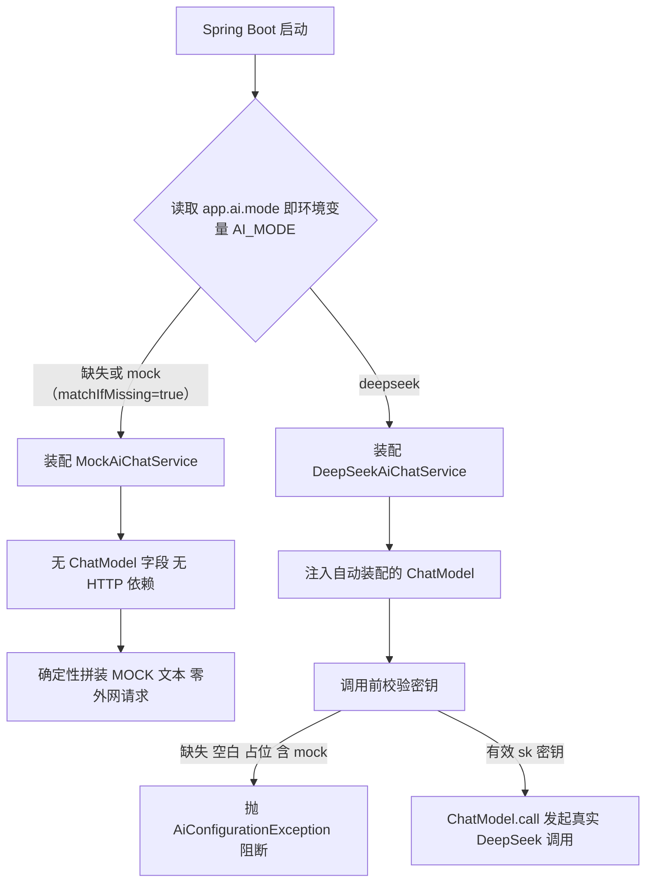
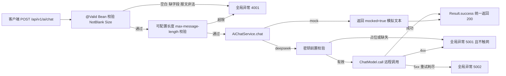
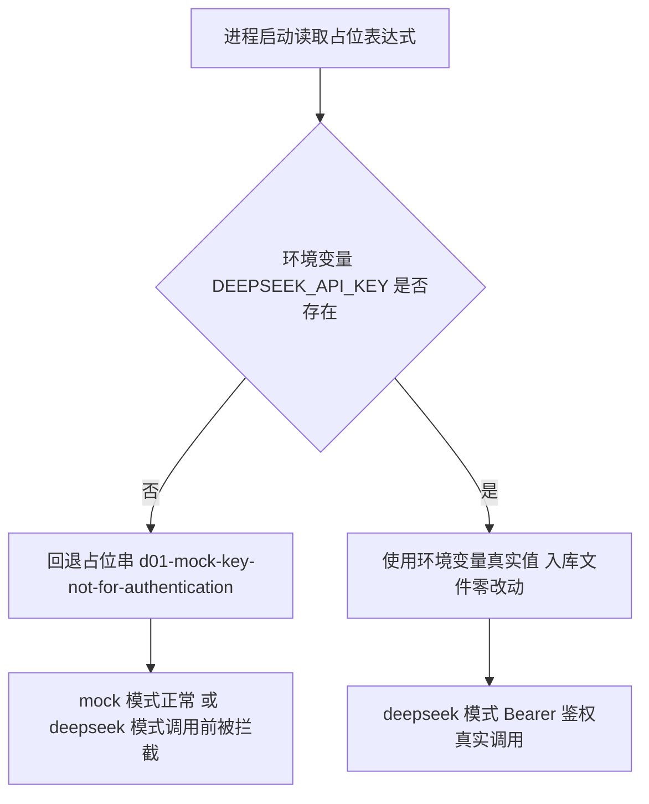

# D01 Spring AI 1.1.x 引入与 DeepSeek API 接入技术文档

> 模块：`D01/D01_SpringAI_init`（M2-Java · 制造业设备故障知识库 + 工单助手 · 模型通道地基）
> 基线：JDK 21.0.7 / Spring Boot 3.5.16 / Spring AI 1.1.8 / Maven 3.9.16
> 文档版本：v1.0　出具时间：2026-10-25
> 仓库根：`E:\AI\project\AI-Learning-two-dblp\M2-Java`
> 约束：本次只打通“模型通道（Chat Channel）”，不引入 Redis、Nacos、MySQL、向量库、Embedding、RAG、Tool Calling、MCP、WebFlux 主栈。

---

## 1. 概述

### 1.1 本次要解决什么

D01 在一个空的 Maven 聚合骨架上，落地一条“本地无密钥可启动可测试、有密钥零改代码即可联通”的大模型聊天通道：

1. 以 `spring-ai-bom:1.1.8` 统一治理 Spring AI 全系版本，引入 DeepSeek 专用 Starter；
2. 提供 `POST /api/v1/ai/chat` 最小验证接口，统一返回体 + 全局异常脱敏；
3. 内置 `mock` / `deepseek` 双模式，由环境变量 `AI_MODE` 切换，**默认 mock**；
4. mock 模式确定性返回、**结构上不持有任何 HTTP 客户端，绝不发外网请求**；
5. deepseek 模式基于 Spring AI 受支持的 `ChatModel` 抽象调用，调用前对缺失/占位密钥快速失败；
6. API 地址、模型名、密钥全部外部化，入库文件只允许出现显式无效占位串。

> 记忆简语：**“BOM 管版本、Starter 管装配、条件注解压模式、占位密钥只装配不外呼、真实密钥走环境变量。”**

### 1.2 与早期规划稿的差异（以本次实施任务书为准）

仓库内《D01-01 ...迭代规划任务书》是“仅规划”稿，本次实施按最新任务书做了以下显式调整：

| 维度 | 规划稿设想 | 本次落地（依据实施任务书） |
|---|---|---|
| 接口形态 | `GET /ai/chat?message=` | `POST /api/v1/ai/chat`，JSON 请求体 DTO |
| 离线策略 | 占位密钥真实调用被 401 归一 | 真正的 `AI_MODE=mock` 离线模式，**完全不发起请求** |
| 默认模型 | `deepseek-v4-flash` | `deepseek-flash`（模型名外置，可一行切换） |
| 调用抽象 | `DeepSeekChatModel` | 注入可移植接口 `ChatModel`（1.1.8 唯一实现即 `DeepSeekChatModel`），属任务书允许的“等效受支持抽象” |
| 基础包名 | 建议 `com.zl.m2.d01`（待确认） | 沿用仓库已存在的物理目录 `com.zl.d01.springai` |

---

## 2. 环境与版本基线（实测）

| 项 | 实测值 | 取证命令 |
|---|---|---|
| JDK | `21.0.7`（HotSpot 64-Bit，`JAVA_HOME=D:\SoftwareInstall\JDK\JDK21`） | `java -version` / `javac -version` |
| Maven | `Apache Maven 3.9.16`，运行于 JDK 21，平台编码 UTF-8 | `mvn -version` |
| Spring Boot | 父 POM `3.5.16`（未升级/降级） | 根 `D01/pom.xml` |
| Spring AI | 全部构件统一 `1.1.8`（1.1.x 线，未使用 2.x、未用动态版本） | `mvn dependency:tree` |
| Servlet 容器 | Tomcat `10.1.55`、Spring Web/WebMVC `6.2.19` | 依赖树 + 启动日志 |
| Maven 镜像 | `~/.m2/settings.xml` 已配阿里云公共仓库代理 central，本地仓 `D:\SoftwareInstall\apache-maven-3.6.1\repository` | settings 扫描 |

> 注意：Spring AI 1.1.8 官方公告基于 Spring Boot 3.5.15 构建，本项目父 POM 为同一次要版本内的补丁版 3.5.16。BOM 只治理 Spring AI 自身、不反向锁 Boot；最终以“上下文成功加载 + 自动装配 Bean 存在 + 全量测试通过 + Tomcat 正常启动”作为兼容证据。

### 2.1 官方资料溯源（版本匹配）

- Spring AI Reference (1.1) - DeepSeek Chat | Spring AI 1.1 参考文档·DeepSeek 聊天：https://docs.spring.io/spring-ai/reference/1.1/api/chat/deepseek-chat.html
- Spring AI Reference (1.1) - Getting Started | Spring AI 1.1 参考文档·入门：https://docs.spring.io/spring-ai/reference/1.1/getting-started.html
- Spring AI Reference (1.1) - Dependency Management | Spring AI 1.1 参考文档·依赖管理：https://docs.spring.io/spring-ai/reference/1.1/getting-started.html#dependency-management
- DeepSeek API Docs | DeepSeek 开放平台 API 文档：https://api-docs.deepseek.com/zh-cn
- Maven Central - spring-ai-bom metadata | Maven 中央仓库·spring-ai-bom 版本元数据：https://repo1.maven.org/maven2/org/springframework/ai/spring-ai-bom/maven-metadata.xml

---

## 3. 工程结构与改动清单

### 3.1 目录结构（交付后）

```text
M2-Java/
├── .gitignore                      # 【修改】追加 application-local.yml/.env 忽略规则
├── README.md
└── D01/
    ├── pom.xml                     # 【修改】追加 spring-ai.version 属性 + spring-ai-bom import
    └── D01_SpringAI_init/
        ├── pom.xml                 # 【修改】新增 web/validation/deepseek/lombok/test 依赖
        └── src/
            ├── main/
            │   ├── java/com/zl/d01/springai/
            │   │   ├── D01SpringAiApplication.java
            │   │   ├── config/
            │   │   │   ├── AiConstants.java        # 模式枚举值/占位密钥/MOCK 标记常量
            │   │   │   └── AiProperties.java       # app.ai.* 绑定（mode、maxMessageLength）
            │   │   ├── common/
            │   │   │   ├── Result.java             # 统一返回体 code/msg/data
            │   │   │   ├── ResultCode.java         # 200/4001/5000/5001/5002
            │   │   │   ├── AiConfigurationException.java
            │   │   │   └── GlobalExceptionHandler.java
            │   │   ├── dto/
            │   │   │   ├── ChatRequest.java        # @NotBlank/@Size
            │   │   │   └── ChatReplyResponse.java  # mode/model/mocked/content
            │   │   ├── service/
            │   │   │   ├── AiChatService.java
            │   │   │   ├── MockAiChatService.java      # 条件装配：mock（默认）
            │   │   │   └── DeepSeekAiChatService.java  # 条件装配：deepseek
            │   │   └── controller/
            │   │       └── ChatController.java     # POST /api/v1/ai/chat + GET /health
            │   └── resources/
            │       ├── application.yml             # 入库主配置，仅含占位密钥
            │       └── application-local.yml.example
            └── test/java/com/zl/d01/springai/
                ├── ApplicationContextLoadTest.java
                ├── MockChatControllerTest.java
                ├── ChatLengthValidationTest.java
                ├── MockNoExternalApiTest.java
                ├── DeepSeekKeyProtectionTest.java
                └── DeepSeekLiveSmokeTest.java      # 默认门控跳过
```

### 3.2 改动文件与理由

| 文件 | 类型 | 理由 |
|---|---|---|
| `D01/pom.xml` | 追加 | 单点属性 `spring-ai.version=1.1.8` + `dependencyManagement` import `spring-ai-bom`；既有 Spring Cloud/MP 段与插件零改动 |
| `D01/D01_SpringAI_init/pom.xml` | 追加 | web（锚定 Servlet）、validation、`spring-ai-starter-model-deepseek`（无版本号）、lombok optional、starter-test |
| 11 个主类 + 2 个资源 | 新增 | 双模式、接口、统一返回、异常脱敏、外部化配置 |
| 6 个测试类 | 新增 | 7 类验收点 + 1 个显式门控在线冒烟 |
| `.gitignore` | 追加 | `**/application-local.yml`、`.env*`，封堵真实密钥入库 |

> 父 POM 改造严格“只追加”：未改 `packaging/modules/parent/插件/既有 BOM`，未添加 `<repositories>`（1.1.x GA 制品在 central，经阿里云代理可达）。

---

## 4. 底层原理与自动装配机制

### 4.1 Spring AI DeepSeek Starter 三层机理

1. **装配层（启动期，零网络）**：`spring-ai-starter-model-deepseek` 通过 Spring Boot 自动装配入口
   `org.springframework.ai.model.deepseek.autoconfigure.DeepSeekChatAutoConfiguration`（见 jar 内
   `META-INF/spring/org.springframework.boot.autoconfigure.AutoConfiguration.imports`）读取
   `spring.ai.deepseek.*` 属性，构建底层 `DeepSeekApi`（基于 `RestClient`，Servlet 友好），
   再注册 `DeepSeekChatModel` Bean。该过程不发起任何 HTTP 请求，因此占位密钥下上下文仍能正常启动。
2. **调用层（运行期）**：业务调用 `chatModel.call(new Prompt(new UserMessage(...)))`，
   序列化为 OpenAI 兼容的 `/chat/completions` 请求，附 `Authorization: Bearer <key>` 发往 `base-url`。
3. **异常翻译层**：HTTP 4xx → `org.springframework.ai.retry.NonTransientAiException`（默认不重试）；
   5xx/超时 → `org.springframework.ai.retry.TransientAiException`（受 `spring.ai.retry.*` 指数退避控制，默认 max-attempts=10）。

> 关键事实（经 1.1.8 实际 jar 核验，非记忆）：异常类包名是 **`org.springframework.ai.retry`**，
> 而非部分旧资料写的 `org.springframework.ai.exception`；核心抽象包名为
> `org.springframework.ai.chat.model.ChatModel/ChatResponse`、`org.springframework.ai.chat.prompt.Prompt`、
> `org.springframework.ai.chat.messages.UserMessage`，模型类为 `org.springframework.ai.deepseek.DeepSeekChatModel`。

### 4.2 双模式条件装配



`MockAiChatService` 与 `DeepSeekAiChatService` 通过
`@ConditionalOnProperty(prefix="app.ai", name="mode", havingValue=...)` 互斥装配，容器中始终只有一个 `AiChatService` 实例。
mock 实现**无任何实例字段、构造器无参**，从对象结构上就不可能触网；这是比“开关判断”更强的离线保证。

### 4.3 一次 HTTP 请求的处理流程



> HTTP 状态码统一返回 200，业务结果由响应体内 `code` 区分，保证 `code/msg/data` 契约在成功/失败下结构一致、便于前端统一拦截。

---

## 5. 配置契约（外部化）

`src/main/resources/application.yml` 的属性名已经官方 1.1 文档核对（**不是 2.x 命名**）：

| 环境变量 | YAML 属性 | 默认值 | 说明 |
|---|---|---|---|
| `AI_MODE` | `app.ai.mode` | `mock` | `mock` 离线 / `deepseek` 真实 |
| `DEEPSEEK_API_KEY` | `spring.ai.deepseek.api-key` | `d01-mock-key-not-for-authentication`（显式无效占位） | 真实密钥仅经环境变量注入 |
| `DEEPSEEK_BASE_URL` | `spring.ai.deepseek.base-url` | `https://api.deepseek.com` | 私有网关可覆盖 |
| `DEEPSEEK_MODEL` | `spring.ai.deepseek.chat.options.model` | `deepseek-flash` | 模型名字符串外置，不引用 SDK 枚举 |
| `AI_CHAT_MAX_LENGTH` | `app.ai.max-message-length` | `2000` | 可调入参长度上限 |
| —（固定） | `spring.ai.deepseek.chat.options.temperature` | `0.7` | 采样温度 [0,2] |

密钥外置与切换流程：



> `.env` 不会因为放在项目根目录就被 Spring Boot 自动读取，本项目也未引入 dotenv 依赖。本地真实密钥请用 IDEA Run Configuration 环境变量或 PowerShell `$env:` 注入，切勿写入入库文件。

---

## 6. 核心代码说明

### 6.1 统一返回体与错误码

`Result<T>` 提供 `success(data)` / `fail(ResultCode)` / `fail(code,msg)` 静态工厂；`ResultCode` 约定：

| code | 含义 | 触发来源 |
|---|---|---|
| 200 | success | 正常返回 |
| 4001 | 请求参数校验失败 | `@NotBlank/@Size`、JSON 不可读、可配置长度超限 |
| 5001 | AI 配置/鉴权/客户端错误 | 占位/缺失密钥、`NonTransientAiException`（含 401） |
| 5002 | AI 服务暂不可用 | `TransientAiException` 重试耗尽 |
| 5000 | 系统繁忙 | 未预期异常兜底 |

### 6.2 真实模式密钥前置保护（`DeepSeekAiChatService`）

```java
private void validateCredential() {
    if (!StringUtils.hasText(this.apiKey)
            || AiConstants.PLACEHOLDER_API_KEY.equals(this.apiKey)
            || this.apiKey.toLowerCase().contains("mock")) {
        throw new AiConfigurationException("...已阻止发起外部请求");
    }
}
```

该方法在 `chatModel.call(...)` **之前**执行，保证无效密钥绝不会产生对外 HTTP 调用与费用；异常文案不含密钥本身，全局处理器对外只回固定提示。

### 6.3 全局异常脱敏（`GlobalExceptionHandler`）

- 参数类异常返回首个字段错误的安全中文提示；
- AI 两类异常只在服务端日志记录**异常类型**，不回显上游报文、请求头、API Key；
- 兜底 `Exception` 完整堆栈仅入日志，响应体只给通用“系统繁忙”。

---

## 7. 测试策略与真实结果

### 7.1 用例与需求映射

| 测试类 | 覆盖验收点 | 断言要点 |
|---|---|---|
| `ApplicationContextLoadTest` | 上下文启动、Bean 装配、配置绑定 | `DeepSeekChatModel` 实例存在；默认 `MockAiChatService`；model=deepseek-flash、key=占位串 |
| `MockChatControllerTest` | mock 正常调用、契约、确定性、空白/空/缺字段/非法 JSON | `$.code=200`、`mocked=true`、含 `[MOCK:D01]`；非法输入 `$.code=4001`；两次响应一致 |
| `ChatLengthValidationTest` | 可调长度限制 | 上限调为 5 后，3 字通过、10 字 4001 |
| `MockNoExternalApiTest` | mock 不触外网的强保证 | DeepSeek Bean 不存在；Mock 服务零字段无参构造；独立 ChatModel mock 零交互 |
| `DeepSeekKeyProtectionTest` | 真实模式缺/占位密钥保护 | `@MockitoBean` 替换 ChatModel，占位密钥返回 5001 且 `verifyNoInteractions`；null/空/空白/占位/含 mock 五类密钥全拦截 |
| `DeepSeekLiveSmokeTest` | 真实 API 冒烟（显式门控） | 双 `@EnabledIfEnvironmentVariable`：需 `AI_MODE=deepseek` 且 `DEEPSEEK_API_KEY` 匹配 `sk-.+`，否则跳过 |

> 门控注解真实包名为 `org.junit.jupiter.api.condition.EnabledIfEnvironmentVariable`（JUnit Jupiter 5.12.2，可重复注解），**不是** Spring 的同名能力——该结论经实际 jar 核验并修复过一次导入错误。

### 7.2 真实执行结果（`mvn clean verify`）

```text
Tests run: 18, Failures: 0, Errors: 0, Skipped: 1   BUILD SUCCESS（Maven 退出码 0）
```

| 测试类 | Tests | Failures | Errors | Skipped |
|---|---|---|---|---|
| ApplicationContextLoadTest | 4 | 0 | 0 | 0 |
| MockChatControllerTest | 6 | 0 | 0 | 0 |
| ChatLengthValidationTest | 2 | 0 | 0 | 0 |
| MockNoExternalApiTest | 3 | 0 | 0 | 0 |
| DeepSeekKeyProtectionTest | 2 | 0 | 0 | 0 |
| DeepSeekLiveSmokeTest | 1 | 0 | 0 | **1（门控跳过）** |

即 17 个用例真实执行全部通过，唯一 Skip 是默认禁用的在线冒烟；普通构建零外网、零真实 Key、零费用。

---

## 8. 构建与运行验证证据

### 8.1 依赖治理

- `mvn dependency:tree -Dincludes=org.springframework.ai`：13 个 Spring AI 构件版本**全部为 1.1.8**，唯一版本号；
- 全量树检索：**无 openai starter、无 reactor-netty/netty**；
- `spring-webflux:6.2.19` 与 `reactor-core:3.7.19` 仅作为 spring-ai-deepseek 的传递**类库**存在（供 WebClient API），不构成反应式 Web 服务器；
- 主栈显式为 `spring-boot-starter-web` → Tomcat 10.1.55 + spring-webmvc 6.2.19；启动日志实证 `Tomcat started on port 8080` 与 `DispatcherServlet`，确认 Servlet 栈未被切换；
- `help:effective-pom` 中 `spring-ai-starter-model-deepseek` 受管版本解析为 1.1.8（import 的 BOM 在有效 POM 中被展开为直接 dependencyManagement 条目）。

### 8.2 运行态实测（可执行 fat jar）

默认 mock 模式（端口 8080）：

- `GET /api/v1/ai/health`
  → `{"code":200,"msg":"success","data":{"application":"D01_SpringAI_init","mode":"mock","maxMessageLength":2000}}`
- `POST /api/v1/ai/chat` 有效消息（原始字节按 UTF-8 解码）：
  → `code=200`，`data.mocked=true`、`data.mode="mock"`、`data.model="offline-mock"`，content 以 `[MOCK:D01]` 开头并明确“未发起任何 DeepSeek 网络请求”；
- 空白 / 空串 / 缺 message / 非法 JSON / 超 2000 字 → 一律 `code=4001`、`data=null`，响应不含堆栈。

deepseek 模式 + 占位密钥（端口 8081，启动参数 `AI_MODE=deepseek SERVER_PORT=8081`）：

- `POST /api/v1/ai/chat` → HTTP 200，响应体 `{"code":5001,"msg":"AI 服务配置或鉴权异常，请检查密钥与参数配置","data":null}`；
- 服务端日志仅一行 `AI 配置校验失败...已阻止发起外部请求`，其后**无任何 RestClient/外网交换记录**，证明调用前拦截生效。

> 取证说明：服务端 `Content-Type: application/json`，响应体为标准 UTF-8 字节，浏览器/curl/HTTP 客户端按 JSON 默认 UTF-8 解码中文正常；某些 PowerShell 抓取命令默认按拉丁字符集解码会显示乱码，那是客户端捕获问题，非服务端缺陷。

---

## 9. IntelliJ IDEA 2024.1 Ultimate 运行指南

1. **Project SDK**：`File → Project Structure → Project`，SDK 选 21（本机 `D:\SoftwareInstall\JDK\JDK21`），Language level 21。
2. **Maven Runner**：`Settings → Build Tools → Maven → Runner`，JRE 选 JDK 21；确认 `User settings file` 指向带阿里云镜像的 `~/.m2/settings.xml`。
3. **Reload Maven**：右键 `D01/pom.xml → Maven → Reload Project`，等待 Spring AI 1.1.8 依赖导入无报错。
4. **启动类**：选择 `com.zl.d01.springai.D01SpringAiApplication`。
5. **默认 mock 运行**：Run Configuration → Environment variables 填 `AI_MODE=mock`（或不填，默认即 mock），启动后访问 8080 验证。
6. **真实模式运行**：同一 Run Configuration 中填
   `AI_MODE=deepseek;DEEPSEEK_API_KEY=sk-你的真实密钥`（可选 `DEEPSEEK_BASE_URL`、`DEEPSEEK_MODEL`），无需改任何源码、无需改入库配置。
7. 切换模式只改环境变量，源代码与 Git 跟踪文件保持零改动。
8. 真实密钥只存在于 IDEA 本地 Run Configuration（工作区配置，不入库）；严禁写入 `application.yml`。`.env` 不会被自动加载，请勿依赖。

命令行等价方式（PowerShell）：

```powershell
# 默认 mock
mvn -f D01\pom.xml spring-boot:run
# 真实模式
$env:AI_MODE="deepseek"; $env:DEEPSEEK_API_KEY="sk-你的真实密钥"
mvn -f D01\pom.xml spring-boot:run
# 显式启用在线冒烟
$env:AI_MODE="deepseek"; $env:DEEPSEEK_API_KEY="sk-你的真实密钥"
mvn -f D01\pom.xml test -Dtest=DeepSeekLiveSmokeTest
```

---

## 10. 安全与 Git 检查

- 全量源码/资源检索 `sk-`、`api-key`、`secret`、`token`：仅命中占位常量 `d01-mock-key-not-for-authentication`、环境变量名与注释说明，**无任何真实凭据**；
- `.gitignore` 追加 `**/application-local.yml`、`**/application-local.properties`、`.env`、`.env.*`；`target/` 本就被忽略；
- 日志只打印消息长度与模式，不打印消息全文、不打印密钥、不打印 `Authorization` 头；异常响应不回显堆栈与上游报文；
- 当前分支 `master`，所有改动**均未提交**（未执行 `git add/commit/push`，无 Commit ID）；工作区原有的 `A/AM` 暂存内容被原样保留，本次仅在工作区做追加式修改；
- 未触碰 D02 等其它模块，未引入任何基础设施类无关依赖。

---

## 11. 验收追踪矩阵（AC-01 ~ AC-08）

| 编号 | 验收要求 | 实现位置 | 验证方法 | 结果 | 证据位置 |
|---|---|---|---|---|---|
| AC-01 | BOM/Starter 正确引入、Spring AI 版本统一无冲突 | `D01/pom.xml`、子模块 `pom.xml` | dependency:tree / effective-pom | 通过 | 13 个构件均 1.1.8，无 openai/netty |
| AC-02 | 保持 Boot 3.5.16 可编译可启动，不静默改版 | 父 POM 未动 Boot 版本 | `mvn clean verify` + jar 启动 | 通过 | BUILD SUCCESS 退出码 0；Tomcat 8080 启动日志 |
| AC-03 | 配置外部化、默认 mock、占位密钥显式无效 | `application.yml`、`AiConstants` | 上下文测试断言解析值 | 通过 | ApplicationContextLoadTest 4/4 |
| AC-04 | mock 确定性返回且不访问外网 | `MockAiChatService` | 反射结构断言 + MockMvc + 零交互 | 通过 | MockNoExternalApiTest 3/3、MockChatControllerTest 6/6 |
| AC-05 | 接口契约、空白与长度校验、统一响应、异常脱敏 | `ChatController`、DTO、`GlobalExceptionHandler` | MockMvc + 真实 HTTP 调用 | 通过 | 4001/200/5001 响应实测 |
| AC-06 | 真实模式用 Spring AI 抽象、缺/占位密钥调用前保护 | `DeepSeekAiChatService` | `@MockitoBean` 替换 + 8081 实跑 | 通过 | DeepSeekKeyProtectionTest 2/2；5001 且零外网 |
| AC-07 | 自动化测试默认无外网无 Key、在线冒烟显式门控 | 6 个测试类 | `mvn clean verify` | 通过 | 17 通过 / 1 门控跳过 / 0 失败 |
| AC-08 | 变更范围受控、密钥不入库、Git 无越界 | 全部改动文件、`.gitignore` | git status/diff + 密钥检索 | 通过 | 仅清单内文件；无真实密钥；未提交 |

---

## 12. 注意事项、未完成项与后续建议

1. **真实 API 联调未执行（AC-05 真实链路）**：当前无真实 `DEEPSEEK_API_KEY`，在线冒烟 `DeepSeekLiveSmokeTest` 保持 Skipped。取得密钥并授权后，按第 9 节注入环境变量单独运行即可，普通构建不会自动触发。
2. **模型名可切换**：默认 `deepseek-flash` 来自实施任务书，通过 `DEEPSEEK_MODEL` 即可切换；代码不引用 `DeepSeekApi.ChatModel` 枚举，规避 SDK 枚举与线上模型名不一致的风险。具体线上可用模型以 DeepSeek 官方当日文档为准。
3. **webflux 类库说明**：classpath 存在 spring-webflux/reactor 传递类库但无 netty、不启动反应式容器；若未来明确需要 WebClient/流式，再评估是否引入 starter-webflux，当前不要误判为容器栈冲突。
4. **surefire `.dumpstream`**：Windows 下 surefire 3.5.6 关于 Boot fat jar 绝对 classpath 的提示性 dump，属无害告警，不影响测试结果。
5. **控制台中文乱码**：仅出现在部分 PowerShell 抓取管道；服务端 JSON 为规范 UTF-8，不影响真实客户端。
6. **后续迭代边界**：ChatClient 高阶 DSL/Advisor/Memory、RAG/向量库、Function Calling、MCP、限流幂等、链路追踪与成本监控均留待后续 Dxx，本次不预埋。
7. **Maven Wrapper（mvnw）**：本仓库暂无 wrapper，当前统一使用本机 mvn 3.9.16；是否补建列为可选项，不影响本次验收。
