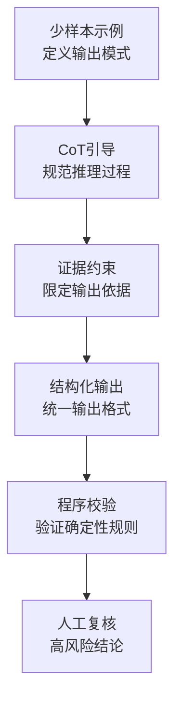

# Spring AI 知识笔记：Prompt 进阶——少样本提示、思维链 CoT 与幻觉抑制

>
> 技术基线：JDK 21 LTS / Spring Boot 3.5.16 / Spring AI 1.1.8 / DeepSeek OpenAI 兼容接口
> 学习目标：建立Prompt进阶方法论，掌握少样本设计、思维链引导、幻觉抑制分层策略，能够在Spring AI工程中落地实施
> 前置知识：Spring AI基础调用、ChatClient使用、大语言模型基本概念

---

## 一、Prompt 进阶技术整体框架与概念定位

### 1.1 核心概念总览

Prompt Engineering（提示词工程）是通过设计输入文本的结构、内容、示例与约束，引导大语言模型按预期模式输出的工程技术。它不是“话术技巧”，而是一套包含任务定义、示例引导、推理控制、证据约束、结果校验的系统化方法。

| 技术                    | 核心定义                                   | 解决的核心问题                                   |
| ----------------------- | ------------------------------------------ | ------------------------------------------------ |
| Zero-shot Prompting     | 零样本提示，不给示例，直接下达任务         | 简单明确任务的快速调用                           |
| One-shot Prompting      | 单样本提示，给出1个输入输出示例            | 简单格式、简单规则的对齐                         |
| Few-shot Prompting      | 少样本提示，给出少量代表性示例             | 让模型理解任务模式、分类规则、输出格式、边界处理 |
| Chain-of-Thought (CoT)  | 思维链提示，引导模型分步推理               | 多步骤计算、复杂判断、符号推理类任务             |
| Grounding               | 基于证据的生成约束                         | 减少无依据生成，限定输出在给定材料范围内         |
| Hallucination           | 幻觉，模型生成看似合理但缺乏事实依据的内容 | 需识别、抑制与管控的核心风险                     |
| RAG                     | 检索增强生成，检索外部资料补充上下文       | 为模型提供训练外的最新或专有数据                 |
| Structured Output       | 结构化输出，约束输出格式与字段             | 便于下游程序解析与校验                           |
| Programmatic Validation | 程序化校验，用代码验证输出                 | 对确定性规则做自动校验，降低错误放行率           |

>
> **核心认知**：以上技术并非互相替代，而是分层互补的关系。没有任何一种技术能独立保证输出100%正确，工程中通常组合使用。

### 1.2 技术层级与作用边界

```
flowchart TD
    A[任务定义与角色设定] --> B[少样本示例引导<br/>Few-shot]
    B --> C[推理过程引导<br/>CoT]
    C --> D[证据约束<br/>Grounding]
    D --> E[结构化输出<br/>Structured Output]
    E --> F[程序化校验<br/>Programmatic Validation]
    F --> G[人工复核<br/>高风险场景]
```

### 1.3 与模型微调的本质区别

| 维度     | 少样本 / CoT 提示                | 模型微调 / 监督训练              |
| -------- | -------------------------------- | -------------------------------- |
| 作用层级 | 输入引导，不改变模型参数         | 修改模型权重与知识               |
| 成本     | 极低，仅Prompt设计成本           | 高，需要数据、算力、标注         |
| 生效速度 | 即时，修改Prompt立即生效         | 慢，需要训练与评估               |
| 适用场景 | 任务模式引导、格式约束、推理引导 | 领域知识注入、风格对齐、能力增强 |
| 工程维护 | 轻量，Prompt版本管理             | 重型，数据集、模型版本、评估体系 |

>
> **关键结论**：少样本提示不会改变模型参数，只是通过上下文引导模型的输出模式。模型不会因为几个示例就“学会”新知识，只是学会了按示例的格式与规则处理当前输入。

《Prompt engineering | OpenAI 提示工程官方指南》：[https://developers.openai.com/api/docs/guides/prompt-engineering](https://developers.openai.com/api/docs/guides/prompt-engineering)

---

## 二、少样本提示（Few-shot Prompting）

### 2.1 基本概念与工作机制

#### 定义

- **Zero-shot**：不给任何示例，直接提问。适合简单、明确、无歧义的任务。
- **One-shot**：给1个完整的输入输出示例。适合格式对齐、简单分类。
- **Few-shot**：给2~5个代表性输入输出示例。适合复杂分类、边界处理、格式严格的任务。

#### 工作原理

大语言模型具备强大的模式识别与泛化能力。在Prompt中提供“输入→输出”的示例对，模型会隐式学习其中的任务模式、分类规则、表达风格、边界处理方式，并将该模式应用到当前输入。

>
> **与微调的本质区别**：Few-shot是上下文内的模式引导，不修改模型参数；示例只影响当前对话，不产生持久的模型能力变化。

#### 三类提示效果对比示例

```
// Zero-shot：直接要求
String zeroShot = "将以下设备故障分类：电机异常振动";

// One-shot：给一个示例
String oneShot = """
将设备故障分类。
示例输入：轴承温度过高伴随异响
示例输出：【机械类故障】
当前输入：电机异常振动
""";

// Few-shot：给多个覆盖不同场景的示例
String fewShot = """
将设备故障分类，信息不足时标注【待补充信息】。
示例1输入：轴承温度过高伴随金属摩擦声
示例1输出：【机械类故障】
示例2输入：控制面板报错，无其他数据
示例2输出：【待补充信息】
示例3输入：通信模块无响应，重启后恢复
示例3输出：【电气类故障】
当前输入：电机异常振动
""";
```

### 2.2 示例设计的核心原则

>
> 示例质量远比例子数量重要。劣质示例反而会降低输出质量。

| 原则         | 说明                                   | 工程意义                             |
| ------------ | -------------------------------------- | ------------------------------------ |
| **代表性**   | 示例覆盖真实业务中的典型输入分布       | 避免模型只学会处理极端情况           |
| **边界覆盖** | 包含空值、模糊输入、异常场景、临界案例 | 减少边界场景的错误处理率             |
| **标签准确** | 示例输出必须经过业务验证，无错误       | 错误示例会教给模型错误规则           |
| **格式一致** | 示例输出与正式输出规范完全一致         | 模型会模仿示例的格式、字段、甚至标点 |
| **规则统一** | 示例之间遵循同一套业务规则，无矛盾     | 规则冲突会导致模型输出随机选择规则   |
| **数量适中** | 简单任务2~~3个，复杂任务3~~5个         | 过多挤占上下文，增加成本与延迟       |
| **顺序影响** | 首尾示例权重更高，关键规则放首尾       | 利用模型的近因效应强化核心规则       |

>
> **经验说明**：以上为工程实践总结的设计原则，具体最优数量与效果随模型、任务不同而变化，需通过实验验证。

### 2.3 正例、边界例与反例

#### 三类示例的作用

| 类型   | 作用                                         | 使用注意                             |
| ------ | -------------------------------------------- | ------------------------------------ |
| 正例   | 展示标准任务的正确完成方式                   | 覆盖主要业务场景                     |
| 边界例 | 展示信息不足、条件临界、异常输入时的处理方式 | 必须明确标注边界条件与处理规则       |
| 反例   | 展示错误输出以及为什么不符合要求             | 必须明确标注“错误示例”，避免模型模仿 |

>
> **风险提示**：反例使用不当会产生“负面示范”效应，导致模型学会错误输出。生产环境优先使用正例+边界例，慎用反例。

### 2.4 Few-shot Prompt 标准工程结构

```
【任务目标】
简要说明任务目的、业务范围与输出要求。

【分类规则/业务规则】
明确列出判定标准、字段定义、枚举值。

【示例】
示例1输入：XXX
示例1输出：XXX

示例2输入：XXX
示例2输出：XXX

【当前输入】
{user_input}

【输出约束】
1. 严格按示例格式输出
2. 信息不足时标注【待补充】
3. 禁止编造不存在的故障代码
```

>
> **设计要点**：用清晰的标题分隔示例与当前输入，避免模型将示例中的设备编号、故障现象误当作当前请求的真实数据。

### 2.5 少样本提示的局限

1. **泛化有限**：示例覆盖不到的输入分布，效果可能明显下降。
2. **规则漂移**：示例规则不明确时，模型可能自行脑补规则。
3. **上下文成本**：示例占用Token，增加调用成本与延迟。
4. **表面模仿**：模型可能只复制格式，未真正理解规则。
5. **错误放大**：示例本身有错误，会导致系统性输出偏差。
6. **任务不适配**：强逻辑、强事实校验的任务，仅靠示例无法保证正确性。

>
> **决策原则**：当Few-shot效果不佳时，优先排查示例质量、边界覆盖、规则清晰度，而非盲目增加示例数量。

---

## 三、思维链提示（Chain-of-Thought, CoT）

### 3.1 定义与研究背景

#### 定义

思维链提示是一种引导大语言模型输出中间推理步骤的技术，通过让模型“说出思考过程”，提升复杂多步推理任务的准确率。

#### 研究背景

2022年Google Research的论文《Chain-of-Thought Prompting Elicits Reasoning in Large Language Models》首次系统提出该方法，实验证明在算术、常识推理、符号推理任务上，CoT能显著提升大模型的表现。

《Chain-of-Thought Prompting Elicits Reasoning in Large Language Models | 思维链提示激发大语言模型的推理能力》：[https://arxiv.org/abs/2201.11903](https://arxiv.org/abs/2201.11903)

#### 核心逻辑

复杂推理任务无法一步得出答案。模型直接输出时，容易跳过关键步骤、出现逻辑跳跃或计算错误；强制输出中间步骤，能让模型逐步验证，降低错误率。

### 3.2 CoT 与普通分步指令的区别

| 方法             | 本质                                 | 适用场景                         |
| ---------------- | ------------------------------------ | -------------------------------- |
| 普通分步指令     | 明确规定执行步骤与检查项，是流程约束 | 流程固定、规则明确的业务处理     |
| Zero-shot CoT    | 加入“请分步思考并说明理由”类引导语   | 开放式推理问题，无固定流程       |
| Few-shot CoT     | 给出带推理过程的示例                 | 模式固定、需要统一推理规范的场景 |
| 程序化多阶段调用 | Java代码分步骤调用模型，每步验证     | 高确定性、强校验的业务流程       |
| 工具辅助验证     | 外部程序/数据库/工具校验结果         | 可量化、可查据的结论             |

>
> **关键区分**：CoT是引导模型的内部推理过程，仍然是自然语言层面的；程序化校验是代码层面的确定性验证，二者不在一个层级。

### 3.3 适用场景与不适用场景

#### 推荐使用CoT的场景

- 多条件业务规则判断
- 故障根因分析与排查
- 多步骤数据转换与计算
- 复杂分类与优先级判定
- 需要解释推导依据的场景

#### 不推荐使用CoT的场景

- 简单字段提取、格式转换
- 固定映射类任务
- 低延迟高吞吐的简单查询
- 可直接用代码完成的确定性计算
- 对输出长度严格限制的场景

>
> **工程原则**：是否采用CoT，根据任务复杂度、准确率要求、延迟成本、模型能力综合权衡，并通过对照实验验证收益。

### 3.4 有效性边界与风险

1. **不保证正确**：分步推理不代表结论必然正确，错误的前提会导致错误的推导。
2. **错误传播**：中间步骤的错误会向后传播，最终结论依然错误。
3. **成本增加**：输出更长，Token消耗增加，延迟上升。
4. **冗余推理**：可能生成无关的推理内容，偏离任务目标。
5. **虚构依据**：推理过程中可能引入不存在的证据、数据或规则。

>
> ⚠️ **重要警示**：不得将模型输出的冗长推理文本，当作正确性的证明。推理越详细≠结论越正确。

### 3.5 进阶方法：自一致性（Self-Consistency）

#### 原理

生成多个独立的推理路径，选择多数一致的答案，通过“投票”提升准确率。

#### 边界

- 成本显著增加，需要多次调用模型
- 一致不代表正确，可能犯同样的错误
- 适合高价值、低延迟要求的任务

《Self-Consistency Improves Chain of Thought Reasoning in Language Models | 自一致性提升语言模型的思维链推理能力》：[https://research.google/pubs/self-consistency-improves-chain-of-thought-reasoning-in-language-models/](https://research.google/pubs/self-consistency-improves-chain-of-thought-reasoning-in-language-models/)

---

## 四、幻觉：定义、分类与产生条件

### 4.1 什么是幻觉

Hallucination（幻觉）指大语言模型生成的内容，在语法通顺、结构完整、语气自信的表象下，包含缺乏事实依据的错误信息、虚构数据或不合逻辑的推论。

>
> 模型不是“故意撒谎”。生成模型的本质是基于统计概率预测下一个token，当知识不足、上下文模糊或任务压力时，会“补全”出看似合理但不符合事实的内容。

《Artificial Intelligence Risk Management Framework: Generative Artificial Intelligence Profile | 人工智能风险管理框架：生成式人工智能概况》：[https://nvlpubs.nist.gov/nistpubs/ai/NIST.AI.600-1.pdf](https://nvlpubs.nist.gov/nistpubs/ai/NIST.AI.600-1.pdf)

### 4.2 幻觉的分类

| 类别       | 说明                                   | 典型场景                             |
| ---------- | -------------------------------------- | ------------------------------------ |
| 事实幻觉   | 生成错误的事实、日期、版本、数值       | 虚构设备参数、故障代码、历史数据     |
| 引用幻觉   | 编造不存在的文献、标准、文档、URL      | 假造维修手册、官方文件、技术规范     |
| 证据幻觉   | 声称有来源支持，但来源实际不支持该结论 | 引用真实文档，但文档内容与结论无关   |
| 计算幻觉   | 生成错误的计算结果或统计数据           | 错误的故障率、寿命计算、成本估算     |
| 代码幻觉   | 生成不存在的API、方法、类名、依赖      | 编造Spring AI配置项、Java类名        |
| 上下文幻觉 | 忽略输入条件，或与已知信息矛盾         | 忽略用户给出的故障现象，套用通用模板 |
| 逻辑幻觉   | 结论不受前提支持，推理跳跃             | 故障原因推导不符合给定现象           |
| 过度确定性 | 信息不足时仍以肯定语气输出             | 证据不足仍给出100%确定的故障判定     |

### 4.3 幻觉的常见诱因

1. **信息缺失**：问题缺少关键信息，模型强行补全。
2. **知识盲区**：模型训练数据未覆盖该领域或内容过时。
3. **输入误导**：用户输入包含错误前提，模型沿错误前提推导。
4. **规则模糊**：任务边界、输出约束、拒答规则不明确。
5. **压力生成**：要求必须给出答案，模型倾向于编造而非承认不知道。
6. **检索错误**：RAG检索到的资料不相关、过时或矛盾。
7. **示例偏差**：少样本示例包含错误或误导性模式。
8. **格式优先**：要求JSON格式时，模型可能为了格式正确编造字段值。

>
> **核心认知**：幻觉是生成模型的固有特性，只能降低风险，无法彻底消除。

---

## 五、幻觉抑制的分层工程策略

>
> 核心原则：**幻觉抑制是分层风险控制，不是单点解决方案**。从Prompt引导→证据约束→检索补充→工具校验→输出规范→监控迭代，逐层降低风险。

### 5.1 Prompt 层：明确规则、边界与不确定性

#### 核心方法

在系统提示中明确输出规则，压缩模型自由发挥的空间。

#### 标准约束模板

```
【回答规则】
1. 只基于本对话提供的资料回答，禁止编造不存在的事实、数据、代码、引用。
2. 明确区分：【事实】【推测】【未知】三类信息。
3. 资料不足无法判断时，明确标注【信息不足】，并说明需要补充的信息。
4. 关键结论必须标注对应依据来源，无来源的不得作为事实输出。
5. 当输入包含错误前提时，请指出错误，而非沿错误前提推导。
6. 禁止编造故障代码、传感器数值、维修记录、官方文件。
7. 所有概率性判断必须标注置信度等级：高/中/低。
```

#### 效果与局限

- 能显著降低“强行回答”类幻觉
- 无法解决模型本身知识缺失问题
- 依赖模型对指令的遵循程度

### 5.2 证据层：Grounding 与来源约束

#### 核心逻辑

给模型提供明确的参考资料，并要求所有关键结论必须映射到对应证据，减少模型自由发挥空间。

#### 主张-证据对应表

| 主张           | 依据来源               | 证据是否直接支持 | 判断状态 |
| -------------- | ---------------------- | ---------------- | -------- |
| 设备轴承故障   | 维修手册第3.2节        | 是               | 【事实】 |
| 可能是电机老化 | 振动特征与老化案例相似 | 间接             | 【推测】 |
| 已运行10万小时 | 无对应记录             | 否               | 【未知】 |

#### 工程要点

1. 资料必须真实存在，且确实支持对应主张。
2. 来源真实 ≠ 来源支持结论，需校验证据相关性。
3. 证据不足时，必须允许模型返回“无法确定”。

### 5.3 检索层：RAG 的作用与局限

#### 作用

通过检索外部知识库、业务数据、最新文档，为模型提供训练外的证据材料，从知识源层面减少幻觉。

#### 为什么检索了还会有幻觉

1. 查询理解错误，检索到不相关资料。
2. 文档切分不当，上下文缺失或断章取义。
3. 多份资料冲突，模型错误选择。
4. 模型错误解读正确的资料。
5. 检索结果不足，模型仍强行补全。

>
> **关键结论**：RAG能提供证据材料，但不能自动保证结论正确。检索质量、排序、上下文组装、答案生成都会影响最终准确率。

### 5.4 工具与外部验证层

#### 核心思想

确定性校验交给程序和工具，不依赖模型自我声明。

#### 适合外部验证的场景

- 数学计算、格式校验 → 代码计算/校验
- 设备编号、工单状态 → 数据库查询
- 标准编号、版本号 → 标准库查询
- JSON结构、字段枚举 → Schema校验
- 业务规则判定 → 规则引擎校验
- 代码语法 → 编译/单元测试

>
> **工程原则**：模型负责语言理解与推理组织；确定性校验交给程序。二者分工明确，不能互相替代。

### 5.5 输出层：结构化结果与拒答策略

#### 结构化输出的作用

通过定义输出字段、枚举值、数据类型，约束输出形态，便于下游程序校验。

#### 未知状态规范

为信息不足、无法判断的场景定义标准的未知状态码、原因说明、补充信息需求，避免模型强行编造。

#### 注意

- JSON合法 ≠ 事实正确
- 置信度文字 ≠ 经过校准的真实概率
- 结构化输出只约束格式，不约束内容真实性

### 5.6 评估与监控层

#### 核心评估指标

| 指标         | 说明                         |
| ------------ | ---------------------------- |
| 事实准确率   | 可验证事实的正确比例         |
| 证据支持率   | 有明确依据的结论占比         |
| 无依据主张率 | 编造、无来源结论的比例       |
| 正确拒答率   | 信息不足时正确返回未知的比例 |
| 错误拒答率   | 能回答却错误拒绝的比例       |
| 引用有效率   | 引用真实且支持结论的比例     |

>
> **核心原则**：幻觉抑制效果不能靠模型自评，必须建立外部可核验的标准与数据集。

---

## 六、少样本、CoT 与幻觉抑制的组合方案

### 6.1 技术组合逻辑



### 6.2 典型组合方案与适用场景

| 组合方案                       | 解决的核心问题                 | 适用场景                       |
| ------------------------------ | ------------------------------ | ------------------------------ |
| Few-shot + 结构化输出          | 统一输出格式与分类规则         | 分类、打标签、字段提取         |
| Few-shot + CoT + 证据约束      | 复杂分析类任务，降低无依据推理 | 故障分析、根因排查、诊断类任务 |
| RAG + Grounding规则 + 引用校验 | 知识库问答，减少编造引用       | 文档问答、手册查询、政策咨询   |
| CoT + 程序化校验               | 多步骤计算，结果自动校验       | 指标计算、成本核算、配置检查   |

### 6.3 剩余风险说明

即使完整组合使用，仍存在以下残余风险：

1. 检索到的资料本身错误或过时
2. 模型对证据的理解偏差
3. 业务规则本身模糊或存在例外
4. 复杂语义无法程序化校验
5. 成本与延迟随层数增加而上升

>
> **工程决策**：根据业务风险等级选择组合策略，平衡准确率、成本、延迟三者关系。

---

## 七、Spring AI 工程实现

### 7.1 核心 API 说明

基于 Spring AI 1.1.8 `ChatClient` 实现，兼容 DeepSeek OpenAI 兼容接口。

核心使用方法：

- `ChatClient.Builder`：构建客户端
- `system()`：设置系统提示、规则、示例
- `user()`：设置用户当前输入
- `call()`：同步调用
- `content()`：获取字符串结果

《Chat Client API | Spring AI 聊天客户端官方文档》：[https://docs.spring.io/spring-ai/reference/1.1/api/chatclient.html](https://docs.spring.io/spring-ai/reference/1.1/api/chatclient.html)

### 7.2 少样本提示的 Java 实现

```
package com.example.ai.prompt;

import org.springframework.ai.chat.ChatClient;
import org.springframework.stereotype.Component;

@Component
public class FewshotFaultClassifier {

    private final ChatClient chatClient;

    public FewshotFaultClassifier(ChatClient.Builder chatClientBuilder) {
        this.chatClient = chatClientBuilder.build();
    }

    public String classifyFault(String faultDesc) {
        return chatClient.prompt()
                .system(s -> s.text("""
                    你是设备故障分类助手。
                    【分类规则】
                    1. 机械类故障：轴承、齿轮、壳体等机械部件异常，伴随摩擦、振动、异响
                    2. 电气类故障：电机、电路、通信、传感器等电气部件异常
                    3. 待补充信息：信息不足，无法明确分类
                    
                    【示例】
                    示例输入：轴承温度过高，伴随金属摩擦异响
                    示例输出：【机械类故障】
                    
                    示例输入：通信模块无响应，重启后恢复正常
                    示例输出：【电气类故障】
                    
                    示例输入：设备报警，无其他描述
                    示例输出：【待补充信息】
                    
                    【输出要求】
                    只输出分类标签，不要额外解释。
                    信息不足时必须输出【待补充信息】，禁止编造。
                    """))
                .user(faultDesc)
                .call()
                .content();
    }
}
```

### 7.3 CoT 分步指令的 Java 实现

```
package com.example.ai.prompt;

import org.springframework.ai.chat.ChatClient;
import org.springframework.stereotype.Component;

@Component
public class CotFaultAnalyzer {

    private final ChatClient chatClient;

    public CotFaultAnalyzer(ChatClient.Builder chatClientBuilder) {
        this.chatClient = chatClientBuilder.build();
    }

    public String analyzeFault(String faultDesc) {
        return chatClient.prompt()
                .system(s -> s.text("""
                    你是设备故障分析助手。
                    【分析步骤】
                    第一步：提取已知事实，列出所有明确给出的现象、数据、记录。
                    第二步：识别缺失信息，列出判断所需但未提供的信息。
                    第三步：给出可能的故障原因，按可能性从高到低排序，每条说明依据。
                    第四步：给出建议的排查顺序与临时处理措施。
                    
                    【输出规则】
                    1. 严格区分【已知事实】【缺失信息】【可能原因】【处理建议】四个部分。
                    2. 可能原因必须标注可能性：高/中/低。
                    3. 禁止编造不存在的故障代码、传感器数值或维修记录。
                    4. 信息不足的原因必须标注依据不足。
                    """))
                .user(faultDesc)
                .call()
                .content();
    }
}
```

### 7.4 幻觉抑制约束的 Java 实现

```
package com.example.ai.prompt;

import org.springframework.ai.chat.ChatClient;
import org.springframework.stereotype.Component;

@Component
public class GroundedFaultQuery {

    private final ChatClient chatClient;

    public GroundedFaultQuery(ChatClient.Builder chatClientBuilder) {
        this.chatClient = chatClientBuilder.build();
    }

    public String queryWithReference(String question, String referenceDoc) {
        return chatClient.prompt()
                .system(s -> s.text("""
                    你是设备知识库助手。
                    【回答规则】
                    1. 只根据提供的参考资料回答问题。
                    2. 关键结论必须标注对应资料中的章节。
                    3. 参考资料没有涉及的问题，明确回答【参考资料未涉及】。
                    4. 禁止编造资料中没有的内容、数据、结论。
                    5. 区分事实陈述与推测，推测必须标注【推测】。
                    
                    【参考资料】
                    {reference_doc}
                    """).param("reference_doc", referenceDoc))
                .user(question)
                .call()
                .content();
    }
}
```

>
> **安全说明**：以上代码为示例实现，API Key通过配置注入，禁止硬编码；生产环境需增加输入校验、异常处理、限流与审计。

---

## 八、综合案例：制造业设备故障知识库助手

### 8.1 案例背景与任务要求

#### 业务场景

制造业设备故障工单初步分析助手，基于故障描述进行分类、初步分析、给出排查建议。

#### 输入示例

>
> 设备编号：EQ-1008
> 故障描述：设备运行约20分钟后出现异常振动，随后控制面板提示温度偏高，目前没有提供温度实测值、报警代码或最近一次维修记录。

#### 任务要求

1. 提取已知事实
2. 标注缺失信息
3. 区分事实与推测
4. 按规则初步分类
5. 给出可能原因与排查建议
6. 禁止编造故障代码、维修记录、传感器数值

### 8.2 少样本示例设计

- 示例1：信息完整的机械故障 → 标准分类+分析
- 示例2：信息缺失的场景 → 返回待补充信息
- 示例3：包含错误前提的输入 → 指出错误前提

### 8.3 CoT 分步分析逻辑

采用四步分析法：事实提取→缺失识别→原因推断→排查建议。

### 8.4 幻觉抑制规则

1. 无报警代码时，不得编造报警代码
2. 无温度值时，不得给出具体温度数值
3. 所有原因标注可能性等级
4. 缺失信息明确列出
5. 高风险结论建议人工复核

### 8.5 Spring AI 完整实现

```
package com.example.ai.fault;

import org.springframework.ai.chat.ChatClient;
import org.springframework.stereotype.Service;

@Service
public class FaultAnalysisService {

    private final ChatClient chatClient;

    public FaultAnalysisService(ChatClient.Builder chatClientBuilder) {
        this.chatClient = chatClientBuilder.build();
    }

    public FaultAnalysisResult analyzeFault(String deviceNo, String faultDesc) {
        String rawResult = chatClient.prompt()
                .system(s -> s.text("""
                    【角色】
                    你是制造业设备故障初步分析助手。
                    
                    【分析步骤】
                    1. 提取已知事实：列出所有明确给出的设备信息、故障现象、已有记录。
                    2. 识别缺失信息：列出判断所需但未提供的数据，如报警代码、温度值、维修记录。
                    3. 故障分类：根据现象给出初步分类，可选值：机械类/电气类/控制类/待补充信息。
                    4. 可能原因：按可能性从高到低给出，每条标注可能性：高/中/低，说明依据。
                    5. 排查建议：给出初步排查顺序与临时处理措施。
                    
                    【示例】
                    示例输入：设备EQ-001，轴承部位有金属摩擦声，温度正常
                    示例输出：
                    【已知事实】
                    - 设备编号：EQ-001
                    - 故障现象：轴承部位金属摩擦声，温度正常
                    【缺失信息】
                    - 运行时长、上次维修时间、报警代码
                    【故障分类】
                    机械类故障
                    【可能原因】
                    - 轴承磨损（可能性：高）依据：金属摩擦声是轴承磨损典型特征
                    【排查建议】
                    1. 检查轴承外观与间隙
                    2. 听诊确认异响位置
                    
                    示例输入：设备EQ-002，报警灯亮，无其他描述
                    示例输出：
                    【已知事实】
                    - 设备编号：EQ-002
                    - 故障现象：报警灯亮
                    【缺失信息】
                    - 报警代码、故障现象、运行数据
                    【故障分类】
                    待补充信息
                    【可能原因】
                    - 无法确定，信息不足
                    【排查建议】
                    1. 读取报警代码
                    2. 补充故障现象描述
                    
                    【输出规则】
                    1. 严格按上述结构输出，不得增减一级标题。
                    2. 禁止编造不存在的报警代码、传感器数值、维修记录、厂家标准。
                    3. 信息不足时分类必须为【待补充信息】，不得强行判断。
                    4. 所有可能性标注必须明确，不得伪装成确定结论。
                    5. 当输入包含明显错误前提时，先指出错误再分析。
                    """))
                .user("设备编号：" + deviceNo + "\n故障描述：" + faultDesc)
                .call()
                .content();

        // 实际工程中此处应增加结构化解析、格式校验、关键字段校验
        return parseResult(rawResult);
    }

    private FaultAnalysisResult parseResult(String raw) {
        // 实际工程中实现结构化解析与校验
        FaultAnalysisResult result = new FaultAnalysisResult();
        result.setRawAnalysis(raw);
        return result;
    }

    public static class FaultAnalysisResult {
        private String rawAnalysis;
        // 字段省略
        public String getRawAnalysis() { return rawAnalysis; }
        public void setRawAnalysis(String rawAnalysis) { this.rawAnalysis = rawAnalysis; }
    }
}
```

>
> **工程说明**：生产环境应结合结构化输出、JSON校验、业务规则引擎实现多层校验，不能仅依赖自然语言分析。

---

## 九、实验设计与效果评价

>
> 以下为实验设计方案，未实际执行，数据为待实测。

### 9.1 实验设计原则

- 控制变量法：每次只改变一个因素，定位效果来源
- 统一测试集：覆盖典型、边界、异常三类输入
- 双盲评估：标注者不知道分组，减少主观偏差
- 多轮重复：降低随机波动影响

### 9.2 Few-shot 对照实验

| 组别    | 实验条件           | 评估指标                               |
| ------- | ------------------ | -------------------------------------- |
| 对照组  | Zero-shot 直接提问 | 分类准确率、格式合规率、边界处理正确率 |
| 实验组1 | 2个标准正例        | 同上                                   |
| 实验组2 | 正例+边界例        | 同上                                   |

### 9.3 CoT 对照实验

| 组别    | 实验条件     | 评估指标               |
| ------- | ------------ | ---------------------- |
| 对照组  | 直接回答     | 结论准确率、逻辑错误率 |
| 实验组1 | 分步指令     | 同上                   |
| 实验组2 | Few-shot CoT | 同上                   |

### 9.4 幻觉抑制对照实验

| 组别    | 实验条件           | 评估指标                             |
| ------- | ------------------ | ------------------------------------ |
| 对照组  | 开放式提问，无约束 | 事实准确率、无依据主张率、正确拒答率 |
| 实验组1 | 基础Grounding规则  | 同上                                 |
| 实验组2 | 规则+参考资料      | 同上                                 |
| 实验组3 | 规则+资料+程序校验 | 同上                                 |

### 9.5 结果记录模板

| 指标         | 对照组 | 实验组1 | 实验组2 | 提升/变化 |
| ------------ | ------ | ------- | ------- | --------- |
| 事实准确率   | 待实测 | 待实测  | 待实测  | -         |
| 无依据主张率 | 待实测 | 待实测  | 待实测  | -         |
| 正确拒答率   | 待实测 | 待实测  | 待实测  | -         |
| 平均Token数  | 待实测 | 待实测  | 待实测  | -         |
| 平均响应时间 | 待实测 | 待实测  | 待实测  | -         |

---

## 十、常见误区与故障诊断

| 现象                         | 可能原因                           | 核查证据                                   | 处理方式                           |
| ---------------------------- | ---------------------------------- | ------------------------------------------ | ---------------------------------- |
| 加了示例结果反而变差         | 示例本身错误、规则冲突、格式不一致 | 检查示例标签准确性、规则一致性             | 修正或移除错误示例，统一格式       |
| 模型复制示例中的数据到新输入 | 示例与当前输入分隔不清，模型混淆   | 检查是否有清晰的标题分隔                   | 增加明确的【当前输入】分隔标题     |
| CoT输出更长但答案仍错        | 前提错误、推理跳跃、证据虚构       | 检查中间步骤是否符合事实                   | 补充证据约束，增加步骤校验         |
| 模型理由很详细但找不到证据   | 模型编造依据，Grounding规则缺失    | 检查是否要求标注来源                       | 增加引用标注要求，关键结论必须溯源 |
| 资料不足仍强行给出确定答案   | 拒答规则不明确，要求必须回答       | 检查是否有明确的未知状态规范               | 增加“信息不足时返回待补充”规则     |
| 模型编造API/配置项           | 幻觉，或版本不匹配                 | 核对官方文档，禁止模型输出直接作为配置依据 | 增加程序校验，对配置项做存在性验证 |
| RAG检索了资料回答仍不准      | 检索不相关、断章取义、资料错误     | 检查检索质量与相关性                       | 优化检索、排序、上下文组装         |
| 输出格式正确但字段值错       | 结构化输出只约束格式，不约束内容   | 检查是否只校验格式不校验值                 | 增加关键字段业务规则校验           |
| 提示词越长效果越差           | 规则矛盾、信息过载、示例冲突       | 精简规则，移除冲突内容                     | 每次只改一个变量，对照实验定位问题 |

---

## 十一、自测与能力验收清单

### 知识理解

- 能解释Zero-shot/One-shot/Few-shot的区别与适用场景
- 能说明示例设计的核心原则与常见陷阱
- 能解释CoT的原理、适用场景与局限性
- 能说明幻觉的定义、分类与常见诱因
- 能说出幻觉抑制的六层策略与各自作用
- 能区分Prompt引导、证据约束、程序化校验的不同作用层级

### 工程实现

- 能独立编写Few-shot分类Prompt
- 能编写带步骤引导的CoT分析Prompt
- 能实现Grounding规则约束的系统提示
- 能在Spring AI ChatClient中集成上述Prompt
- 能设计对照实验评估Prompt效果

### 风险意识

- 知道少样本提示的局限，不盲目增加示例
- 不认为CoT能保证结论正确
- 知道幻觉无法彻底消除，只能分层控制
- 不把模型推理文本当作事实依据
- 知道结构化输出不等于事实正确

---

## 十二、参考文献

[1] OpenAI 官方文档. Prompt engineering | OpenAI 提示工程官方指南. [https://developers.openai.com/api/docs/guides/prompt-engineering](https://developers.openai.com/api/docs/guides/prompt-engineering)
[2] Jason Wei 等. Chain-of-Thought Prompting Elicits Reasoning in Large Language Models | 思维链提示激发大语言模型的推理能力. [https://arxiv.org/abs/2201.11903](https://arxiv.org/abs/2201.11903)
[3] Google Research. Self-Consistency Improves Chain of Thought Reasoning in Language Models | 自一致性提升语言模型的思维链推理能力. [https://research.google/pubs/self-consistency-improves-chain-of-thought-reasoning-in-language-models/](https://research.google/pubs/self-consistency-improves-chain-of-thought-reasoning-in-language-models/)
[4] NIST. Artificial Intelligence Risk Management Framework: Generative Artificial Intelligence Profile | 人工智能风险管理框架：生成式人工智能概况. [https://nvlpubs.nist.gov/nistpubs/ai/NIST.AI.600-1.pdf](https://nvlpubs.nist.gov/nistpubs/ai/NIST.AI.600-1.pdf)
[5] Spring AI 官方文档. Prompts | Spring AI 提示词 API 文档. [https://docs.spring.io/spring-ai/reference/1.1/api/prompt.html](https://docs.spring.io/spring-ai/reference/1.1/api/prompt.html)
[6] Spring AI 官方文档. Chat Client API | Spring AI 聊天客户端 API. [https://docs.spring.io/spring-ai/reference/1.1/api/chatclient.html](https://docs.spring.io/spring-ai/reference/1.1/api/chatclient.html)
[7] Spring AI 官方文档. Structured Output Converter | Spring AI 结构化输出转换器. [https://docs.spring.io/spring-ai/reference/1.1/api/structured-output-converter.html](https://docs.spring.io/spring-ai/reference/1.1/api/structured-output-converter.html)

>
> 注：Anthropic 官方文档因地区限制无法访问，本笔记未引用其内容。