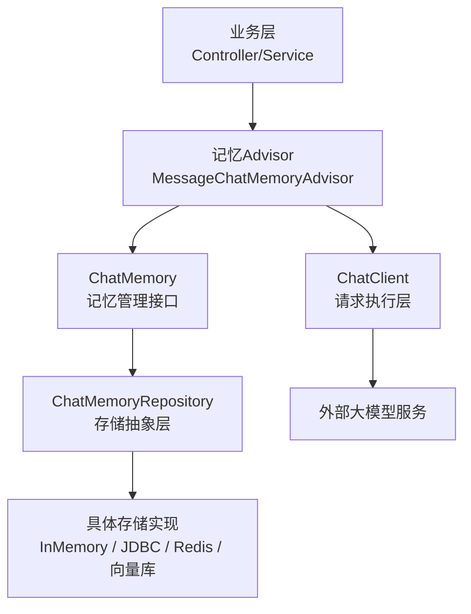
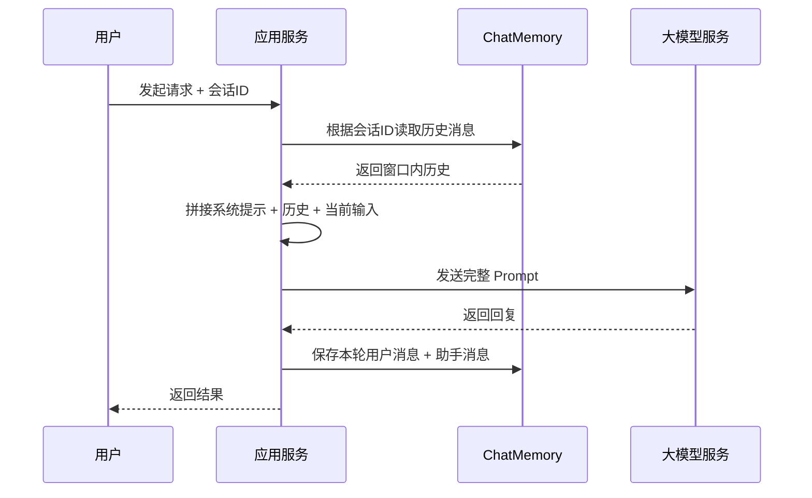
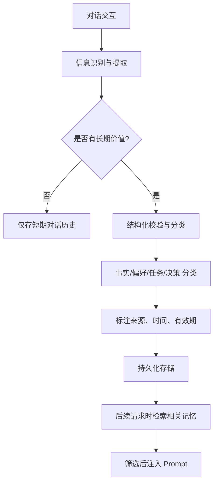

# AI 大模型与 Spring AI 知识笔记：对话记忆——短期记忆、长期记忆与记忆窗口

>
> 技术基线：JDK 21 LTS / Spring Boot 3.5.16 / Spring AI 1.1.8 / DeepSeek OpenAI 兼容接口
> 学习目标：掌握对话记忆的原理、架构、实现与工程设计，能够独立实现多会话记忆管理、窗口策略设计与故障排查
> 前置知识：Spring AI基础调用、ChatClient使用、大语言模型基本概念

---

## 一、大语言模型为什么需要对话记忆

### 1.1 大模型的无状态本质

大语言模型（LLM）的每次 API 请求都是**独立、无状态**的。模型本身不会在两次独立调用之间自动保存对话内容，所有上下文、历史、规则都必须通过本次请求的 Prompt 输入传递给模型。

>
> **核心认知**：模型的“记忆”本质上是**本次请求输入的上下文**，而非模型自身参数的持久化改变。对话记忆是**应用层的能力**，不是模型原生能力。

### 1.2 对话记忆解决的核心问题

- **指代消解**：用户说“它”“刚才那个设备”，模型能对应到前文对象
- **多轮任务延续**：分步确认的复杂任务，不需要每轮重复全部前提条件
- **信息复用**：已提供的背景信息不需要用户重复输入
- **体验一致性**：符合自然对话习惯，保持角色与语境的连续

### 1.3 对话记忆 vs 模型训练

| 维度         | 对话记忆               | 模型微调 / 训练        |
| ------------ | ---------------------- | ---------------------- |
| 作用层级     | 输入上下文层面         | 模型参数层面           |
| 是否改变模型 | 否，仅改变本次请求输入 | 是，修改模型权重       |
| 生效范围     | 当前会话 / 指定请求    | 永久影响模型能力       |
| 实现成本     | 低，仅增加 Token 消耗  | 高，需要标注数据与算力 |
| 适用场景     | 多轮对话、任务上下文   | 领域知识注入、风格对齐 |

>
> 关键结论：把聊天记录存到数据库 ≠ 训练模型；把历史加入 Prompt ≠ 模型学会了新知识。

---

## 二、核心概念与记忆层次

### 2.1 核心概念对比表

| 概念             | 定义                                       | 核心目的                     | 存储位置              | 是否进入当前Prompt          | 生命周期          |
| ---------------- | ------------------------------------------ | ---------------------------- | --------------------- | --------------------------- | ----------------- |
| **短期对话记忆** | 当前会话内的上下文信息，用于延续本次交互   | 支撑单轮多轮对话             | 内存 / 持久化存储     | 是，按需筛选后注入          | 会话级            |
| **长期对话记忆** | 跨会话复用的结构化信息，如偏好、事实、约定 | 跨会话复用高价值信息         | 持久化数据库 / 向量库 | 是，检索筛选后注入          | 用户级 / 长期     |
| **聊天历史**     | 完整的交互全记录，包含所有消息             | 审计、回放、追溯、合规       | 业务数据库 / 日志系统 | 不一定，仅筛选部分入 Prompt | 永久 / 按保留策略 |
| **上下文窗口**   | 模型单次请求能处理的最大 Token 容量        | 限制输入规模，保证模型可处理 | 模型服务层面          | -                           | 单次请求物理限制  |

### 2.2 扩展记忆分类（设计层面概念）

>
> 以下是系统设计层面的概念分类，并非 Spring AI 内置的固定实现类。

- **用户画像（User Profile）**：用户稳定特征、使用偏好、业务权限
- **事实记忆（Factual Memory）**：经确认的可复用业务事实与规则
- **情景记忆（Episodic Memory）**：具体交互事件、处理过程与结果记录
- **语义记忆（Semantic Memory）**：从历史信息中归纳的概念与关系

### 2.3 记忆窗口 vs 模型上下文窗口

| 维度   | 记忆窗口                         | 模型上下文窗口               |
| ------ | -------------------------------- | ---------------------------- |
| 性质   | 应用层策略，可自定义             | 模型物理能力边界，固定       |
| 单位   | 消息条数 / Token / 时间 / 相关性 | Token 数量                   |
| 作用   | 筛选进入Prompt的历史范围         | 限制单次请求最大输入输出总量 |
| 可调性 | 业务层可灵活调整                 | 由模型硬件与算法决定         |

>
> 核心边界：记忆窗口大小不能超过模型上下文窗口；超出上下文窗口的内容会被模型截断或报错。

---

## 三、Spring AI 对话记忆整体架构

### 3.1 分层架构图



#### 各层职责

1. **业务层**：发起请求，传入会话标识，不感知记忆实现细节
2. **记忆 Advisor**：自动从记忆中读取历史，注入到当前 Prompt
3. **ChatMemory**：记忆管理抽象，定义增删查能力与窗口策略
4. **ChatMemoryRepository**：存储抽象，隔离业务逻辑与具体存储介质
5. **存储实现**：负责数据持久化的具体技术实现

### 3.2 核心组件详解

#### 3.2.1 ChatMemory

对话记忆的核心抽象接口，定义会话消息的管理能力。

**核心方法**：

- `add(String conversationId, Message message)`：向指定会话添加消息
- `get(String conversationId)`：获取指定会话的消息列表
- `clear(String conversationId)`：清除指定会话的全部记忆

>
> 职责：管理会话消息集合，不负责具体存储实现，也不定义窗口淘汰策略。

#### 3.2.2 ChatMemoryRepository

存储抽象层，负责消息的持久化读写，隔离业务逻辑与具体存储介质。

**官方内置实现**：

| 实现类                          | 存储介质        | 特点                         |
| ------------------------------- | --------------- | ---------------------------- |
| `InMemoryChatMemoryRepository`  | 内存            | 默认实现，简单快速，重启丢失 |
| `JdbcChatMemoryRepository`      | 关系型数据库    | 持久化，支持主流数据库       |
| `CassandraChatMemoryRepository` | Cassandra       | 高可用，支持 TTL             |
| `MongoChatMemoryRepository`     | MongoDB         | 文档型存储，灵活             |
| `Neo4jChatMemoryRepository`     | Neo4j           | 图结构存储                   |
| `CosmosDBChatMemoryRepository`  | Azure Cosmos DB | 云原生存储                   |

>
> 核心价值：更换存储介质不影响上层业务逻辑，符合开闭原则。

#### 3.2.3 MessageWindowChatMemory

滑动窗口记忆的标准实现，也是生产最常用的短期记忆策略。

- **机制**：维持最多 `maxMessages` 条消息，超出时淘汰最早的非系统消息
- **默认窗口大小**：20 条消息
- **特殊规则**：系统消息（System Message）会被永久保留，不会被淘汰
- **适用场景**：绝大多数多轮对话场景，实现简单、性能稳定

《Chat Memory | Spring AI 对话记忆官方文档》：[https://docs.spring.io/spring-ai/reference/1.1/api/chat-memory.html](https://docs.spring.io/spring-ai/reference/1.1/api/chat-memory.html)

#### 3.2.4 记忆 Advisor

Spring AI 通过 Advisor 机制将记忆自动注入到 Prompt 中，业务代码无需手动拼接历史。

| Advisor 类型                   | 说明                            | 版本状态               |
| ------------------------------ | ------------------------------- | ---------------------- |
| `MessageChatMemoryAdvisor`     | 将历史作为结构化消息注入 Prompt | ✅ 推荐使用             |
| `PromptChatMemoryAdvisor`      | 将历史嵌入系统提示文本          | ❌ 1.1.3 起废弃，不推荐 |
| `VectorStoreChatMemoryAdvisor` | 从向量存储检索相关历史注入      | 适合长期语义记忆       |

>
> ⚠️ 强制要求：每次请求必须传入 `ChatMemory.CONVERSATION_ID` 参数，标识当前会话，否则抛出 `IllegalArgumentException`。

《Advisors API | Spring AI Advisor 接口官方文档》：[https://docs.spring.io/spring-ai/reference/1.1/api/advisors.html](https://docs.spring.io/spring-ai/reference/1.1/api/advisors.html)

---

## 四、记忆窗口的工作原理与策略

### 4.1 为什么需要限制记忆窗口

1. **Token 成本**：历史越长，输入 Token 越多，调用费用越高
2. **延迟增加**：输入越长，模型生成时间越长，接口越慢
3. **干扰风险**：无关历史会干扰当前任务，降低回答准确性
4. **信息过期**：过早的信息可能已失效，导致错误结论

>
> 反常识：不是历史越多越好，精准筛选的上下文，往往比全量历史效果更好、成本更低。

### 4.2 按消息数量的滑动窗口

- **实现**：`MessageWindowChatMemory`
- **机制**：按消息条数计数，超过 `maxMessages` 时淘汰最早的用户/助手消息
- **优点**：实现简单，性能好，可预测性强
- **缺点**：消息长短不一，条数固定不代表 Token 固定
- **计数规则**：一条用户消息 + 一条助手消息算 2 条，不是一轮对话算 1 条

#### 窗口淘汰示例（窗口设为 4 条）

1. 轮次1：用户A → 助手A → 共 2 条
2. 轮次2：用户B → 助手B → 共 4 条（窗口满）
3. 轮次3：用户C输入 → 淘汰最早的「用户A」，加入「用户C」
4. 模型回复助手C → 淘汰最早的「助手A」，加入「助手C」

### 4.3 基于 Token 的窗口策略

- **说明**：Spring AI 1.1.8 没有内置 Token 窗口实现，属于**应用层自定义策略**
- **原理**：按 Token 估算值限制历史总长度，更贴近模型上下文限制
- **适用**：对 Token 成本控制严格的生产场景
- **注意**：Token 估算存在误差，需要预留 10%~20% 安全余量，且必须为输出预留预算

### 4.4 基于时间的过期策略

- **原理**：给消息设置 TTL（生存时间），过期自动清除
- **实现依赖**：存储介质原生支持，如 Redis TTL、Cassandra TTL
- **适用**：临时会话、短时任务、敏感信息场景
- **注意**：数据库 TTL 删除的是存储数据，不代表当前 Prompt 里的历史同步过期，需要结合内存刷新策略

### 4.5 基于语义相关性的记忆检索

- **原理**：不用最近的，而用和当前问题**语义最相关**的历史信息
- **实现**：向量存储 + 相似度检索 + `VectorStoreChatMemoryAdvisor`
- **适用**：大量长期记忆、需要从历史中召回相关信息
- **缺点**：可能漏掉时序关键信息；相似度高不代表事实正确

### 4.6 记忆摘要与压缩

- **原理**：用模型将长历史总结成短摘要，保留核心信息
- **优点**：大幅减少 Token 占用
- **风险**：丢失细节、关键约束、时间顺序
- **原则**：摘要必须保留原始记录用于追溯；重要事实不适合只存摘要

---

## 五、短期记忆的完整工程流程

### 5.1 标准调用时序图



### 5.2 会话标识（Conversation ID）

- **作用**：唯一标识一个对话，隔离不同会话的记忆
- **生成**：后端生成并维护，或基于登录会话派生
- **安全红线**：必须校验用户与会话的归属关系，不能前端传什么 ID 就用什么，防止越权访问他人记忆
- **注意**：没有默认会话 ID，每次请求必须显式传入

### 5.3 关键设计要点

1. 会话 ID 必须和用户身份绑定校验
2. 新会话必须生成独立 ID，不能复用旧 ID
3. 模型调用失败时，是否保存本轮消息依业务策略定（通常用户消息保存，失败的助手消息不保存）
4. 重启后记忆是否恢复取决于存储介质：内存存储丢失，持久化存储可恢复

---

## 六、长期记忆的设计与实现原理

### 6.1 核心认知

>
> Spring AI 提供的 `ChatMemory` 是基础对话记忆接口，**不等于完整的长期用户记忆系统**。长期记忆需要结合业务逻辑、数据结构、检索策略、生命周期管理共同设计。

### 6.2 长期记忆的典型内容

- 用户明确确认的偏好与设置
- 稳定的业务事实（设备信息、客户等级、合同约定）
- 跨会话的未完成任务与待办事项
- 重要决策及其依据
- 有复用价值的历史处理方案

>
> 原则：不是所有对话都要存长期记忆，只保存**经确认、有价值、可复用**的信息。

### 6.3 长期记忆处理流程



### 6.4 长期记忆数据结构（设计示例）

| 字段          | 类型     | 说明                            |
| ------------- | -------- | ------------------------------- |
| `memory_id`   | String   | 记忆唯一标识                    |
| `user_id`     | String   | 所属用户，用于权限隔离          |
| `memory_type` | Enum     | 类型：偏好 / 事实 / 任务 / 决策 |
| `content`     | String   | 记忆内容                        |
| `source`      | String   | 来源会话 / 业务依据             |
| `created_at`  | DateTime | 创建时间                        |
| `updated_at`  | DateTime | 更新时间                        |
| `expires_at`  | DateTime | 过期时间（可选）                |
| `status`      | Enum     | 有效 / 待确认 / 已过期 / 已删除 |
| `version`     | Int      | 版本号，用于冲突处理            |

>
> 说明：以上为业务设计示例，非 Spring AI 内置数据结构。

### 6.5 冲突与更新管理

- **冲突处理**：新信息与旧信息冲突时，按时间新 > 来源优先级高 > 用户显式确认的优先级处理
- **过期管理**：定期清理过期记忆，避免失效信息干扰
- **权限控制**：用户只能管理自己的记忆
- **真实性原则**：模型生成的推测不能直接存为事实，必须经过业务校验

---

## 七、Spring AI 存储与记忆实现

### 7.1 In-Memory 内存存储

- **实现**：`InMemoryChatMemoryRepository`，Spring AI 默认
- **优点**：简单、高性能、无外部依赖
- **缺点**：应用重启丢失、多实例不共享、无法持久化
- **适用**：开发测试、临时会话、单实例部署

### 7.2 JDBC 关系型数据库存储

- **实现**：`JdbcChatMemoryRepository`
- **支持数据库**：PostgreSQL、MySQL、SQL Server、Oracle、HSQLDB
- **默认表名**：`SPRING_AI_CHAT_MEMORY`
- **优点**：持久化、事务性、可与业务数据同库
- **注意**：工具调用的中间消息在当前版本不存储；schema 初始化默认仅对嵌入式数据库执行，生产环境建议设为 `never`，自行管理表结构

《Chat Memory | Spring AI 对话记忆官方文档》：[https://docs.spring.io/spring-ai/reference/1.1/api/chat-memory.html](https://docs.spring.io/spring-ai/reference/1.1/api/chat-memory.html)

### 7.3 Redis 存储

- **说明**：Spring AI 1.1.8 无官方内置 Redis ChatMemoryRepository，可自定义实现 `ChatMemoryRepository` 接口
- **优点**：高性能、支持 TTL、适合分布式部署
- **适用**：临时会话、高并发短周期记忆

### 7.4 向量存储与语义记忆

- **组件**：`VectorStore` + `VectorStoreChatMemoryAdvisor`
- **作用**：从历史中检索语义相关的内容注入 Prompt
- **适用**：大量长期记忆、需要相关性检索的场景
- **注意**：向量检索是相似度匹配，不保证事实正确；适合召回相关信息，不适合精确事实查询

《Vector Store API | Spring AI 向量存储官方文档》：[https://docs.spring.io/spring-ai/reference/1.1/api/vectordbs.html](https://docs.spring.io/spring-ai/reference/1.1/api/vectordbs.html)

---

## 八、Spring AI Java 实战

### 8.1 基础短期记忆配置（Spring AI 1.1.8）

```
package com.example.ai.config;

import org.springframework.ai.chat.ChatClient;
import org.springframework.ai.chat.memory.ChatMemory;
import org.springframework.ai.chat.memory.MessageWindowChatMemory;
import org.springframework.ai.chat.memory.advisor.MessageChatMemoryAdvisor;
import org.springframework.ai.openai.OpenAiChatModel;
import org.springframework.context.annotation.Bean;
import org.springframework.context.annotation.Configuration;

/**
 * 对话记忆配置
 * 基于 Spring AI 1.1.8 官方 API
 */
@Configuration
public class ChatMemoryConfig {

    /**
     * 消息窗口记忆：最多保留 10 条消息
     * 系统消息会被永久保留
     */
    @Bean
    public ChatMemory chatMemory() {
        return MessageWindowChatMemory.builder()
                .maxMessages(10)
                .build();
    }

    /**
     * 配置带记忆能力的 ChatClient
     * 通过 MessageChatMemoryAdvisor 自动注入历史
     */
    @Bean
    public ChatClient chatClient(OpenAiChatModel chatModel, ChatMemory chatMemory) {
        return ChatClient.builder(chatModel)
                .defaultAdvisors(
                        MessageChatMemoryAdvisor.builder(chatMemory).build()
                )
                .build();
    }
}
```

### 8.2 多轮对话服务实现

```
package com.example.ai.service;

import org.springframework.ai.chat.ChatClient;
import org.springframework.ai.chat.memory.ChatMemory;
import org.springframework.stereotype.Service;

@Service
public class ChatService {

    private final ChatClient chatClient;
    private final ChatMemory chatMemory;

    public ChatService(ChatClient chatClient, ChatMemory chatMemory) {
        this.chatClient = chatClient;
        this.chatMemory = chatMemory;
    }

    /**
     * 带会话记忆的对话
     * @param conversationId 会话唯一标识
     * @param userMessage 用户输入
     */
    public String chat(String conversationId, String userMessage) {
        return chatClient.prompt()
                .user(userMessage)
                .advisors(a -> a.param(ChatMemory.CONVERSATION_ID, conversationId))
                .call()
                .content();
    }

    /**
     * 清除指定会话记忆
     */
    public void clearConversation(String conversationId) {
        chatMemory.clear(conversationId);
    }
}
```

>
> ⚠️ 注意：每次请求必须通过 `advisors()` 传入 `conversationId`，否则抛出运行时异常。

### 8.3 多用户会话隔离示例

```
package com.example.ai.controller;

import org.springframework.web.bind.annotation.*;
import java.security.Principal;

@RestController
@RequestMapping("/api/chat")
public class ChatController {

    private final ChatService chatService;

    public ChatController(ChatService chatService) {
        this.chatService = chatService;
    }

    @PostMapping
    public String chat(@RequestParam String conversationId,
                      @RequestBody String message,
                      Principal principal) {
        // 生产环境必须校验 conversationId 属于当前用户
        // 会话ID拼接用户ID，天然隔离不同用户的会话
        String safeConversationId = principal.getName() + ":" + conversationId;
        return chatService.chat(safeConversationId, message);
    }

    @DeleteMapping("/{conversationId}")
    public void clearConversation(@PathVariable String conversationId, Principal principal) {
        String safeConversationId = principal.getName() + ":" + conversationId;
        chatService.clearConversation(safeConversationId);
    }
}
```

>
> 安全警示：绝对不能直接使用前端传入的 conversationId 不做校验，会导致越权访问他人对话记忆。

---

## 九、Token 预算与上下文管理

### 9.1 上下文窗口资源分配示例

| 组成部分 | 占比参考 | 说明                     |
| -------- | -------- | ------------------------ |
| 系统提示 | 10%      | 角色定义、规则、输出约束 |
| 工具定义 | 15%      | 函数描述、参数说明       |
| 历史对话 | 40%      | 记忆窗口占用             |
| 当前输入 | 10%      | 用户当前问题             |
| 输出预留 | 25%      | 模型生成回答的预留空间   |

>
> 说明：以上为通用示例比例，需根据模型、业务场景具体调整。

### 9.2 核心原则

1. 永远不要占满整个上下文窗口，必须为输出预留空间
2. 记忆窗口的消息条数 ≠ Token 消耗量，长消息一条就可能占很多 Token
3. 重要规则放前面，模型注意力相对更高
4. 超限时优先保留系统规则、关键事实，淘汰最早的普通对话

---

## 十、安全、隐私与数据治理

### 10.1 会话隔离与权限

- 每个用户只能访问自己的会话记忆
- 会话 ID 必须结合用户身份校验，不能客户端传什么就用什么
- 管理操作（清除、导出）需要额外权限校验

### 10.2 数据安全

- 敏感信息（身份证、银行卡、密码）不要存入记忆
- 长期记忆必须做数据分级，敏感信息单独保护
- 定期清理过期数据，最小化隐私风险
- 日志脱敏，不要打印完整对话内容

### 10.3 记忆污染防护

- 不要把用户输入的指令直接存入长期记忆，防止 Prompt 注入
- 模型生成的内容必须标注来源，不能直接当事实存储
- 重要记忆更新需要人工确认或多源校验

### 10.4 并发与一致性

- 同一会话并发写入可能导致消息顺序错乱
- 重要场景加锁或采用原子操作
- 多实例部署时，共享存储才能会话同步

---

## 十一、常见故障与诊断

| 现象                   | 可能原因                                                     | 排查步骤                                                     | 解决方式                                       |
| ---------------------- | ------------------------------------------------------------ | ------------------------------------------------------------ | ---------------------------------------------- |
| 模型不记得上一轮对话   | 1. 未传入 conversationId   2. Advisor 未配置   3. 记忆中无历史 | 1. 检查是否传入 CONVERSATION_ID 参数   2. 检查 MessageChatMemoryAdvisor 配置   3. 确认记忆写入是否成功 | 正确传入会话ID；配置记忆 Advisor；确认历史写入 |
| 多用户记忆串线         | 1. 会话ID未绑定用户   2. 全局共用一个默认ID                  | 1. 检查会话ID是否包含用户标识   2. 检查是否配置了默认会话ID  | 会话ID拼接用户ID；禁止全局默认ID；增加权限校验 |
| 数据库有历史但模型不用 | 1. Advisor 未启用   2. 窗口太小被淘汰   3. 消息类型不支持    | 1. 检查记忆 Advisor 是否启用   2. 检查窗口大小   3. 确认消息格式 | 启用 Advisor；调大窗口；确认消息类型被存储     |
| 应用重启记忆丢失       | 使用 InMemory 内存存储                                       | 1. 检查 Repository 实现类型   2. 确认持久化配置              | 更换为 JDBC / Redis 等持久化存储               |
| 窗口20条还是超Token    | 1. 单条消息过长   2. 系统提示很长                            | 1. 估算 Token 总量   2. 检查单条消息长度                     | 改用 Token 窗口策略；精简系统提示              |
| 工具调用消息丢失       | 当前版本 Repository 不存储工具中间消息                       | 1. 查阅官方文档对应版本说明   2. 自定义扩展存储              | 接受当前限制；自定义实现存储逻辑               |
| 向量检索到无关记忆     | 1. 相似度阈值太低   2. 向量化效果差                          | 1. 调高相似度阈值   2. 优化 Embedding 模型                   | 调整阈值；优化向量化策略                       |

---

## 十二、综合对比与架构决策

### 12.1 核心概念对比表

| 对比对                             | 核心区别                                               |
| ---------------------------------- | ------------------------------------------------------ |
| 短期记忆 vs 长期记忆               | 会话级 vs 跨会话；上下文延续 vs 信息复用；临时 vs 持久 |
| 聊天历史 vs 聊天记忆               | 完整记录 vs 上下文筛选；审计目的 vs 生成目的           |
| 记忆窗口 vs 上下文窗口             | 应用策略 vs 模型能力；可配置 vs 物理限制               |
| ChatMemory vs ChatMemoryRepository | 记忆管理逻辑 vs 存储抽象；策略 vs 介质                 |
| 滑动窗口 vs 语义检索               | 时序优先 vs 相关性优先；最近信息 vs 相关信息           |
| 持久化存储 vs 模型可见             | 数据已保存 vs 已注入当前Prompt；存了 ≠ 模型用了        |

### 12.2 架构选型建议

| 场景                     | 推荐方案                                    | 注意事项               |
| ------------------------ | ------------------------------------------- | ---------------------- |
| 开发测试、临时对话       | InMemory + 10条消息窗口                     | 重启丢失，仅适合开发   |
| 普通多轮对话、生产环境   | JDBC持久化 + 10~20条消息窗口                | 最通用方案             |
| 高并发、短周期会话       | Redis + TTL策略                             | 性能好，自动过期       |
| 跨会话用户偏好、事实记忆 | 关系数据库 + 结构化存储 + 精确查询          | 适合结构化事实管理     |
| 大量历史语义检索         | 向量数据库 + VectorStoreChatMemoryAdvisor   | 适合非结构化长文本记忆 |
| 合规审计要求             | 完整聊天历史单独存储 + 记忆窗口筛选入Prompt | 历史全留，用多少选多少 |

---

## 十三、核心总结与自测

### 核心知识总结

1. 大模型本身无状态，所有记忆都是应用层通过 Prompt 输入实现的
2. Spring AI 通过 `ChatMemory + Repository + Advisor` 三层架构实现对话记忆
3. 记忆窗口不是越大越好，需要平衡成本、准确性、延迟
4. 存了历史 ≠ 模型会用，必须通过 Advisor 注入 Prompt 才有效
5. 会话 ID 是记忆隔离的关键，必须结合用户权限校验
6. 长期记忆需要业务设计，不是存起来就行，要筛选、校验、更新、淘汰
7. 向量存储适合语义检索，不适合精确事实管理

### 自测清单

- 能解释为什么大模型不会自动记住上一轮对话
- 能区分短期记忆、长期记忆、聊天历史、上下文窗口
- 能说出 ChatMemory、ChatMemoryRepository、MessageWindowChatMemory 的职责
- 能正确配置带记忆的 ChatClient 并传入会话 ID
- 能解释记忆窗口的作用和四种常见策略
- 能说明为什么数据库存了历史，模型不一定会用
- 能设计基础的长期记忆数据结构和处理流程
- 能排查记忆不生效、串线、丢失等常见问题
- 知道会话隔离和权限校验的重要性

---

## 参考文献

[1] Spring AI 官方文档. Chat Memory | Spring AI 对话记忆官方文档. [https://docs.spring.io/spring-ai/reference/1.1/api/chat-memory.html](https://docs.spring.io/spring-ai/reference/1.1/api/chat-memory.html)
[2] Spring AI 官方文档. Chat Client API | Spring AI 聊天客户端官方文档. [https://docs.spring.io/spring-ai/reference/1.1/api/chatclient.html](https://docs.spring.io/spring-ai/reference/1.1/api/chatclient.html)
[3] Spring AI 官方文档. Advisors API | Spring AI Advisor 接口官方文档. [https://docs.spring.io/spring-ai/reference/1.1/api/advisors.html](https://docs.spring.io/spring-ai/reference/1.1/api/advisors.html)
[4] Spring AI 官方文档. Vector Store API | Spring AI 向量存储官方文档. [https://docs.spring.io/spring-ai/reference/1.1/api/vectordbs.html](https://docs.spring.io/spring-ai/reference/1.1/api/vectordbs.html)
[5] Spring AI 官方发布. Releases | Spring AI 版本发布记录. [https://github.com/spring-projects/spring-ai/releases](https://github.com/spring-projects/spring-ai/releases)