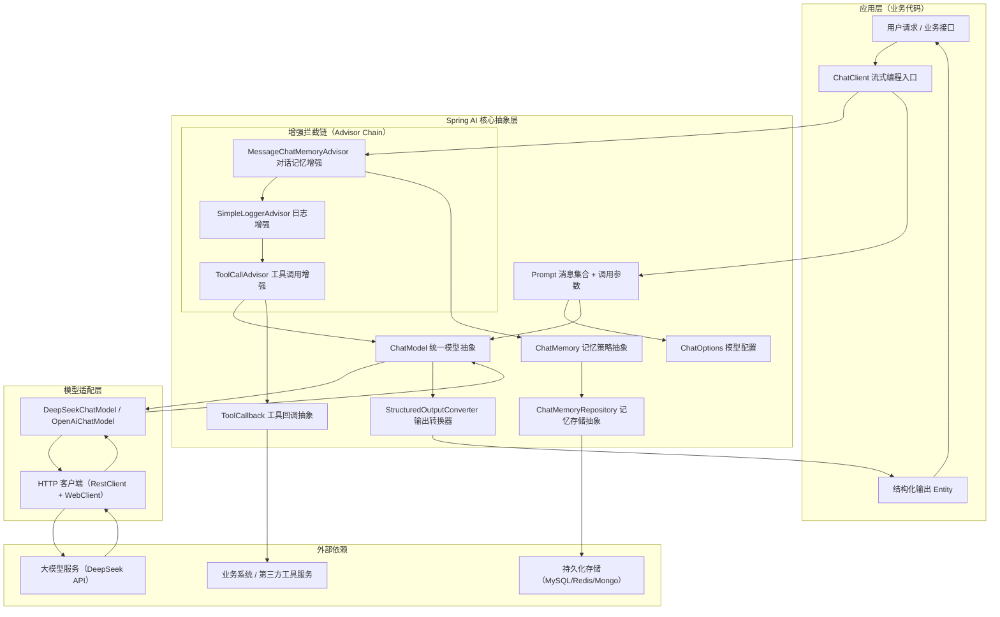

# Spring AI 知识笔记：阶段性知识点复盘

## 文档元信息

- 技术基线：JDK 21 LTS / Spring Boot 3.5.16 / Spring AI 1.1.8 / Maven 3.9.16
- 适配模型：DeepSeek OpenAI 兼容 API
- 复盘目标：贯通模型调用、Prompt工程、对话记忆、结构化输出、工具调用五大核心模块，厘清组件边界与协作链路，形成可落地的工程化知识体系，通过自测定位薄弱点
- 文档规范：Typora 0.11.18 兼容，所有 API 与配置严格对齐 Spring AI 1.1.x 官方规范

---

## 二、知识地图与整体架构

### 2.1 核心调用链路架构图



### 2.2 架构分层说明

Spring AI 本质是 Spring 生态下的**AI应用开发抽象层**，核心价值是屏蔽不同大模型厂商的API差异，提供与 Spring 编程模型一致的自动配置、依赖注入、扩展机制。整体自顶向下分为三层：

1. **业务接入层**：以 `ChatClient` 为核心的 Fluent API，是业务代码的主要交互入口，内置模板解析、响应转换、增强链编排能力。
2. **核心抽象层**：定义 `ChatModel`、`ChatMemory`、`ToolCallback` 等标准接口，通过 Advisor 责任链机制提供扩展点，实现记忆、日志、工具调用、RAG 等增强能力。
3. **模型适配层**：针对不同厂商的模型提供具体实现，将原生 API 适配为 Spring AI 标准接口，兼容 OpenAI 协议、Anthropic、Ollama 等多种服务。

---

## 三、核心知识模块复盘

### 3.1 核心组件职责与协作

| 组件                          | 核心职责                                                     | 输入                             | 输出                           |
| ----------------------------- | ------------------------------------------------------------ | -------------------------------- | ------------------------------ |
| **ChatClient**                | 面向业务的高层Fluent API，封装Prompt构建、Advisor编排、响应解析 | 用户文本、模板参数、工具配置     | 字符串、Java实体、完整响应对象 |
| **ChatModel**                 | 大模型底层统一抽象，屏蔽厂商API差异，负责原生模型调用        | Prompt 实例                      | ChatResponse 响应              |
| **Prompt**                    | 一次模型调用的完整输入载体                                   | 消息集合 + ChatOptions 配置      | 传入 ChatModel 执行调用        |
| **Message**                   | 单条对话消息，区分 System/User/Assistant/Tool 等角色         | 文本内容 + 元数据                | 组成 Prompt 的消息列表         |
| **ChatOptions**               | 模型调用参数配置，支持全局默认与单次覆盖                     | temperature、maxTokens、模型名等 | 控制模型生成行为               |
| **ChatResponse**              | 模型完整响应，包含生成结果、Token用量、元数据                | 模型服务返回报文                 | 业务侧可提取内容与用量         |
| **Generation**                | 单条生成结果，一条ChatResponse可包含多条                     | 单条输出消息 + 生成元信息        | 组成 ChatResponse 的结果集     |
| **Advisor**                   | 请求拦截增强器，基于责任链模式，在调用前后加工请求/响应      | AdvisedRequest                   | 增强后的请求/响应              |
| **ChatMemory**                | 对话记忆策略抽象，定义消息保留与淘汰规则                     | conversationId + 新消息          | 筛选后的历史消息列表           |
| **ChatMemoryRepository**      | 记忆存储抽象，负责消息持久化与读取                           | conversationId + 消息内容        | 持久化的全量消息               |
| **MessageWindowChatMemory**   | 基于消息数量的滑动窗口记忆实现，默认保留20条                 | 消息列表 + 窗口阈值              | 窗口内有效消息                 |
| **StructuredOutputConverter** | 结构化输出转换器，注入格式指令并解析文本为Java对象           | 模型返回文本                     | 指定类型的Java对象             |
| **BeanOutputConverter**       | 基于Java类/Record的JSON转换器，自动生成JSON Schema           | 目标类Class                      | 反序列化后的Java实体           |
| **@Tool**                     | 注解式工具定义，将Java方法声明为模型可调用工具               | 方法 + 描述 + 参数注解           | ToolCallback 实例              |
| **ToolCallback**              | 工具回调统一抽象，封装工具定义与执行逻辑                     | 工具调用参数JSON                 | 工具执行结果文本               |

### 3.2 模型 API 与生成参数

#### 3.2.1 核心调用方式

**同步调用**：阻塞等待完整响应，适合后端内部调用、简单接口场景

```
// 1. 最简字符串返回
String content = chatClient.prompt()
    .user("用户问题")
    .call()
    .content();

// 2. 获取完整响应（含Token用量、元数据）
ChatResponse response = chatClient.prompt()
    .user("用户问题")
    .call()
    .chatResponse();
```

**流式调用**：非阻塞逐块返回，适合对话前端、长文本生成，基于 Reactive Flux 实现

```
// 1. 流式返回字符串
Flux<String> stream = chatClient.prompt()
    .user("长文本生成")
    .stream()
    .content();

// 2. 流式返回完整响应对象
Flux<ChatResponse> responseStream = chatClient.prompt()
    .user("长文本生成")
    .stream()
    .chatResponse();
```

#### 3.2.2 核心生成参数

- **temperature**：控制输出随机性，取值0~~2；值越高创造性越强、幻觉风险越高，事实类任务建议0.1~~0.3
- **top_p**：核采样参数，与temperature二选一调节随机性，通常不同时修改
- **maxTokens**：单次输出的最大Token数，必须小于模型上下文窗口减去输入Token的余量
- **上下文窗口**：模型单次请求可处理的总Token上限（输入+输出），由模型本身决定

#### 3.2.3 关键概念辨析

1. **Token ≠ 字符**：Token是模型的语义处理单位，中文约1.5~2个汉字对应1个Token，英文约4个字符对应1个Token；计费、上下文限制均以Token为单位，不能用字符数直接估算。
2. **最大输出Token ≠ 上下文窗口**：上下文窗口是总Token上限，输出上限是回复长度上限，输出必须小于窗口减去输入的余量。
3. **流式API ≠ HTTP SSE**：stream()是编程模型抽象，底层默认基于SSE实现，但二者不是等价关系；前端消费流式响应需使用EventSource。
4. **收到部分文本 ≠ 请求成功**：流式输出中途可能因超时、限流、审核被截断，只有收到完整结束标识才算调用成功。

### 3.3 Prompt 工程基础与进阶

#### 3.3.1 标准Prompt结构

生产级Prompt建议包含7个要素：

1. **角色设定**：明确AI的身份与专业领域
2. **背景上下文**：提供任务相关的背景信息、已知事实
3. **任务目标**：清晰说明需要完成的具体任务
4. **执行步骤**：拆解任务的执行流程与思考要求
5. **约束规则**：明确禁止项、边界条件、安全要求
6. **输出格式**：指定输出的结构、格式、字段要求
7. **验收标准**：说明评判输出质量的标准

#### 3.3.2 Prompt Template

Spring AI 默认基于 StringTemplate 引擎实现模板，使用 `{变量名}` 作为占位符，运行时动态替换参数：

```
String answer = chatClient.prompt()
    .user(u -> u.text("分析设备{deviceCode}的故障：{faultDesc}")
            .param("deviceCode", "EQ-001")
            .param("faultDesc", "主轴异响"))
    .call()
    .content();
```

#### 3.3.3 进阶能力

- **Zero-shot / One-shot / Few-shot**：
  - Zero-shot：不给示例，直接让模型输出，适合简单通用任务
  - One-shot：给1个示例，引导模型理解格式与规则
  - Few-shot：给3~5个示例，提升输出一致性，适合格式要求严格的场景
  - 注意：示例并非越多越好，过多会增加Token成本，还可能导致过拟合、泛化能力下降
- **CoT 思维链**：引导模型输出推理过程，分步得出结论，适合复杂逻辑、数学计算类任务；但推理文本越长不代表结论越正确，错误的推理链会放大幻觉。
- **幻觉治理**：
  - 幻觉类型：事实性幻觉（编造信息）、逻辑幻觉（推理错误）、格式幻觉（输出不符合要求）
  - 治理手段：降低temperature、增加事实证据约束（RAG/工具调用）、程序侧业务校验、人工复核
  - 核心认知：Prompt只能降低幻觉概率，无法完全消除，事实类结论必须有可核验的证据支撑

### 3.4 对话记忆与上下文管理

#### 3.4.1 记忆分层架构

1. **短期对话记忆**：当前会话内的上下文，用于维持对话连贯性，通常采用滑动窗口策略
2. **长期记忆**：跨会话的用户画像、历史知识，通常采用向量检索、摘要压缩等方式提取
3. **全量聊天历史**：完整的会话记录，用于审计、归档、回溯，不直接注入当前Prompt

#### 3.4.2 Spring AI 记忆体系

采用**策略与存储分离**的双层抽象：

- **ChatMemory（策略层）**：决定哪些消息保留、哪些淘汰，核心实现为 `MessageWindowChatMemory`
  - 默认保留20条消息，超出时淘汰最早的用户/助手消息
  - 系统消息不会被淘汰，新的系统消息会覆盖旧系统消息
  - 可自定义maxMessages调整窗口大小
- **ChatMemoryRepository（存储层）**：负责消息的持久化与读取
  - 默认实现：`InMemoryChatMemoryRepository`，基于ConcurrentHashMap，适合开发测试
  - 生产级实现：JDBC、Redis、Cassandra、MongoDB、Neo4j 等

#### 3.4.3 记忆接入方式

推荐使用 `MessageChatMemoryAdvisor` 通过 Advisor 链注入，1.1.3 版本后替代废弃的 `PromptChatMemoryAdvisor`，以原生Message对象注入，降低Prompt注入风险。

```
// 每次调用必须传入 conversationId，否则抛出 IllegalArgumentException
chatClient.prompt()
    .user("用户问题")
    .advisors(a -> a.param(ChatMemory.CONVERSATION_ID, "会话唯一ID"))
    .call()
    .content();
```

#### 3.4.4 关键认知

1. **持久化 ≠ 被使用**：存储的全量历史不会全部注入当前Prompt，只有记忆策略筛选后的子集才会参与模型计算。
2. **记忆窗口 ≠ 上下文窗口**：记忆窗口以消息条数为单位，上下文窗口以Token为单位；记忆注入的总Token必须小于模型上下文窗口。
3. **短期/长期记忆不是框架固定实现**：二者是架构概念，Spring AI 仅提供基础抽象，具体策略由业务自定义实现。
4. **安全风险**：必须保证conversationId与用户绑定，防止越权访问他人对话；敏感信息存入记忆前必须脱敏。

### 3.5 输出解析与工具调用

#### 3.5.1 结构化输出三层方案

| 方案                | 实现方式                                         | 稳定性 | 适用场景                             |
| ------------------- | ------------------------------------------------ | ------ | ------------------------------------ |
| Prompt引导式        | 手动在Prompt中加格式要求，自行用Jackson解析      | 低     | 简单场景、模型不支持原生结构化输出   |
| BeanOutputConverter | 自动生成JSON Schema指令，ChatClient.entity()封装 | 中     | 大多数生产场景，兼容所有模型         |
| 原生结构化输出      | 模型原生支持JSON Schema约束，通过Advisor开启     | 高     | 支持该特性的模型，格式要求极高的场景 |

核心用法：

```
// 1. 直接映射为Record
UserDTO user = chatClient.prompt()
    .user("生成一个用户信息")
    .call()
    .entity(UserDTO.class);

// 2. 泛型集合映射
List<UserDTO> users = chatClient.prompt()
    .user("生成5个用户信息")
    .call()
    .entity(new ParameterizedTypeReference<List<UserDTO>>() {});

// 3. 开启原生结构化输出（模型支持时）
chatClient.prompt()
    .advisors(AdvisorParams.ENABLE_NATIVE_STRUCTURED_OUTPUT)
    .user("生成用户信息")
    .call()
    .entity(UserDTO.class);
```

#### 3.5.2 Tool Calling 工具调用

**核心原理**：模型根据工具定义自主判断是否调用工具，应用侧负责执行工具并回传结果，模型再基于结果生成最终回复。工具始终在应用侧执行，模型无法直接访问业务系统。

**三种定义方式**：

1. **@Tool 注解（推荐）**：声明式定义，自动生成参数Schema

```
@Tool(description = "根据设备编号查询设备基础档案")
public String getDeviceProfile(@ToolParam(description = "设备编号") String deviceCode) {
    // 业务查询逻辑
}
```

2. **FunctionToolCallback**：函数式定义，适配Function接口
3. **@Bean 动态注册**：将Spring容器中的Function Bean注册为工具，通过toolNames()动态解析

**完整执行流程**：

1. 应用将工具定义（名称、描述、参数Schema）随Prompt发送给模型
2. 模型判断是否需要调用工具，返回工具调用指令（工具名+参数）
3. Spring AI 的 ToolCallingManager 解析指令，匹配对应 ToolCallback 并执行
4. 工具执行结果序列化为文本，作为工具响应消息回传给模型
5. 模型基于工具结果生成最终自然语言回复

**工程安全约束**：

- 参数校验：框架自动校验必填项，业务侧必须补充业务规则校验
- 权限校验：工具执行前必须校验用户权限，模型调用指令不能作为权限依据
- 幂等性：有副作用的工具必须实现幂等，防止重复调用
- 异常处理：默认运行时异常转为错误信息回传模型，可配置是否直接抛出

#### 3.5.3 关键认知

1. **合法JSON ≠ 业务正确**：格式校验仅验证语法，字段内容的真实性、合法性必须做业务校验。
2. **模型请求调用 ≠ 工具已执行**：工具执行完全由应用侧控制，模型仅发出调用请求。
3. **JSON输出 ≠ Tool Calling**：JSON输出是结构化返回数据，Tool Calling是交互协议，用于触发外部操作。

### 3.6 工程化边界与后续衔接

本阶段知识是 Spring AI 应用的基础底座，后续进阶方向的衔接关系：

- **RAG 检索增强生成**：基于 Advisor 机制扩展，在Prompt中注入检索到的知识库文档，本质是特殊的上下文增强
- **MCP 协议**：工具调用的标准化协议，实现工具的跨服务复用，对应 ToolCallback 的服务化封装
- **Agent Workflow**：基于工具调用、记忆、规划能力的多轮自主执行，本质是工具调用的多轮循环与任务拆解
- **生产级工程化**：监控观测、限流降级、安全防护、容器化部署，是本阶段工程能力的深化

---

## 四、易混淆概念对比总表

| 对比维度   | 概念A           | 概念B                 | 核心区别                                                     |
| ---------- | --------------- | --------------------- | ------------------------------------------------------------ |
| 编程入口   | ChatClient      | ChatModel             | ChatClient是面向业务的Fluent高层封装，内置Advisor链、模板解析、响应转换；ChatModel是底层模型抽象，仅负责原生模型调用。业务开发优先使用ChatClient。 |
| 调用模式   | 同步调用 call() | 流式调用 stream()     | 同步阻塞等待完整响应，适合后端内部调用；流式非阻塞逐块返回，适合前端对话场景，基于Reactive Flux编程模型。 |
| 计费单位   | Token           | 字符                  | Token是模型的语义处理单位，中英文转换比例不同，计费、上下文限制均按Token计算；字符是文本长度单位，二者不能划等号。 |
| 上下文上限 | 模型上下文窗口  | 记忆窗口大小          | 上下文窗口是模型层面的总Token上限（输入+输出）；记忆窗口是应用侧保留的历史消息数量，最终注入Token总量不能超过模型上下文窗口。 |
| 对话数据   | 聊天历史        | 对话记忆              | 聊天历史是全量会话记录，用于归档审计；对话记忆是筛选后注入Prompt的上下文，是聊天历史的子集，用于维持对话连贯性。 |
| 效果优化   | Few-shot 示例   | 模型微调              | Few-shot是在Prompt中给少量示例，无需训练即时生效，适合规则对齐；微调是重新训练模型参数，成本高周期长，适合深度知识/风格对齐。 |
| 推理实现   | CoT 思维链      | 程序化分步执行        | CoT是引导模型自主输出推理过程，黑盒不可控；程序化分步是应用代码拆分步骤依次调用模型，白盒可控，适合流程固定的任务。 |
| 事实依据   | 模型生成的解释  | 可核验的证据          | 模型生成的推理解释可能是幻觉，不能作为事实依据；可核验证据来自检索、工具调用、业务系统，是判断结论正确性的标准。 |
| 输出校验   | JSON 语法解析   | 业务数据校验          | JSON解析仅验证格式合法、字段类型正确；业务校验验证字段值域、逻辑一致性、权限匹配，格式正确不代表数据有效。 |
| 结构化能力 | JSON 输出       | Tool Calling 工具调用 | JSON输出是返回指定格式的文本数据，用于结果结构化；Tool Calling是触发应用侧方法执行，用于获取外部信息或执行操作，本质是交互协议。 |

---

## 五、综合案例：制造业设备故障工单分析

### 5.1 场景说明

某制造企业设备运维智能助手，用户提交设备编号与故障现象，助手结合设备档案、历史工单生成结构化初步分析报告，严格区分已知事实与推测结论。

>
> 本案例为技术演示，所有数据均为虚构，不构成真实设备诊断依据。

### 5.2 核心代码实现

#### 1. 结构化输出定义

```
/**
 * 故障分析结构化结果
 */
public record FaultAnalysisResult(
        String deviceName,
        String deviceModel,
        List<String> confirmedFacts,    // 确认事实
        List<String> possibleCauses,   // 推测原因
        List<String> suggestedChecks,  // 建议排查项
        Integer riskLevel              // 风险等级 1~5
) {}
```

#### 2. 工具类定义

```
@Component
public class DeviceInfoTools {

    @Tool(description = "根据设备编号查询设备基础档案，包含名称、型号、所属车间、投产日期")
    public String getDeviceProfile(@ToolParam(description = "设备编号") String deviceCode) {
        // 生产环境对接真实设备管理系统，此处模拟返回
        if ("EQ-2024-001".equals(deviceCode)) {
            return """
                    {
                        "deviceCode": "EQ-2024-001",
                        "deviceName": "数控车床A01",
                        "model": "CK6150",
                        "workshop": "机加工一车间",
                        "produceDate": "2024-03-15"
                    }
                    """;
        }
        return "未找到对应设备档案";
    }

    @Tool(description = "查询指定设备近3个月的历史故障工单记录")
    public String getDeviceHistoryOrders(@ToolParam(description = "设备编号") String deviceCode) {
        if ("EQ-2024-001".equals(deviceCode)) {
            return """
                    [
                        {"orderId": "WO-2408001", "faultType": "主轴异响", "fixMethod": "更换主轴轴承", "date": "2024-08-12"},
                        {"orderId": "WO-2409003", "faultType": "温度过高报警", "fixMethod": "清理冷却系统", "date": "2024-09-25"}
                    ]
                    """;
        }
        return "无历史工单记录";
    }
}
```

#### 3. ChatClient 配置

```
@Configuration
public class ChatClientConfig {

    @Bean
    public ChatMemory chatMemory() {
        // 10条消息窗口记忆，生产环境替换为Redis/JDBC存储
        return MessageWindowChatMemory.builder()
                .maxMessages(10)
                .chatMemoryRepository(new InMemoryChatMemoryRepository())
                .build();
    }

    @Bean
    public ChatClient faultAnalysisChatClient(
            ChatClient.Builder chatClientBuilder,
            ChatMemory chatMemory,
            DeviceInfoTools deviceInfoTools
    ) {
        return chatClientBuilder
                .defaultSystem("""
                        你是专业设备运维工程师，负责故障初步分析。
                        严格遵守规则：
                        1. 确认事实只能来自用户输入或工具查询结果，禁止编造数据
                        2. 所有可能原因必须标注为推测，不得作为事实陈述
                        3. 必须调用工具查询设备档案与历史工单后再分析
                        4. 仅输出纯JSON，不得添加解释文本、Markdown标记
                        """)
                .defaultAdvisors(MessageChatMemoryAdvisor.builder(chatMemory).build())
                .defaultTools(deviceInfoTools)
                .build();
    }
}
```

#### 4. 业务调用接口

```
@RestController
@RequestMapping("/api/fault")
public class FaultAnalysisController {

    private final ChatClient faultAnalysisChatClient;

    public FaultAnalysisController(ChatClient faultAnalysisChatClient) {
        this.faultAnalysisChatClient = faultAnalysisChatClient;
    }

    @PostMapping("/analyze")
    public FaultAnalysisResult analyze(
            @RequestParam String conversationId,
            @RequestParam String deviceCode,
            @RequestParam String faultDesc
    ) {
        String userPrompt = """
                设备编号：%s
                故障现象：%s
                请生成故障分析报告。
                """.formatted(deviceCode, faultDesc);

        return faultAnalysisChatClient.prompt()
                .user(userPrompt)
                .advisors(a -> a.param(ChatMemory.CONVERSATION_ID, conversationId))
                .call()
                .entity(FaultAnalysisResult.class);
    }
}
```

### 5.3 调用示例与边界说明

**输入**：conversationId=conv-001，deviceCode=EQ-2024-001，faultDesc=主轴运行时有异响，外壳温度偏高，缺少振动测量数据

**输出示例**：

```
{
    "deviceName": "数控车床A01",
    "deviceModel": "CK6150",
    "confirmedFacts": [
        "设备编号EQ-2024-001，型号CK6150，位于机加工一车间",
        "故障现象为主轴异响、外壳温度偏高",
        "2024年8月曾出现主轴异响故障，更换主轴轴承修复",
        "2024年9月曾出现温度过高报警，清理冷却系统修复",
        "当前缺少振动测量数据"
    ],
    "possibleCauses": [
        "推测主轴轴承再次出现磨损",
        "推测冷却系统堵塞导致散热不良，加剧异响",
        "推测主轴动平衡失衡"
    ],
    "suggestedChecks": [
        "测量主轴振动值，判断轴承磨损程度",
        "检查冷却系统流量与散热片清洁度",
        "检测主轴动平衡精度"
    ],
    "riskLevel": 2
}
```

**事实与推测边界**：

- 确认事实：全部来自用户输入与工具返回结果，无模型编造内容
- 可能原因：均为模型基于运维知识的推测，不代表实际故障原因，必须现场核验
- 本案例仅演示技术实现，不具备真实诊断效力

---

## 六、常见故障与诊断

统一采用「现象—可能原因—核查证据—解决方向」结构：

### 6.1 ChatClient.Builder 注入失败

- **现象**：启动时报 `NoSuchBeanDefinitionException`，提示 ChatClient.Builder 不存在
- **可能原因**：① 未引入对应模型的 Starter 依赖；② Spring AI 版本与 Spring Boot 版本不兼容；③ 手动配置了 `spring.ai.chat.client.enabled=false`
- **核查证据**：① `mvn dependency:tree` 查看是否包含对应模型 Starter；② 核对版本兼容矩阵（1.1.8 适配 Spring Boot 3.5.x）；③ 检查配置文件是否禁用自动配置
- **解决方向**：① 补充模型 Starter 依赖；② 对齐版本基线；③ 多模型场景下手动通过 `ChatClient.create()` 构建实例

### 6.2 模型调用401认证失败

- **现象**：调用时报 401 Unauthorized 或 Invalid API Key
- **可能原因**：① API Key 配置错误或环境变量未生效；② base-url 配置错误指向错误地址；③ API Key 过期或无对应模型权限
- **核查证据**：① 打印配置项确认密钥与地址加载正确；② 用 curl 直接调用模型接口验证密钥有效性
- **解决方向**：① 修正配置，使用环境变量管理敏感信息；② 更换有效密钥并开通对应模型权限

### 6.3 流式输出中途中断

- **现象**：前端 EventSource 接收过程中连接断开，文本不完整
- **可能原因**：① 网关/反向代理超时时间小于生成时长；② 模型服务限流或超时主动断连；③ 网络波动或客户端主动取消；④ 内容审核触发截断
- **核查证据**：① 查看网关访问日志的响应时长与状态码；② 查看应用日志的 WebClient 异常；③ 检查模型服务限流、审核记录
- **解决方向**：① 调大网关与HTTP客户端超时时间；② 实现异常重连与断点续传；③ 增加错误事件监听，向前端返回明确中断原因

### 6.4 Prompt 效果不稳定、频繁幻觉

- **现象**：相同 Prompt 多次调用结果差异大，经常出现编造事实
- **可能原因**：① temperature 设置过高，随机性太强；② Prompt 缺少明确的事实约束；③ 上下文信息不足，模型自行补全；④ 任务超出模型能力边界
- **核查证据**：① 查看 ChatOptions 中的 temperature 值；② 打印完整 Prompt 检查约束规则；③ 统计幻觉出现的场景
- **解决方向**：① 降低 temperature 至 0.1~0.3；② 优化 Prompt，明确“仅基于提供的上下文回答，禁止编造”；③ 引入工具调用或检索提供事实依据；④ 拆分复杂任务分步校验

### 6.5 对话记忆串线

- **现象**：不同用户/会话的上下文互相混淆
- **可能原因**：① 未传入 conversationId 或多个会话共用同一ID；② 记忆存储未按会话隔离；③ 并发更新存在竞态条件
- **核查证据**：① 排查业务代码是否每次传入唯一会话ID；② 检查 Repository 实现是否支持多会话隔离；③ 压测验证并发场景是否出现数据覆盖
- **解决方向**：① 强制传入用户维度唯一会话ID，建立绑定校验；② 使用支持多会话的持久化 Repository；③ 记忆更新采用原子操作，避免竞态

### 6.6 结构化输出解析失败

- **现象**：调用 entity() 抛出 `JsonParseException`，或字段值为 null
- **可能原因**：① 模型输出包含额外解释、Markdown 代码块；② Java 类字段与 JSON 不匹配；③ maxTokens 过小导致输出截断；④ 纯 Prompt 引导稳定性不足
- **核查证据**：① 打印模型原始返回文本检查格式；② 核对 Java 类字段名、类型；③ 检查 maxTokens 配置
- **解决方向**：① 模型支持时开启原生结构化输出；② 优化 Prompt，要求仅输出纯 JSON；③ 增加格式容错，提取代码块内 JSON；④ 调大 maxTokens

### 6.7 工具调用越权风险

- **现象**：模型调用了无权限的工具，或执行超出用户权限的操作
- **可能原因**：① 工具全局注册，所有请求都能访问全部工具；② 工具执行侧未做权限校验；③ 工具描述不准确导致误调用
- **核查证据**：① 检查 ChatClient 的 defaultTools 是否包含敏感工具；② 查看工具方法内部是否有权限校验；③ 核对工具描述与实际功能是否匹配
- **解决方向**：① 按场景拆分 ChatClient，仅注册对应工具；② 工具执行前强制校验用户权限；③ 优化工具描述明确适用边界；④ 有副作用的工具增加二次确认

### 6.8 Token 成本异常

- **现象**：单日 Token 用量暴增，成本超出预算
- **可能原因**：① 记忆窗口过大，每次请求携带大量历史消息；② Prompt 冗余信息过多；③ 工具调用多轮迭代携带全量上下文；④ 日志打印完整报文泄露敏感信息
- **核查证据**：① 统计单次请求的输入输出 Token 数；② 评估记忆窗口的 Token 占比；③ 检查日志级别与打印内容
- **解决方向**：① 缩小记忆窗口，采用摘要式压缩历史；② 精简 Prompt 移除冗余指令；③ 配置用量监控与告警；④ 生产环境关闭报文级日志，敏感信息脱敏

---

## 七、分层自测题

>
> 建议先独立作答，再核对参考答案

### 7.1 基础概念题（每题5分，共30分）

1. Spring AI 中 ChatClient 和 ChatModel 的核心职责分别是什么？
2. MessageWindowChatMemory 默认保留多少条消息？系统消息会被淘汰吗？
3. 调用带记忆的 ChatClient 时，必须传入哪个参数？不传会抛出什么异常？
4. BeanOutputConverter 的核心作用是什么？
5. 使用 @Tool 注解定义工具时，description 属性的作用是什么？
6. 大模型的上下文窗口指的是什么？和最大输出 Token 是什么关系？

### 7.2 原理解释题（每题10分，共20分）

1. 简述 Spring AI 中 Advisor 机制的工作原理，以及它在对话记忆、工具调用中的作用。
2. 简述 Tool Calling 的完整执行流程，说明应用侧和模型侧各自负责什么。

### 7.3 API 代码阅读题（10分）

阅读以下代码，指出至少3处错误或不符合生产规范的地方，并说明原因。

```
@RestController
public class ChatController {

    private final ChatClient chatClient;

    public ChatController(ChatClient.Builder builder) {
        this.chatClient = builder
                .defaultSystem("你是一个助手")
                .build();
    }

    @GetMapping("/chat")
    public String chat(String userInput) {
        return chatClient.prompt()
                .user(userInput)
                .advisors(a -> a.param(ChatMemory.CONVERSATION_ID, "fixed-id"))
                .call()
                .content();
    }
}
```

### 7.4 易混淆概念辨析题（每题5分，共20分）

1. 为什么说“Token 不等于字符”？请举例说明。
2. 对话记忆持久化了，就代表每次请求都会用到所有历史消息吗？为什么？
3. Few-shot 示例越多，模型输出效果越好吗？为什么？
4. 模型返回了合法的 JSON，就代表输出内容是正确的吗？为什么？

### 7.5 故障诊断题（10分）

现象：调用流式接口时前端能收到部分文本，但中途突然断开，没有收到结束标识。请列出至少3种可能的原因，并说明对应的排查方法。

### 7.6 综合设计题（10分）

请设计一个客户服务智能问答接口的技术方案，要求：

1. 支持多轮对话，用户隔离
2. 可以查询客户的订单信息（只读）
3. 输出结构化的问答结果，包含问题分类、答案、相关订单号
4. 尽可能降低幻觉风险
请说明核心组件选型、关键配置、安全控制措施。

---

## 八、参考答案与评分标准

### 8.1 基础概念题参考答案

1. **ChatClient**：面向业务开发的Fluent API高层封装，负责Prompt构建、Advisor链编排、响应解析，是业务代码的主要交互入口；**ChatModel**：大模型的底层统一抽象，定义call/stream等核心方法，屏蔽不同厂商API差异，负责与模型服务的原生交互。
评分：答对两个职责得5分，漏一个扣2.5分。
2. 默认保留20条消息；系统消息不会被淘汰，新的系统消息会覆盖旧的系统消息。
评分：答对数量得2分，答对系统消息特性得3分。
3. 必须传入 `ChatMemory.CONVERSATION_ID`（会话ID）；不传会抛出 `IllegalArgumentException`。
评分：答对参数名得3分，答对异常得2分。
4. 自动生成Java类对应的JSON Schema格式指令注入Prompt，并将模型返回的JSON文本反序列化为指定的Java对象/Record。
评分：答对格式注入得2分，答对反序列化得3分。
5. 描述工具的功能与适用场景，帮助模型理解工具的用途，判断何时应该调用该工具，是模型正确选择工具的关键依据。
评分：答对帮助模型判断调用时机得5分。
6. 上下文窗口是模型单次请求能处理的总Token上限，包含输入Token和输出Token；最大输出Token是单次生成回复的长度上限，最大输出Token必须小于上下文窗口减去输入Token的余量。
评分：答对上下文窗口定义得2分，答对关系得3分。

### 8.2 原理解释题参考答案

1. **Advisor工作原理**：Advisor是Spring AI的请求拦截增强机制，基于责任链模式，在Prompt发送给模型之前对请求进行加工（如注入历史消息、检索知识库），在模型返回响应后对结果进行后处理。
   - 对话记忆：MessageChatMemoryAdvisor在请求前根据conversationId拉取历史消息，加入Prompt的消息列表中，响应后将新的对话消息存入记忆。
   - 工具调用：ToolCallAdvisor在收到模型返回的工具调用指令时，执行对应工具并将结果回传给模型，循环直到无工具调用。
   评分：答对原理得4分，答对两个场景的作用各得3分。
2. **Tool Calling执行流程**：
   1. 应用侧将工具的名称、描述、参数Schema随Prompt一起发送给模型
   2. 模型侧根据用户问题判断是否需要调用工具，若需要则返回工具调用指令（工具名+参数）
   3. 应用侧的ToolCallingManager解析指令，找到对应ToolCallback并执行Java方法
   4. 应用侧将工具执行结果序列化为文本，作为工具响应消息回传给模型
   5. 模型侧基于工具执行结果生成最终的自然语言回复
    职责划分：模型仅负责判断是否调用、生成调用参数；应用侧负责工具的实际执行、权限校验、结果返回，工具执行完全由应用控制。
     评分：答对完整流程得6分，答对职责划分得4分。

### 8.3 API代码阅读题参考答案

至少3处错误：

1. **会话ID固定写死**：所有用户共用同一个conversationId，会导致对话记忆串线，不同用户的上下文互相干扰。生产环境必须为每个用户/会话生成唯一ID。
2. **缺少输入校验**：直接将用户输入传给模型，未做长度限制、敏感词过滤、注入风险校验，可能导致Prompt注入攻击或Token成本异常。
3. **构造器中执行build**：ChatClient.Builder是原型Bean，在构造器中构建会导致默认配置无法动态更新，更推荐在@Bean中构建ChatClient实例注入。
4. **缺少异常处理**：直接返回模型调用结果，未捕获模型服务超时、限流、认证失败等异常，会导致接口直接500。
评分：每指出1处正确的错误并说明原因得3分，答出3处即可得满分10分。

### 8.4 易混淆概念辨析题参考答案

1. Token是大模型的语义处理单位，是模型分词后的最小单元，不是按字符数计算。例如中文通常1.5~2个汉字对应1个Token，英文约4个字母对应1个Token。因此相同字符数的中英文，Token数量差异很大，计费和上下文限制都以Token为准，不能用字符数估算。
评分：答出本质差异得3分，举例得2分。
2. 不是。持久化存储的是全量聊天历史，而每次请求注入Prompt的是经过记忆策略筛选后的子集。例如MessageWindowChatMemory只保留最近N条消息，超出窗口的历史消息即使持久化了，也不会被当前请求使用；长期记忆还需要通过检索筛选相关内容才会注入。
评分：答出全量历史和记忆子集的区别得3分，结合窗口策略说明得2分。
3. 不一定。适量的示例可以帮助模型理解输出格式与规则，但过多示例会大幅增加输入Token长度，提升成本；同时可能导致模型过拟合示例，泛化能力下降，甚至被示例误导。通常3~5个示例即可覆盖大多数场景，并非越多越好。
评分：答出否定结论得2分，说明成本和过拟合问题各得1.5分。
4. 不代表。JSON合法仅说明输出的格式、字段类型符合语法要求，但字段的内容可能是幻觉、不符合业务规则、超出权限范围。例如查询订单时，模型可能返回格式正确但不存在的订单号。因此必须在程序侧做业务校验、权限校验、数据真实性核验。
评分：答出否定结论得2分，说明格式和业务的差异得3分。

### 8.5 故障诊断题参考答案

可能原因与排查方法：

1. **网关/代理超时**：Nginx、Spring Cloud Gateway等反向代理的超时时间小于模型生成时长，主动断开连接。排查：查看网关访问日志的响应时长与状态码，调大超时时间验证。
2. **模型服务限流或超时**：模型服务QPS超限，或单请求处理超时，主动中断流式响应。排查：查看模型服务返回的错误信息，检查API调用频率与配额。
3. **HTTP客户端超时**：Spring AI底层WebClient的超时时间配置过小。排查：查看应用日志是否有超时异常，调整超时参数验证。
4. **客户端主动取消**：前端页面关闭或主动调用了abort方法。排查：查看前端埋点，确认是否有主动取消操作。
评分：每答出1个原因+对应排查方法得3分，答出3个即可得满分10分。

### 8.6 综合设计题参考答案

**核心方案**：

1. **组件选型**：
   - 模型接入：Spring AI ChatClient + DeepSeek模型，temperature设置为0.2降低随机性
   - 对话记忆：MessageWindowChatMemory + RedisChatMemoryRepository，按用户ID+会话ID隔离，窗口大小10条
   - 工具调用：@Tool注解封装订单查询接口，只读操作，参数校验
   - 结构化输出：ChatClient.entity() + BeanOutputConverter，返回自定义Record
2. **关键配置**：
   - 系统Prompt明确约束：仅基于工具返回的订单数据回答，禁止编造订单信息；不知道的内容明确告知无法查询
   - 订单查询工具仅允许根据用户ID查询，禁止跨用户查询
   - 配置模型maxTokens=1024，控制输出长度与成本
3. **安全控制**：
   - 用户隔离：conversationId与用户ID绑定校验，防止越权访问他人对话
   - 权限校验：工具执行前校验当前登录用户是否有权限查询对应订单
   - 输入校验：用户问题做长度限制与敏感词过滤，防范Prompt注入
   - 结果校验：输出的订单号必须在工具返回的结果范围内，校验一致性
   评分：组件选型完整得3分，关键配置合理得3分，安全控制到位得4分，总分10分。

### 8.7 评分标准

- 90~100分：知识掌握扎实，工程落地能力强，概念边界清晰
- 75~89分：核心知识掌握良好，部分细节有疏漏，可针对性补全
- 60~74分：基础概念基本掌握，原理与工程化理解不足，需要强化实践
- 60分以下：知识体系零散，概念混淆较多，建议从头梳理核心模块

---

## 九、薄弱点诊断和补学建议

根据自测错误对应薄弱项，针对性补学：

1. **基础概念错误较多**：核心组件职责不清晰
   - 补学方向：重新梳理Spring AI核心架构，逐个验证组件输入输出与协作关系，手写最简Demo
   - 重点：ChatClient与ChatModel分层、Advisor机制、记忆抽象分层
2. **原理题得分低**：底层工作机制理解不深
   - 补学方向：追踪一次完整调用链路，调试查看Advisor执行顺序、工具调用完整交互过程
   - 重点：Advisor责任链、Tool Calling执行流程、结构化输出转换机制
3. **代码阅读题失分**：工程规范意识不足
   - 补学方向：参考官方最佳实践，完善异常处理、用户隔离、输入校验、安全防护
   - 重点：会话隔离、输入校验、异常兜底、敏感信息管理
4. **易混淆概念辨析错误**：概念边界模糊，易踩坑
   - 补学方向：对照易混淆概念表，逐个验证差异，结合故障案例加深理解
   - 重点：Token与字符、记忆窗口与上下文窗口、格式校验与业务校验
5. **故障诊断与综合设计薄弱**：工程落地经验不足
   - 补学方向：搭建完整Demo项目，模拟各类故障场景排查解决；逐步完善工程化能力
   - 重点：流式异常处理、幻觉治理、工具安全、成本管控

---

## 十、官方参考资料

1. Chat Client API | 聊天客户端 API：[](https://docs.spring.io/spring-ai/reference/1.1/api/chatclient.html)[https://docs.spring.io/spring-ai/reference/1.1/api/chatclient.html](https://docs.spring.io/spring-ai/reference/1.1/api/chatclient.html)
2. Chat Memory | 对话记忆：[](https://docs.spring.io/spring-ai/reference/1.1/api/chat-memory.html)[https://docs.spring.io/spring-ai/reference/1.1/api/chat-memory.html](https://docs.spring.io/spring-ai/reference/1.1/api/chat-memory.html)
3. Structured Output Converter | 结构化输出转换器：[](https://docs.spring.io/spring-ai/reference/1.1/api/structured-output-converter.html)[https://docs.spring.io/spring-ai/reference/1.1/api/structured-output-converter.html](https://docs.spring.io/spring-ai/reference/1.1/api/structured-output-converter.html)
4. Tool Calling | 工具调用：[](https://docs.spring.io/spring-ai/reference/1.1/api/tools.html)[https://docs.spring.io/spring-ai/reference/1.1/api/tools.html](https://docs.spring.io/spring-ai/reference/1.1/api/tools.html)
5. Spring AI Releases | Spring AI 版本发布记录：[](https://github.com/spring-projects/spring-ai/releases)[https://github.com/spring-projects/spring-ai/releases](https://github.com/spring-projects/spring-ai/releases)