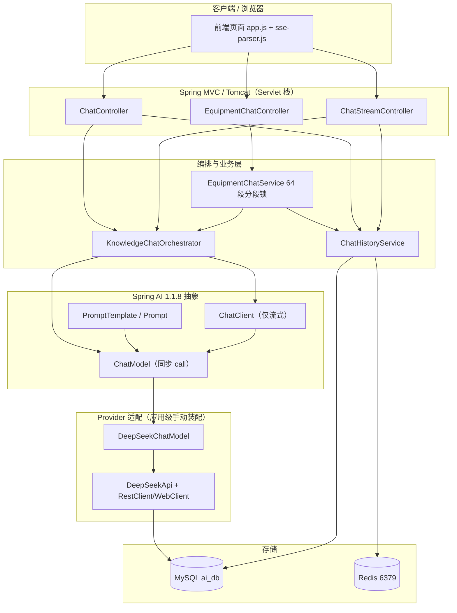
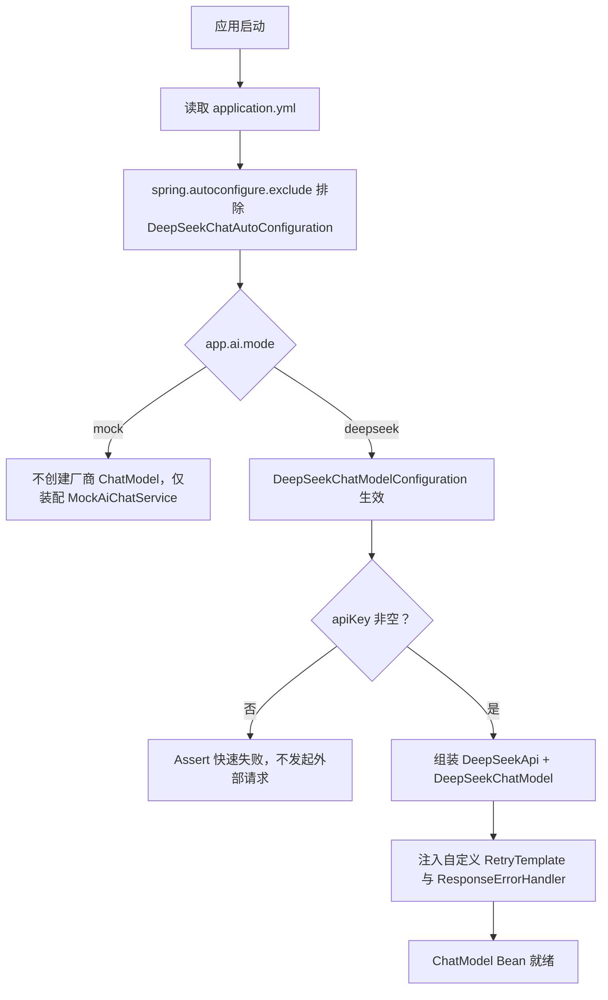
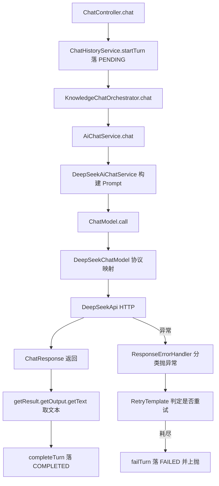
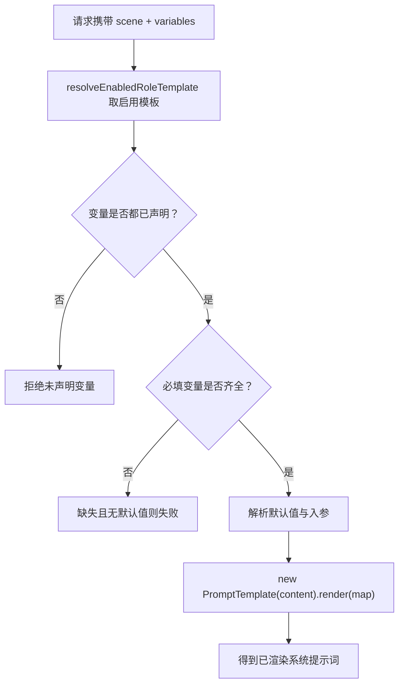
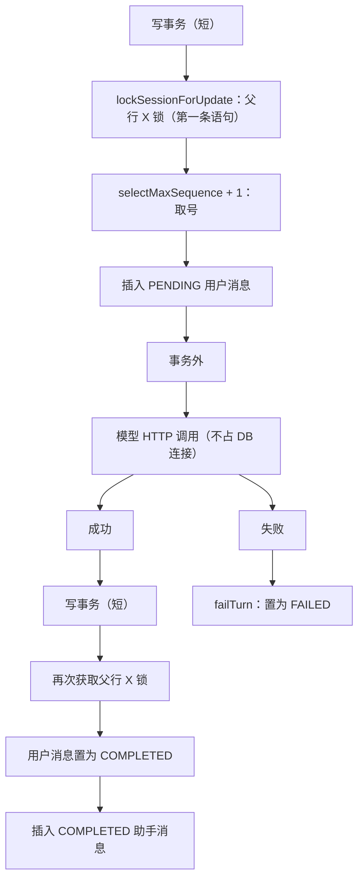
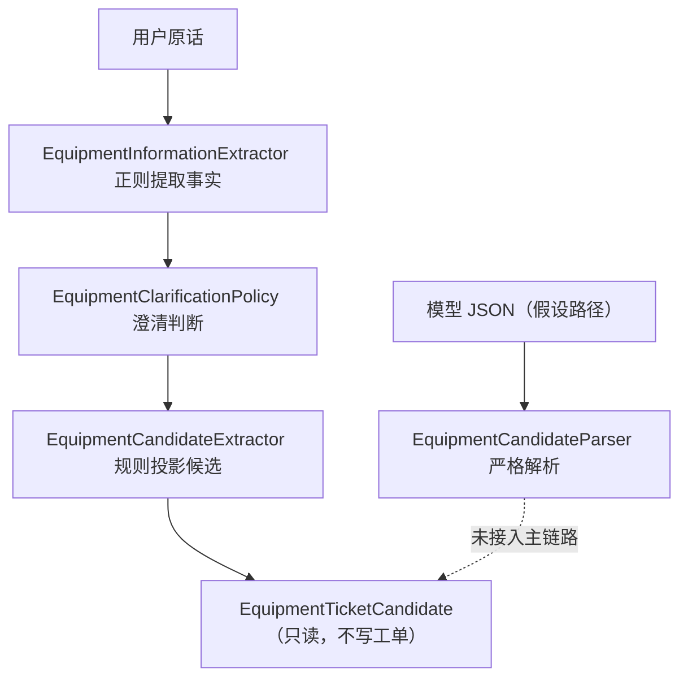
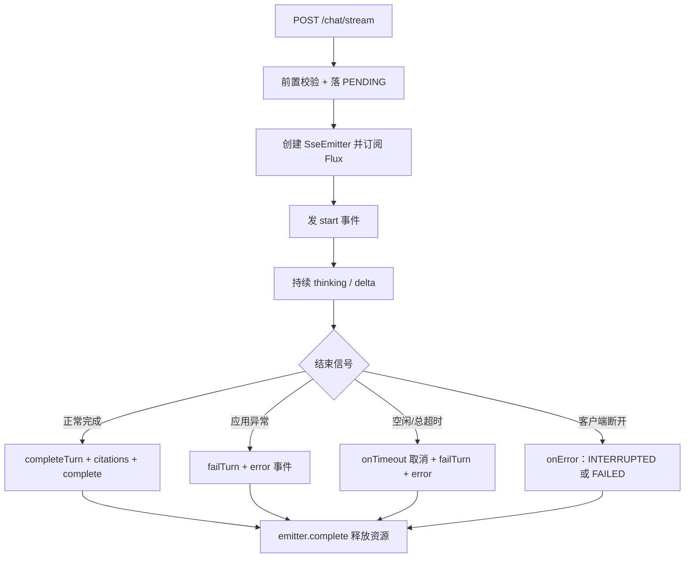
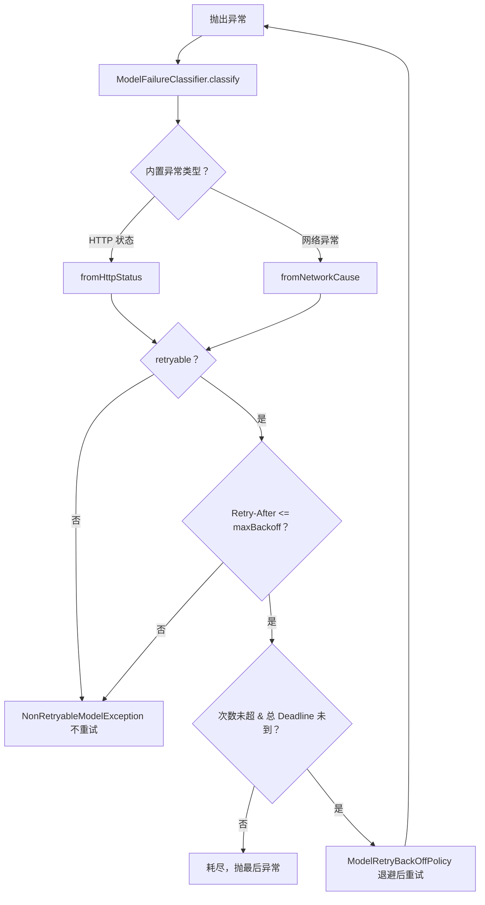

# D24 知识笔记：Spring AI 1.1.8 七大核心链路

> 主题：自动配置、ChatClient/ChatModel、Prompt 与消息构建、对话记忆、结构化输出、SSE 流式响应、失败策略
>
> 工程基线：JDK 21、Spring Boot 3.5.16、Spring AI 1.1.8、Maven 3.9.16
>
> 项目代码库（第二份，D24）：`E:\AI\project\AI-Learning-two-lp\M2-Java-ds\D23`
> 唯一子模块：`D23_CRTFC_SSE_MASO`，物理包根 `com.zl.d23`
>
> 笔记生成日期：2026-11-06。本笔记所有“项目现状”均来自对该代码库真实源码的逐文件精读，未实现内容明确标注，不虚构、不调用真实 DeepSeek API。

---

## 0. 阅读约定：四类能力标记

为避免把“框架能做的”“项目已经做的”“建议你做的”混为一谈，全文统一使用以下标记：

| 标记 | 含义 |
| --- | --- |
| 【官方框架能力】 | Spring AI / Spring Boot / Spring Framework 官方在对应版本提供的能力，有官方文档或 Javadoc 依据 |
| 【项目已实现】 | D24 代码库中真实存在的类、配置、调用链或测试，可在源码中定位 |
| 【项目尚未实现】 | 框架支持但本项目当前没有落地，或明确不做的内容 |
| 【建议练习】 | 本笔记给出的独立练习/示例，不属于项目现状，默认 Mock、不触网 |

> 重要边界：本笔记与第一份代码库（`AI-Learning-one`，groupId `org.ai.m2`）的同名笔记不是同一项目。D24 的 groupId 为 `org.ai.m2.ds`，包组织、自动配置关闭方式、ChatClient 使用方式、失败重试体系均有实质差异，结论以本代码库源码为准，不照抄第一份。

---

# 1. 技术基线、版本核验与项目扫描范围

## 1.1 版本基线（pom 实证）

【项目已实现】版本在父 POM 与子模块 POM 中锁定，关键坐标如下：

| 维度 | 锁定值 | 依据 |
| --- | --- | --- |
| JDK | 21（`maven.compiler.source/target=21`，实测 java 21.0.7） | 子模块 pom |
| Spring Boot | 3.5.16 | 父 POM 父级 |
| Spring AI | 1.1.8（BOM 统一管理，禁止升 2.x、禁止动态版本） | 父 POM import `spring-ai-bom` |
| Spring Cloud | 2025.0.0 | 父 POM |
| Spring Cloud Alibaba | 2025.0.0.0 | 父 POM |
| MyBatis-Plus | 3.5.17（含 generator、jsqlparser、spring-boot3-starter） | 父 POM + 子模块 |
| MySQL 驱动 | 8.0.33 | 子模块 pom |
| Mockito | 5.17.0（随 starter-test） | 依赖管理 |
| Surefire | 3.5.6 | 插件管理 |
| Velocity | 2.3（代码生成器用） | 子模块 pom |

【项目已实现】子模块关键依赖（`D23_CRTFC_SSE_MASO/pom.xml`）：

- `org.springframework.ai:spring-ai-starter-model-deepseek`：DeepSeek 模型 Starter，版本由 BOM 管理，不写 `<version>`。
- `org.springframework.boot:spring-boot-starter-web`：**锚定 Tomcat + Spring MVC（Servlet 栈）**，确保不被切换到 WebFlux 反应式容器。
- `spring-boot-starter-validation`、`spring-boot-starter-aop`、`spring-boot-starter-data-redis`。
- `io.projectreactor.netty:reactor-netty-http`：**显式补充**。DeepSeek Starter 只传递 `spring-webflux` API，不传递可用的 Reactor Netty HTTP 连接器，流式 WebClient 需要它；服务端仍由 starter-web 锚定 MVC。
- `spring-security-crypto`、`lombok`（optional）、`spring-boot-starter-test`（test）。

## 1.2 工程结构与包组织（与第一份代码库的关键差异）

【项目已实现】D24 是“父 POM + 唯一子模块”结构，物理包根 `com.zl.d23`。包组织与第一份代码库形似但有实质差异：

| 维度 | D24（本项目） | 第一份代码库（对照，非本项目） |
| --- | --- | --- |
| groupId | `org.ai.m2.ds` | `org.ai.m2` |
| 设备相关包 | `equipment` | `device` |
| 失败/重试承载包 | `model`（失败分类 + Spring Retry） | `resilience` |
| 数据传输 | 独立 `dto` 包 | 分散 |
| 适配边界包 | **无 `adapter`、无 `resilience`、无 `device` 包** | 有 adapter 边界 |
| 供应商专有类型 | 直接出现在 Service 与配置类 | 经端口/适配边界隔离 |
| 端口/边界测试 | **无 ChatModelPort、无 VendorBoundaryTest、无 FormalTicketPort** | 有对应边界与测试 |

【项目已实现】`com.zl.d23` 下主类按包分布（精简索引）：

- 根：`D23SpringAiApplication`（启动类，**无 `exclude` 注解**）。
- `common`：`AiConfigurationException`、`GlobalExceptionHandler`、`Result`、`ResultCode`。
- `config`：`AiConstants`、`AiProperties`、`ConversationRedisProperties`、`DeepSeekChatModelConfiguration`、`ModelCallConfiguration`、`ModelCallProperties`、`PromptCacheProperties`。
- `controller`：`ChatController`（`POST /api/v1/ai/chat`、`GET /health`）、`ChatStreamController`（`POST /api/v1/ai/chat/stream`）。
- `conversation`：`ConversationMemory`（Redis，不进主链路）、`HistoryMessageConverter`、`RedisSessionPayload`、`RoleConversationService`、`model`。
- `dto`：`ChatReplyResponse`、`ChatRequest`、`CitationDto`、`RoleChatReplyResponse`、`SsePayloads`。
- `equipment`：`EquipmentCandidateExtractor`、`EquipmentCandidateParser`、`EquipmentChatController`、`EquipmentChatService`、`EquipmentClarificationPolicy`、`EquipmentFacts`、`EquipmentInformationExtractor`，及 `dto`、`model`。
- `history`：`ChatHistoryService`、`HistoryController`、`config`、`dto`、`mapper`、`model`、`po`。
- `knowledge`：`CitationRegistry`、`KnowledgeChatOrchestrator`、`KnowledgeChunk`、`KnowledgeCorpus`、`KnowledgeProperties`、`KnowledgeRetrievalService`。
- `model`（失败/重试）：`ClassifiedResponseErrorHandler`、`ModelAttemptRetryPolicy`、`ModelFailure`、`ModelFailureCategory`、`ModelFailureClassifier`、`ModelRetryBackOffPolicy`、`ModelRetryListener`、`NonRetryableModelException`、`RetryableModelException`。
- `observability`：`ModelCallRecorder`、`ModelTokenUsage`、`TokenUsageExtractor`。
- `prompt`：模板仓库、服务、校验器、初始化器、Controller、版本管理等。
- `service`：`AiChatResult`、`AiChatService`、`ChatInvocation`、`DeepSeekAiChatService`、`MockAiChatService`、`ReasoningEffort`、`StreamChunk`、`ThinkingSettings`、`ThinkingSettingsResolver`。

## 1.3 项目读取范围与未验证边界

- 已读取：父/子 POM、`application.yml`、`application-test.yml`、上述全部核心类、关键测试、前端 `sse-parser.js` 及 Node 测试、db 脚本与种子资源。
- 【项目尚未实现 / 未验证】真实 DeepSeek 远程调用、跨进程重启恢复、容器级超时真实兜底、DB 异常分支：因无真实 Key 且本任务默认 Mock，**均未执行真实链路验证**，笔记中按“未验证/未执行”标注。

---

# 2. 七大模块总览及端到端架构图

## 2.1 先给结论

1. 【项目已实现】本项目**关闭了 DeepSeek 官方自动配置**，改在 `application.yml` 用 `spring.autoconfigure.exclude` 排除，再由应用级 `DeepSeekChatModelConfiguration` 在 `mode=deepseek` 时手动组装 `DeepSeekChatModel`。
2. 【项目已实现】真实服务 `DeepSeekAiChatService` 中，**同步走 `ChatModel.call(...)`，流式走 `ChatClient`（构造器内 `ChatClient.builder(chatModel).build()`）**，这是与第一份代码库“完全不用 ChatClient”的最大区别之一。
3. 【项目已实现】重试不依赖 Spring AI 默认 10 次策略，而是基于 **Spring Retry** 自定义 `RetryTemplate`：复合策略（次数+分类 / 总 Deadline）+ 自定义退避 + 监听器，`setThrowLastExceptionOnExhausted(true)`。
4. 【项目已实现】主链路的“记忆”是 **MySQL 完整历史 + 上下文窗口**（`ChatHistoryService`），不是 Spring AI `ChatMemory`；Redis 版 `ConversationMemory` 保留但不进主链路。
5. 【项目已实现】严格 JSON 解析器 `EquipmentCandidateParser` **未接入主链路**（Grep 仅命中自身与两个测试）；真实设备链路用确定性规则组件，不额外调模型。
6. 【项目已实现】SSE 运行在 Spring MVC 上，用 `SseEmitter` 把 Reactor `Flux<StreamChunk>` 桥接为命名事件；终态只落库一次，断连保留 INTERRUPTED。

## 2.2 端到端分层架构图



> 职责分层：应用代码只面向 Controller/编排器；ChatClient 是流式门面、ChatModel 是模型调用抽象；`DeepSeekChatModel`/`DeepSeekApi` 是厂商适配层，负责把通用 `Prompt`/`ChatResponse` 与 DeepSeek HTTP 协议互转。三层不是同一层，不可混为一谈。

---

# 3. 七大核心链路

## 3.1 链路一：Spring AI 自动配置

### 3.1.1 官方机制（Starter / BOM / 自动装配）

【官方框架能力】

- **Starter 与 BOM**：`spring-ai-starter-model-deepseek` 是聚合 Starter，传递底层 `spring-ai-deepseek` 等模块；`spring-ai-bom` 以 `dependencyManagement` 统一所有 Spring AI 构件版本，业务 pom 不写版本号，避免传递依赖版本漂移。
- **自动配置加载**：Spring Boot 通过自动配置导入元数据（`AutoConfiguration.imports`）发现厂商自动配置类，再结合条件注解决定是否创建 Bean。
- **常见条件注解**：
  - `@ConditionalOnClass`：类路径存在指定类才生效。
  - `@ConditionalOnMissingBean`：容器中没有同类型 Bean 时才创建默认 Bean（用户自定义 Bean 可覆盖）。
  - `@ConditionalOnProperty`：配置属性匹配时才生效。
- 厂商 Starter 通常会自动创建 `ChatModel`、`ChatClient.Builder` 等 Bean，并把 `spring.ai.deepseek.*` 属性绑定到配置属性对象。

### 3.1.2 项目现状：用 yml 排除自动配置（关键差异点）

【项目已实现】启动类 `D23SpringAiApplication` **不使用** `@SpringBootApplication(exclude = ...)` 注解，而是在 `application.yml` 中以配置方式排除：

```yaml
spring:
  autoconfigure:
    exclude:
      - org.springframework.ai.model.deepseek.autoconfigure.DeepSeekChatAutoConfiguration
```

文件：`D23_CRTFC_SSE_MASO/src/main/resources/application.yml`

**设计原因**：Spring AI 1.1.8 的 DeepSeek 自动配置强制要求非空 Key，无法满足 Mock 模式“无 Key 启动”。排除后，由应用级 `DeepSeekChatModelConfiguration` 仅在 `app.ai.mode=deepseek` 时手动组装模型；Mock 模式下根本不创建厂商 Bean，从结构上保证离线可启动。

【项目已实现】同文件还设置了安全兜底，防止自动配置意外运行时回退到默认 10 次重试：

```yaml
spring:
  ai:
    retry:
      max-attempts: 1
      on-client-errors: false
      on-http-codes: []
      exclude-on-http-codes: [400, 401, 402, 403, 404, 408, 409, 422]
```

口径：即使应用自定义 `RetryTemplate` 因装配异常缺失，自动配置路径也最多执行 1 次，不会回退默认 10 次；常见 4xx 全部排除重试。

### 3.1.3 手动装配边界

【项目已实现】`DeepSeekChatModelConfiguration`（`config` 包）是本项目唯一允许直接组装 DeepSeek API/Options 的配置边界，整体被 `@ConditionalOnProperty(app.ai.mode=deepseek)` 约束：

```java
@Bean
@ConditionalOnMissingBean(ChatModel.class)
public DeepSeekChatModel deepSeekChatModel(
        AiProperties properties,
        ObjectProvider<RestClient.Builder> restClientBuilders,
        ObjectProvider<WebClient.Builder> webClientBuilders,
        ObjectProvider<ToolCallingManager> toolCallingManagers,
        ObjectProvider<ObservationRegistry> observationRegistries,
        RetryTemplate retryTemplate,
        ResponseErrorHandler responseErrorHandler) {
    Assert.hasText(properties.getApiKey(),
            "deepseek 模式缺少 app.ai.api-key，请通过 AI_API_KEY 环境变量注入");
    DeepSeekApi deepSeekApi = DeepSeekApi.builder()
            .baseUrl(properties.getBaseUrl())
            .apiKey(properties.getApiKey())
            .restClientBuilder(restClientBuilders.getIfAvailable(RestClient::builder))
            .webClientBuilder(webClientBuilders.getIfAvailable(WebClient::builder))
            .responseErrorHandler(responseErrorHandler)
            .build();
    DeepSeekChatOptions defaultOptions = DeepSeekChatOptions.builder()
            .model(properties.getModel())
            .temperature(properties.getTemperature())
            .build();
    // ... ToolCallingManager、ObservationRegistry 缺省兜底
    return DeepSeekChatModel.builder()
            .deepSeekApi(deepSeekApi)
            .defaultOptions(defaultOptions)
            .toolCallingManager(toolCallingManager)
            .retryTemplate(retryTemplate)
            .observationRegistry(observationRegistry)
            .build();
}
```

要点：`@ConditionalOnMissingBean(ChatModel.class)` 保证用户已提供 ChatModel 时不重复创建；`RestClient`/`WebClient` Builder 用 `ObjectProvider` 缺省兜底；自定义 `RetryTemplate` 与 `ResponseErrorHandler` 被注入模型，覆盖默认行为。

### 3.1.4 自动配置装配流程



### 3.1.5 诊断手段

【官方框架能力】Bean 缺失/冲突/条件不匹配的排查：

- 依赖树：`mvn dependency:tree`，确认 Starter 与底层模块是否进入、版本是否被 BOM 对齐。
- 条件评估报告：启动开启 debug，查看 `DeepSeekChatAutoConfiguration` 的匹配/不匹配原因。
- 测试上下文：`ApplicationContextLoadTest` 验证上下文能在 Mock 模式正常启动。
- 【项目已实现】`MockWithoutApiKeyTest`、`MockNoExternalApiTest` 固化“无 Key 可启动、不触网”契约。

---

## 3.2 链路二：ChatClient 与 ChatModel

### 3.2.1 职责边界（不可混为一谈）

【官方框架能力】

| 抽象 | 层次 | 职责 |
| --- | --- | --- |
| `ChatModel` | 模型调用抽象 | 对接厂商模型，提供 `call(Prompt)` 同步与 `stream(Prompt)` 流式能力，返回 `ChatResponse` |
| `StreamingChatModel` | 流式模型接口 | 声明 `stream(Prompt)` 返回 `Flux<ChatResponse>` |
| `ChatClient` | 面向应用的 Fluent 门面 | 以链式 API 组装请求、可挂 Advisor、终端操作触发执行，底层委托 ChatModel |
| `Prompt` | 请求载体 | 持有消息列表与可选 `ChatOptions` |
| `ChatResponse` | 响应载体 | 含 `Generation`，其 `getOutput()` 为 `AssistantMessage` |
| `ChatOptions` | 选项 | 通用可移植选项 + 厂商专属扩展 |

口径：`ChatClient` 是门面，`ChatModel` 是抽象，厂商适配器负责协议映射；它们不是同一层。

### 3.2.2 项目现状：同步用 ChatModel，流式用 ChatClient（核心差异）

【项目已实现】`DeepSeekAiChatService` 同时持有两者，`ChatClient` 在构造器内基于同一个 `ChatModel` 构建：

```java
private final ChatModel chatModel;
private final ChatClient chatClient;

public DeepSeekAiChatService(ChatModel chatModel, AiProperties aiProperties) {
    this.chatModel = chatModel;
    this.chatClient = ChatClient.builder(chatModel).build();
    // ...
}
```

**同步路径用 `ChatModel.call`**（单轮示例）：

```java
Prompt prompt = new Prompt(new UserMessage(message));
ChatResponse response = this.chatModel.call(prompt);
String content = response.getResult().getOutput().getText();
```

**流式路径用 `ChatClient`**（单轮示例）：

```java
return observedStringStream(this.model, () -> this.chatClient.prompt()
        .user(message)
        .stream()
        .chatResponse())
        .doOnComplete(() -> log.info("流式调用正常结束，model={}", this.model));
```

口径：`stream().chatResponse()` 返回 `Flux<ChatResponse>`，**直到 Web 层订阅时才执行**（冷流）；不假设每块对应一个 token/单词/整句；异常原样传播，由 SSE 层转 error 事件。

### 3.2.3 角色链路：消息按角色独立组装

【项目已实现】`buildMessages` 严格按“系统提示词 → 历史 → 当前用户消息”组装，用户输入只进入 `UserMessage`，无法覆盖 `SystemMessage` 中的角色规则：

```java
private List<Message> buildMessages(ChatInvocation invocation) {
    List<Message> messages = new ArrayList<>();
    if (StringUtils.hasText(invocation.systemPrompt())) {
        messages.add(new SystemMessage(invocation.systemPrompt()));
    }
    for (ChatInvocation.Turn turn : invocation.history()) {
        if ("assistant".equals(turn.role())) {
            messages.add(new AssistantMessage(turn.content()));
        } else {
            messages.add(new UserMessage(turn.content()));
        }
    }
    messages.add(new UserMessage(invocation.userMessage()));
    return messages;
}
```

### 3.2.4 一次同步调用的职责与异常传播



### 3.2.5 终端操作与多 Bean 组织

【官方框架能力】`call()`/`stream()` 是终端操作，真正触发执行；`content()` 直接取文本、`chatResponse()` 取完整响应、`entity()` 取结构化实体。
【项目已实现】本项目只用 `chatResponse()`（流式）与 `ChatModel.call`（同步），未使用 `entity()`；多模型/多 ChatClient 场景【项目尚未实现】，当前仅一个 DeepSeek 模型、一个 ChatClient，靠 `@ConditionalOnProperty` 在 Mock/DeepSeek 间二选一，不存在多 Builder 冲突。

---

## 3.3 链路三：Prompt 与消息构建

### 3.3.1 消息角色与请求结构

【官方框架能力】`Prompt` 由一组 `Message` 加可选 `ChatOptions` 构成；消息角色：

- `SystemMessage`：系统指令/角色规则。
- `UserMessage`：用户输入。
- `AssistantMessage`：助手历史回复。
- 工具消息：工具调用结果（本项目主链路未使用）。

【项目已实现】`ChatInvocation`（record）把“系统提示词、当前用户消息、历史轮次”三段显式分开，从入参结构上杜绝用户消息被拼进系统提示词位置：

```java
public record ChatInvocation(String systemPrompt, String userMessage, List<Turn> history) {
    public record Turn(String role, String content) {}
}
```

### 3.3.2 模板渲染：PromptTemplate 与变量白名单

【项目已实现】`PromptTemplateService.render` 先做变量白名单校验，再用 Spring AI `PromptTemplate` 渲染：

```java
public String render(PromptTemplateEntity entity, Map<String, Object> inputs) {
    Map<String, TemplateVariable> declared = new HashMap<>();
    entity.getVariables().forEach(v -> declared.put(v.name(), v));
    for (String key : inputs.keySet()) {
        if (!declared.containsKey(key)) {
            throw new IllegalArgumentException("传入了模板未声明的变量: " + key);
        }
    }
    // 必填变量缺失且无默认值即失败；其余解析默认值
    return new PromptTemplate(entity.getContent()).render(resolved);
}
```

文件：`prompt/PromptTemplateService.java`

口径：

- 默认模板语法为占位符 `{变量名}`，渲染时以数据替换。
- **未声明变量一律拒绝**，防注入；必填变量缺失且无默认值即失败。
- 用户动态值只作为模板变量数据传入，永远不会被拼进系统规则位置。
- 【官方框架能力】当正文需要字面 JSON 花括号时，`{}` 与占位符语法存在冲突，应通过变量传入或转义，避免被当作占位符解析。

### 3.3.3 选项覆盖规则与厂商专属 Options

【项目已实现】思考模式按请求构造厂商专属选项，1.1.8 仅支持模型级开关，故只设置 model：

```java
private DeepSeekChatOptions buildModelOptions(String effectiveModel) {
    return DeepSeekChatOptions.builder().model(effectiveModel).build();
}
```

【官方框架能力】通用 `ChatOptions` 承载可移植参数（model、temperature、maxTokens 等），厂商专属 `DeepSeekChatOptions` 承载 DeepSeek 扩展；请求级 Options 覆盖默认 Options。
【项目已实现】默认 Options 在 `DeepSeekChatModelConfiguration` 用 `model + temperature` 构造，请求级再按模型覆盖。

### 3.3.4 集中管理与提示词注入防护

【项目已实现】模板集中在 `prompt` 包管理，含仓库（内存/MyBatis）、版本管理、初始化器、Controller，8 个种子模板（`seed-templates.json`）：`customer_service`、`programming`、`equipment_customer_service`、`equipment_technical_engineer`、`technical_explanation`、`code_review`、`summarization`、`information_extraction`。避免在业务方法散落硬编码 Prompt。

工程防护：变量白名单 + 用户输入只进 UserMessage + 敏感数据最小化 + 访问日志对 `message/prompt/content` 等字段精确脱敏。

### 3.3.5 模板渲染流程



---

## 3.4 链路四：对话记忆与历史管理

### 3.4.1 无状态特征与两种“记忆”

【官方框架能力】LLM 调用本身无状态，多轮对话需由应用重新提供上下文。Spring AI 提供 `ChatMemory`、`ChatMemoryRepository`、`MessageWindowChatMemory` 及 `MessageChatMemoryAdvisor` 等抽象，按消息数维护窗口。

【项目已实现】**本项目主链路不使用 Spring AI ChatMemory/Advisor**，而是自建 MySQL 完整历史 + 上下文窗口（`ChatHistoryService`），类注释明确“写入路径只此一条，不引入 ChatMemory/Advisor，从结构上避免双写”。

### 3.4.2 Redis 版 ConversationMemory：保留但不进主链路

【项目已实现】`conversation/ConversationMemory` 是基于 Redis 的会话存储，`MAX_MESSAGES_PER_SESSION=20`，单会话 20 条 FIFO、滑动 TTL、SCAN 而非 KEYS。但 `application.yml` 明确：主链路权威存储已切换为 MySQL，**该组件与配置保留作学习资产，不进主链路**。

### 3.4.3 完整历史与上下文窗口（主链路）

【项目已实现】`ChatHistoryService` 关键设计：

- **短事务**：每个状态变更独立短事务；**模型 HTTP 调用在事务外**，不持有数据库连接等待外部响应。
- **父行 X 锁串行取号**：同会话写事务先对 `chat_session` 父行加排他记录锁（写事务第一条语句），再用普通 `SELECT MAX(sequence_no)+1` 取号；唯一约束 `uk_session_sequence` 兜底。
- **窗口只取 COMPLETED**：`getContextWindow` 只选 COMPLETED 消息，默认 10 条，倒序 `LIMIT` 后再 `reverse` 回正序；若首条是孤立 assistant，则向前补一条 user。

```java
public List<HistoryMessage> getContextWindow(String sessionId) {
    int limit = Math.max(1, properties.getContextWindowMessages());
    List<HistoryMessagePO> rows = messageMapper.selectList(
            new LambdaQueryWrapper<HistoryMessagePO>()
                    .eq(HistoryMessagePO::getSessionId, sessionId)
                    .eq(HistoryMessagePO::getStatus, MessageStatus.COMPLETED.name())
                    .orderByDesc(HistoryMessagePO::getSequenceNo)
                    .last("LIMIT " + limit));
    List<HistoryMessage> window = new ArrayList<>(rows.stream().map(this::toMessage).toList());
    Collections.reverse(window);
    if (!window.isEmpty() && ROLE_ASSISTANT.equals(window.get(0).getRole())) {
        // 向前补一条 user，保证问答轮次完整
    }
    return window;
}
```

### 3.4.4 消息状态机与父行锁

【项目已实现】消息状态：`PENDING → COMPLETED`（成功）、`PENDING → FAILED`（失败）、`PENDING → INTERRUPTED`（流式中断）。只有 COMPLETED 进入下一轮窗口。



**为什么父行锁必须是第一条语句**：REPEATABLE READ 下首次一致性读会建立读视图，若先普通 SELECT 后 `FOR UPDATE`，锁等待结束后取号仍走旧视图，读不到并发已提交序号，会触发唯一约束重复键。父行锁只锁已存在唯一记录，不产生消息表 `SELECT MAX ... FOR UPDATE` 的间隙锁，避免 InnoDB 1213 死锁。

### 3.4.5 窗口 ≠ Token 上下文、会话隔离

- 【官方框架能力】按消息条数管理的窗口不等于模型 Token 上下文窗口；工具消息、SystemMessage 占用需单独评估。
- 【项目已实现】归属隔离：`resolveOwner` 校验 `X-Dev-User`（开发身份，非生产鉴权），`requireOwnedSession` 对不存在/无权访问统一抛同一异常，不泄露资源是否存在。

---

## 3.5 链路五：结构化输出

### 3.5.1 保证边界（不同层次不可替代）

【官方框架能力】普通文本、JSON、JSON Schema、厂商原生结构化是不同保证级别；Spring AI 提供 `StructuredOutputConverter` 及 `BeanOutputConverter`、`MapOutputConverter`、`ListOutputConverter`，`ChatClient.entity()` 可借转换器把输出绑定为实体。JSON 解析、Schema 校验、Jackson 反序列化、Bean Validation、业务语义校验是不同层次，不能相互替代。

### 3.5.2 项目现状：严格解析器存在但未接入主链路

【项目已实现】`EquipmentCandidateParser`（`@Component`）做严格 `JsonNode` 解析与字段校验：

- 顶层必须是对象，`FAIL_ON_TRAILING_TOKENS` 防尾随令牌。
- 必填文本、枚举（`TicketCategory`/`CandidateStatus`/`CandidateSourceType`）、数组逐项校验，含长度/数量上限。
- 枚举越界、类型错误、超长、缺失均抛 `IllegalArgumentException`（全局处理转 4001）。

```java
JsonNode root = objectMapper.reader()
        .with(DeserializationFeature.FAIL_ON_TRAILING_TOKENS)
        .readTree(json);
if (root == null || !root.isObject()) {
    throw new IllegalArgumentException("候选 JSON 顶层必须是对象");
}
TicketCategory category = parseEnum(root, "ticketCategory", TicketCategory.class);
List<String> symptoms = stringList(root, "observedSymptoms");
```

**关键事实（Grep 实证）**：`EquipmentCandidateParser` 全仓仅被 3 个文件引用——自身 + `EquipmentCandidateParserTest` + `EquipmentCandidateParserRegressionTest`，**没有任何主链路类注入它，即未接入主链路**。

### 3.5.3 真实设备链路：确定性规则，不调模型

【项目已实现】主链路不依赖模型生成结构化 JSON，而用两个确定性组件：

- `EquipmentInformationExtractor`：正则/关键词从用户原话提取设备事实（型号、编号、故障码、现象、时间、频率、状态、高风险），不推断根因、不补故障码。
- `EquipmentCandidateExtractor`：把事实**规则投影**为只读 `EquipmentTicketCandidate`，分类用内部字典，未命中返回 `UNCLASSIFIED`，不调模型、不产生额外费用。

`TicketCategory` 受控字典：`MECHANICAL`、`THERMAL_COOLING`、`ELECTRICAL`、`CONTROL_SENSOR`、`SAFETY_RISK`、`UNCLASSIFIED`。

### 3.5.4 结构化转换链路



### 3.5.5 业务可信收口

【项目已实现】候选是内部只读对象，类注释明确“本阶段不会把候选值写入工单”。模型/规则产出属于不可信输入，任何写库、工单副作用前必须经参数、权限、业务规则与幂等校验。
【项目尚未实现】`ChatClient.entity()`、`BeanOutputConverter` 等框架结构化转换在本项目未使用；有限自修正/重试也未针对结构化解析实现。

---

## 3.6 链路六：SSE 流式响应

### 3.6.1 从模型流到 SSE 事件

【官方框架能力】Spring AI `stream()` 基于 Reactor `Flux<ChatResponse>`；SSE 协议以 `Content-Type: text/event-stream`、`event:`、`data:`、`id:`、`retry:`、空行分帧，UTF-8，支持心跳与重连。模型流分片、HTTP 网络分片、SSE 事件、模型 Token 四者不保证一一对应。

【项目已实现】运行在 **Spring MVC（非 WebFlux 容器）**，用 MVC 原生 `SseEmitter` 把 `Flux<StreamChunk>` 桥接为命名事件。`SseEmitter` 是 Spring MVC 的异步响应载体，**不是 Spring AI 的返回类型**。

### 3.6.2 事件协议（SsePayloads）

【项目已实现】`dto/SsePayloads` 全部为不可变 record，`@JsonInclude(NON_NULL)`：

| 事件 | 载荷 record | 用途 |
| --- | --- | --- |
| `start` | `Start(requestId, mode, model, sessionId, scene, templateId, templateVersion, thinkingEnabled)` | 流开始，回传 sessionId |
| `thinking` | `Thinking(seq, content)` | 推理增量，仅显式要求展示时发送，独立 seq |
| `delta` | `Delta(seq, content)` | 答案文本增量，seq 从 0 递增 |
| `citations` | `Citations(citations)` | 引用来源，complete 前发送 |
| `complete` | `Complete(seq, mode, model, mocked, totalChars, thinkingEnabled)` | 正常结束，之后无内容事件 |
| `error` | `Error(code, message)` | 异常事件，固定文案，不含堆栈/密钥/上游原文 |

### 3.6.3 超时双层控制与容器兜底

【项目已实现】`ChatStreamController` 同时设置两层超时：

```java
SseEmitter emitter = new SseEmitter(
        Math.max(streamTimeoutMs, streamTotalTimeoutMs) + CONTAINER_TIMEOUT_GRACE_MS);
// CONTAINER_TIMEOUT_GRACE_MS = 5000
Flux<StreamChunk> boundedChunks = outcome.chunks()
        .timeout(Duration.ofMillis(streamTimeoutMs))                       // 相邻 chunk 空闲上限
        .takeUntilOther(Mono.delay(Duration.ofMillis(streamTotalTimeoutMs))// 整个流绝对上限
                .flatMap(ignored -> Mono.error(new TimeoutException("stream total deadline exceeded"))));
```

- 空闲超时 `stream-timeout-ms=60000`：相邻 chunk 上限。
- 总时限 `stream-total-timeout=180s`：防止持续小 chunk 永不触发空闲超时。
- 容器超时 = 两者较大值 + 5000ms 宽限，`onTimeout` 兜底取消订阅、落 FAILED。

### 3.6.4 终态只落一次与断连收口

【项目已实现】独立 `persisted`（AtomicBoolean）保证终态只落库一次，防止 Reactor 回调与容器回调重复写：

- 正常完成：`completeTurn` 落助手全文 COMPLETED，再发 complete。
- 应用异常：`persistFailure` 落 FAILED，发 error 后 `complete()`。
- 客户端断开：有部分正文走 `interruptTurn` 保留 INTERRUPTED，无正文落 FAILED；**不把半截回答伪装成完整成功**。

```java
emitter.onError(ex -> {
    if (persisted.compareAndSet(false, true)) {
        if (assistantBuffer.length() > 0) {
            historyService.interruptTurn(turn, assistantBuffer.toString(), model,
                    "ClientDisconnect", "客户端断开连接，流式输出中断");
        } else {
            historyService.failTurn(turn, "ClientDisconnect", "客户端断开连接，无助手内容");
        }
    }
});
```

### 3.6.5 SSE 生命周期



### 3.6.6 代理缓冲与线程边界

【项目已实现】响应头设置 `Cache-Control: no-cache`、`X-Accel-Buffering: no`，抑制 Nginx 缓冲；`/api/v1/ai/chat/stream` 在 access-log 排除路径中，跳过正文缓存过滤器，避免增量被缓冲、过滤器提前收尾截断流。
【官方框架能力】背压、慢客户端、取消传播由 Reactor 与容器协同；`Flux` 仅作数据管道，服务端仍是 MVC，不切换反应式容器。

---

## 3.7 链路七：失败策略与可靠性

### 3.7.1 统一分类器：唯一重试判定入口

【项目已实现】`ModelFailureClassifier`（`model` 包）按异常类型 + HTTP 状态码分类，是同步、流式、HTTP 异常的**唯一重试可适性判定入口**。15 个分类：

`PARAMETER_ERROR`、`AUTHENTICATION_FAILED`、`AUTHORIZATION_FAILED`、`MODEL_OR_RESOURCE_NOT_FOUND`、`BUSINESS_REJECTED`、`QUOTA_EXHAUSTED`、`RATE_LIMITED`、`UPSTREAM_UNAVAILABLE`、`CONNECT_FAILURE`、`READ_TIMEOUT`、`DEADLINE_EXCEEDED`、`INVALID_RESPONSE`、`NETWORK_IO`、`CANCELLED`、`UNKNOWN`。

### 3.7.2 HTTP 状态映射（项目口径，需特别注意）

【项目已实现】`fromHttpStatus` 关键映射：

| 状态/条件 | 分类 | 可重试 |
| --- | --- | --- |
| 429 且 body 含永久配额词（`insufficient_quota`/`quota_exceeded`/`billing_hard_limit`/`insufficient balance`/`余额不足`/`额度不足`） | `QUOTA_EXHAUSTED` | 否 |
| 429 其余（限流，含 Retry-After） | `RATE_LIMITED` | 是 |
| 502 / 503 / 504 | `UPSTREAM_UNAVAILABLE` | 是 |
| 其余通用 5xx | `UPSTREAM_UNAVAILABLE` | **否** |
| 400 / 422 | `PARAMETER_ERROR` | 否 |
| 401 | `AUTHENTICATION_FAILED` | 否 |
| 403 | `AUTHORIZATION_FAILED` | 否 |
| 402 | `QUOTA_EXHAUSTED` | 否 |
| 404 | `MODEL_OR_RESOURCE_NOT_FOUND` | 否 |
| 408 | `READ_TIMEOUT` | 否 |
| 409 | `BUSINESS_REJECTED` | 否 |
| 通用 4xx | `PARAMETER_ERROR` | 否 |

### 3.7.3 网络异常映射（口径差异重点）

【项目已实现】`fromNetworkCause` 沿因果链查找：

| 异常 | 分类 | 可重试 |
| --- | --- | --- |
| `UnknownHostException` | `AUTHENTICATION_FAILED` | 否 |
| `SSLHandshakeException` | `AUTHENTICATION_FAILED` | 否 |
| `HttpConnectTimeoutException` / `ConnectException` / Netty `ConnectTimeoutException` / `NoRouteToHostException` | `CONNECT_FAILURE` | 是 |
| `SocketTimeoutException` / `HttpTimeoutException` / Netty `ReadTimeoutException` | `READ_TIMEOUT` | 否（默认） |
| `CancellationException` | `CANCELLED` | 否 |
| 其他 IO | `NETWORK_IO` | 否 |

> 注意这是项目的**显式口径**，不是通用常识：DNS/SSL 失败被归为认证类不可重试；建连类失败可重试；读超时默认不可重试。

### 3.7.4 Retry-After 与重试门槛

【项目已实现】支持两种格式：`delta-seconds`（纯数字秒）与 RFC1123 HTTP-date（解析为时间差）。**Retry-After 超过 `maxBackoff`（默认 10s）时不再重试**：

```java
public boolean isRetryable(Throwable throwable) {
    ModelFailure failure = classify(throwable);
    if (!failure.retryable()) {
        return false;
    }
    return failure.retryAfter() == null
            || failure.retryAfter().compareTo(properties.getMaxBackoff()) <= 0;
}
```

### 3.7.5 Spring Retry 复合策略（项目重试体系）

【项目已实现】`ModelCallConfiguration.retryTemplate` 基于 Spring Retry，而非 Spring AI 默认重试：

```java
ModelAttemptRetryPolicy attempts = new ModelAttemptRetryPolicy(properties.getMaxAttempts(), classifier);
TimeoutRetryPolicy deadline = new TimeoutRetryPolicy(properties.getTotalDeadline().toMillis());
CompositeRetryPolicy policy = new CompositeRetryPolicy();
policy.setPolicies(new RetryPolicy[]{attempts, deadline});
policy.setOptimistic(false);                 // 所有子策略都通过才重试
RetryTemplate retryTemplate = RetryTemplate.builder()
        .customPolicy(policy)
        .customBackoff(new ModelRetryBackOffPolicy(classifier, properties))
        .withListener(new ModelRetryListener(classifier))
        .build();
retryTemplate.setThrowLastExceptionOnExhausted(true);
```

- `ModelAttemptRetryPolicy`（extends `SimpleRetryPolicy`）：在次数上限上叠加分类判断，`isRetryable=false` 立即终止。
- `TimeoutRetryPolicy`：总 Deadline（默认 90s）兜底。
- `CompositeRetryPolicy.optimistic=false`：**AND 语义**，次数、分类、总 Deadline 全部满足才重试。
- `setThrowLastExceptionOnExhausted(true)`：耗尽后抛出最后一个真实异常，而非包装异常，保留根因。
- `ModelRetryBackOffPolicy`：有上限指数退避（2 的幂），含抖动，Retry-After 取 `max(指数值, Retry-After)`，整体封顶 `maxBackoff`。
- `ModelRetryListener`：只记录分类、状态、尝试次数，不记录 Prompt/响应正文/凭据。

### 3.7.6 错误处理器与异常类型

【项目已实现】`ClassifiedResponseErrorHandler`（`ResponseErrorHandler`）把同步 HTTP 状态映射为内部异常：可重试抛 `RetryableModelException`（extends `TransientAiException`），不可重试抛 `NonRetryableModelException`（extends `NonTransientAiException`），且不把上游正文写进异常或日志。

### 3.7.7 失败分类与重试决策



### 3.7.8 职责边界与多层重试防护

【官方框架能力】HTTP 客户端超时（建连/读取）、Spring Retry（模型调用重试）、Resilience4j（熔断/限流/舱壁/时间限制）是不同职责，叠加会放大请求。
【项目已实现】本项目**只有 Spring Retry 一层同步重试，流式路径不自动重试**；未引入 Resilience4j。降级以“明确失败 + 落 FAILED + 安全错误码”收口，不把错误伪装成成功回答。
【项目已实现】幂等：SSE 已发部分内容后不从头重复输出；候选不写工单，规避副作用重复提交。

---

# 4. 横向补充知识

## 4.1 同步/响应式边界

【项目已实现】服务端锚定 Tomcat + Spring MVC（Servlet 栈，`spring-boot-starter-web`）。`reactor-core` 的 `Flux` 仅作为 Spring AI 流式数据管道，由 `ChatStreamController` 桥接到 `SseEmitter`，**不切换 WebFlux 反应式容器**。`MvcStackDecisionTest`、`StreamContractCompatibilityTest` 固化该决策。取消通过 `Disposable.dispose()` 向上游传播。

## 4.2 安全与数据保护

- 【项目已实现】API Key 只通过环境变量（`AI_API_KEY`）注入；`AiProperties.apiKey` 标注 `@ToString.Exclude`，不进日志/toString；Mock 模式允许为空。
- 【项目已实现】`DeepSeekKeyProtectionTest`、`DeepSeekConfigurationBindingTest` 固化密钥保护；真实调用前 `validateCredential()` 对空白/占位密钥快速失败。
- 访问日志对 `message/prompt/completion/content/reasoningcontent/reasoning_content` 精确字段脱敏，设备与流式路径排除正文日志。
- 本笔记不含任何 Key、密钥片段、敏感 Header 或真实用户数据。

## 4.3 可观测性

【项目已实现】`observability` 包：`ModelCallRecorder`（Logger 名 `MODEL_CALL`，白名单字段，内部类 `Call` 记录模式、首包、成功/失败）、`TokenUsageExtractor`、`ModelTokenUsage`。`TraceIdFilter` 维护请求 ID（MDC），响应头 `X-Request-Id`/`X-Trace-Id` 回写。推理全文只记长度不记内容。指标、日志、Trace 分层，敏感内容默认脱敏。

## 4.4 测试分层

【项目已实现】测试覆盖多个层次，且会**真实写入本机 MySQL 与 Redis**：

- 纯单元 / Mockito：如 `ModelFailureClassifierTest`、`PromptTemplateServiceTest`。
- Spring 上下文：`ApplicationContextLoadTest`。
- Web/MockMvc：`MockChatControllerTest`、`HistoryControllerWebTest`。
- 流式/SSE：`ChatStreamIntegrationTest`、`ChatStreamTimeoutTest`、`StreamClientDisconnectIntegrationTest`。
- 持久化/并发：`HistoryPersistenceTest`、`HistoryConcurrencyTest`、`SessionIsolationTest`。
- 支撑类 `AbstractPersistenceCleanupTest`：每个用例后清理 `ut_` 前缀 DB 数据与 `d15f:` 缓存键。
- 真实模型验收：`DeepSeekLiveSmokeTest` 默认禁用，需三个环境变量同时满足才启用。

## 4.5 上下文与成本预算

【官方框架能力】输入/输出 Token、历史累积、System Prompt、工具定义、检索片段都占上下文；超时、重试、流式连接都有资源成本。
【项目已实现】默认 Mock 零外部成本；确定性设备链路不额外调模型；`max-message-length=2000`、窗口 10 条、重试上限 2 次共同约束预算。

## 4.6 业务边界

【项目已实现】模型/规则产出均为不可信输入；设备候选只读、不写工单；写正式业务表前必须经参数、权限、业务规则与幂等校验。

---

# 5. 关键 API / 配置速查表

## 5.1 应用配置（app.ai.*，默认值）

| 配置 | 默认值 | 说明 |
| --- | --- | --- |
| `app.ai.mode` | `mock` | mock / deepseek |
| `app.ai.model` | `deepseek-flash` | 真实模型 ID |
| `app.ai.base-url` | `https://api.deepseek.com` | 模型 Base URL |
| `app.ai.api-key` | 空 | 环境变量注入，不入库 |
| `app.ai.temperature` | `0.7` | 采样温度 |
| `app.ai.max-message-length` | `2000` | 入参字符上限 |
| `app.ai.stream-timeout-ms` | `60000` | 相邻 chunk 空闲超时 |
| `app.ai.model-call.connect-timeout` | `5s` | 建连超时 |
| `app.ai.model-call.response-timeout` | `30s` | 响应读取超时 |
| `app.ai.model-call.total-deadline` | `90s` | 同步总 Deadline |
| `app.ai.model-call.stream-total-timeout` | `180s` | 流式总时限 |
| `app.ai.model-call.max-attempts` | `2`（校验 1~3） | 同步总尝试次数 |
| `app.ai.model-call.initial-backoff` | `500ms` | 首次退避 |
| `app.ai.model-call.max-backoff` | `10s` | 退避上限/Retry-After 门槛 |
| `app.ai.model-call.jitter-factor` | `0.2` | 抖动比例 |
| `app.ai.history.context-window-messages` | `10` | 窗口消息条数 |
| `app.ai.history.default-page-size` | `20`（上限 100） | 分页大小 |
| `app.ai.history.dev-user-header` | `X-Dev-User` | 开发身份头 |
| `app.ai.history.default-owner` | `dev-user`（test 为 `ut-default`） | 默认归属 |
| `app.ai.thinking.reasoner-model` | `deepseek-reasoner` | 思考模式模型 |

## 5.2 官方 spring.ai.retry 默认值（DeepSeek Starter，1.1.8 文档实证）

| 属性 | 默认值 |
| --- | --- |
| `spring.ai.retry.max-attempts` | 10 |
| `spring.ai.retry.backoff.initial-interval` | 2 秒 |
| `spring.ai.retry.backoff.multiplier` | 5 |
| `spring.ai.retry.backoff.max-interval` | 3 分钟 |
| `spring.ai.retry.on-client-errors` | false |

> 项目已用自定义 `RetryTemplate` 覆盖上述默认；并在 yml 设 `max-attempts=1` 作安全兜底。

## 5.3 关键类速查

| 类 | 包 | 职责 |
| --- | --- | --- |
| `D23SpringAiApplication` | 根 | 启动类（无 exclude 注解） |
| `DeepSeekChatModelConfiguration` | config | 手动装配 DeepSeekChatModel |
| `ModelCallConfiguration` | config | RetryTemplate / ErrorHandler / 超时 |
| `ModelCallProperties` | config | 超时与重试配置绑定（含校验） |
| `DeepSeekAiChatService` | service | 同步 ChatModel + 流式 ChatClient |
| `MockAiChatService` | service | 离线确定性 Mock（零字段） |
| `ModelFailureClassifier` | model | 唯一失败分类/重试判定入口 |
| `ClassifiedResponseErrorHandler` | model | HTTP 状态到内部异常映射 |
| `ChatHistoryService` | history | 历史状态机、窗口、父行锁 |
| `EquipmentChatService` | equipment | 64 段锁设备链路 |
| `EquipmentCandidateParser` | equipment | 严格 JSON 解析（未接入主链路） |
| `KnowledgeChatOrchestrator` | knowledge | 检索-增强-调用-引用编排 |
| `ChatStreamController` | controller | SseEmitter 桥接 SSE |

---

# 6. 常见故障诊断表

| 现象 | 可能根因 | 排查位置 | 修复/处理 |
| --- | --- | --- | --- |
| Mock 模式启动报缺 Key | 自动配置未被排除 | yml `spring.autoconfigure.exclude` | 确认排除类名正确，用应用级配置 |
| 上下文启动失败、Bean 冲突 | 同类型 ChatModel 重复 | 条件评估报告、`@ConditionalOnMissingBean` | 只保留一个 ChatModel Bean |
| 失败被重试 10 次 | 自定义 RetryTemplate 未生效 | 依赖树 + 启动日志 | 确认 RetryTemplate 注入；兜底 max-attempts=1 |
| 同会话并发取号报唯一键冲突 | 父行锁不是第一条语句/先读后锁 | `startTurn`、`lockSessionForUpdate` | 父行 X 锁前置，避免间隙锁 |
| SSE 增量不实时、被缓冲 | 代理/过滤器缓冲 | 响应头、access-log 排除路径 | `X-Accel-Buffering:no`，跳过缓存过滤器 |
| 流式永不结束 | 只有空闲超时、无总时限 | `takeUntilOther` 总 Deadline | 设 stream-total-timeout |
| 断连后半截回答被当成功 | 缺 INTERRUPTED 收口 | `onError`/`persisted` | 有部分正文落 INTERRUPTED |
| 429 被反复重试 | 永久配额误判为限流 | body 配额词分类 | 配额耗尽不重试 |
| 读超时被重试 | 分类口径误设 | `fromNetworkCause` | 项目默认读超时不可重试 |
| 推理内容混入答案/日志 | reasoning 未分离 | `DeepSeekAssistantMessage`、Recorder | 独立取 reasoning，只记长度 |
| 结构化解析器“改了没效果” | 未接入主链路 | Grep 引用关系 | 主链路用规则投影，需显式接入才生效 |

---

# 7. 最小实践清单、测试验收与面试自测

## 7.1 实测验证结果（真实执行，非推测）

【项目已实现】本笔记在本机真实执行了全量测试，结果如下：

- 命令：`mvn -f D23_CRTFC_SSE_MASO/pom.xml -o clean test`（离线，Mock profile）。
- 结果汇总行：`Tests run: 194, Failures: 0, Errors: 0, Skipped: 1`，**BUILD SUCCESS**，总耗时约 **1 分 28 秒**。
- 执行测试类：**59 个**（surefire 报告 59 个 .txt）；测试源文件 61 个（含启动占位类与清理基类两个非测试支撑类）。
- 唯一跳过：`DeepSeekLiveSmokeTest`（1 个），因 `@EnabledIfEnvironmentVariable` 三条件未满足（默认禁用真实调用），属预期。
- 前端 Node 测试：`node --test src/test/node/sse-parser.test.js` → **12 个用例全部通过，0 失败**。
- 前置：MySQL（3306）与 Redis（6379）端口均可达；测试真实写入并由清理基类回收 `ut_`/`d15f:` 数据。

> 未执行/未验证：真实 DeepSeek 远程调用、跨进程重启恢复、容器级超时真实兜底、真实 DB 异常分支——无真实 Key 且默认 Mock，不做结论。

## 7.2 最小 Mock 实践（建议练习，独立示例）

【建议练习】以下为与版本匹配的独立练习，**不是项目现状**，默认 Mock、不触网。

目标：用静态 Mock JSON 模拟模型目录/能力查询，验证统一抽象与边界，覆盖未知 ID、字段缺失、预算不足。

```java
// JDK21 record，独立示例（非项目代码）
public record ModelCard(String id, Integer contextWindow, List<String> inputModalities,
                        Boolean toolCalls) {
}

public final class ModelCatalog {
    private final Map<String, ModelCard> cards;

    public ModelCatalog(List<ModelCard> source) {
        this.cards = source.stream()
                .collect(java.util.stream.Collectors.toUnmodifiableMap(
                        ModelCard::id, c -> c));
    }

    public ModelCard requireCard(String id) {
        ModelCard card = cards.get(id);
        if (card == null) {
            throw new IllegalArgumentException("未知 model id: " + id);
        }
        return card;
    }

    public boolean supportsTool(String id) {
        ModelCard card = requireCard(id);
        return Boolean.TRUE.equals(card.toolCalls());
    }

    public void assertBudget(String id, int estimatedTokens) {
        ModelCard card = requireCard(id);
        if (card.contextWindow() == null) {
            throw new IllegalStateException("字段缺失：contextWindow 未声明");
        }
        if (estimatedTokens > card.contextWindow()) {
            throw new IllegalArgumentException("上下文预算不足");
        }
    }
}
```

验收条件：

- 未知 ID 抛“未知 model id”；字段缺失抛“未声明”；预算超限抛“预算不足”。
- 工具支持按 `toolCalls` 精确返回，缺省为 false，不臆测。
- Mock 数据明确标注“非线上实时数据”。

## 7.3 面试/自测问题（12 题，附简要参考答案）

1. **ChatClient 和 ChatModel 是同一层吗？**
   不是。ChatModel 是模型调用抽象（call/stream），ChatClient 是面向应用的 Fluent 门面，底层委托 ChatModel；厂商适配器再做协议映射。
2. **本项目同步和流式分别用什么？**
   同步 `ChatModel.call`，流式 `ChatClient.builder(chatModel).build()` 后 `stream().chatResponse()`。
3. **项目怎么关闭 DeepSeek 自动配置？**
   yml 用 `spring.autoconfigure.exclude` 排除 `DeepSeekChatAutoConfiguration`，启动类无 exclude 注解；并设 retry max-attempts=1 兜底。
4. **为什么不直接用自动配置？**
   1.1.8 自动配置强制非空 Key，Mock 模式无 Key 无法启动；排除后手动装配，仅 deepseek 模式创建模型。
5. **重试体系基于什么？复合策略怎么配？**
   Spring Retry。CompositeRetryPolicy 含次数+分类（ModelAttemptRetryPolicy）与总 Deadline（TimeoutRetryPolicy），optimistic=false 为 AND 语义。
6. **耗尽后为什么要 setThrowLastExceptionOnExhausted？**
   保留最后一个真实异常与根因，避免包装异常丢失分类信息。
7. **哪些失败可重试？**
   限流（429 非永久配额）、502/503/504、建连类失败；读超时、通用 5xx、认证/参数/配额耗尽默认不重试。
8. **UnknownHostException 归哪类？**
   项目口径归 AUTHENTICATION_FAILED，不可重试（注意这是项目显式口径，非通用常识）。
9. **Retry-After 超过 maxBackoff 怎么办？**
   不再重试。支持 delta-seconds 与 RFC1123 两种格式。
10. **ChatMemory 和完整历史什么区别？项目用哪个？**
    ChatMemory 是短期窗口抽象；项目主链路用 MySQL 完整历史 + 只取 COMPLETED 的上下文窗口，Redis ConversationMemory 保留但不进主链路。
11. **SseEmitter 是 Spring AI 的返回类型吗？**
    不是，它是 Spring MVC 的异步响应载体；服务端仍是 MVC，Flux 只是数据管道。
12. **EquipmentCandidateParser 为什么“改了没效果”？**
    Grep 证实它仅被自身和两个测试引用，未接入主链路；真实链路用确定性规则投影，不调模型。

---

# 8. 官方资料索引

> 核验日期均为 2026-11-06；以下为 Spring AI 1.1.x 官方文档，版本与本项目 1.1.8 匹配。

1. DeepSeek Chat | DeepSeek 聊天模型：[https://docs.spring.io/spring-ai/reference/1.1/api/chat/deepseek-chat.html](https://docs.spring.io/spring-ai/reference/1.1/api/chat/deepseek-chat.html)
   用途：自动配置、连接/重试属性与默认值、DeepSeekChatOptions、手动配置、推理模型行为。
2. Chat Client | 聊天客户端：[https://docs.spring.io/spring-ai/reference/1.1/api/chatclient.html](https://docs.spring.io/spring-ai/reference/1.1/api/chatclient.html)
   用途：ChatClient Fluent API、call/stream、终端操作、Advisor。
3. Chat Model | 聊天模型：[https://docs.spring.io/spring-ai/reference/1.1/api/chatmodel.html](https://docs.spring.io/spring-ai/reference/1.1/api/chatmodel.html)
   用途：ChatModel/StreamingChatModel 抽象与职责。
4. Chat Memory | 聊天记忆：[https://docs.spring.io/spring-ai/reference/1.1/api/chat-memory.html](https://docs.spring.io/spring-ai/reference/1.1/api/chat-memory.html)
   用途：ChatMemory、Repository、MessageWindowChatMemory、Advisor。
5. Structured Output Converter | 结构化输出转换器：[https://docs.spring.io/spring-ai/reference/1.1/api/structured-output-converter.html](https://docs.spring.io/spring-ai/reference/1.1/api/structured-output-converter.html)
   用途：Bean/Map/List Converter、entity 转换。

---

## 附：生成前自检对照

- [x] 七大模块全部覆盖，每个知识点对应真实类/配置/调用链/测试，未实现明确标注。
- [x] 自动配置（yml 排除）、ChatClient（流式）/ChatModel（同步）、Prompt、记忆（MySQL 历史）、结构化（解析器未接入）、SSE（SseEmitter）、失败策略（Spring Retry 复合策略）关系讲清。
- [x] Spring AI API/属性按 1.1.8 与项目依赖核验，未套用 2.x。
- [x] 区分 ChatMemory 与完整历史、消息窗口与 Token 窗口、模型流与 SSE 事件、JSON 与 Schema/业务校验、重试与超时。
- [x] 含同步/响应式边界、取消/背压、会话隔离、幂等、安全与可观测性。
- [x] 项目现状、官方能力、建议练习严格区分，无伪造证据，无 API Key/敏感 Header/真实用户数据。
- [x] 测试结论真实执行：194 Java（1 跳过）+ 12 Node，全通过；未验证项明确标注。
